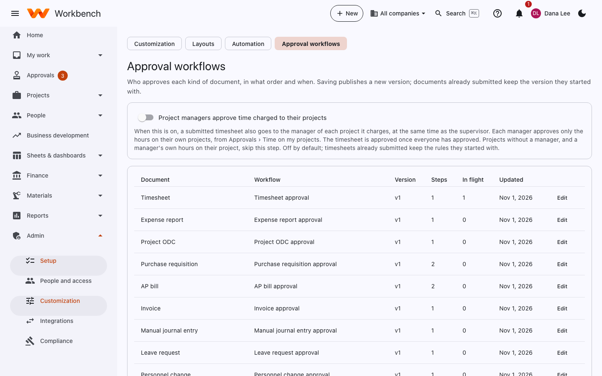

# Approval workflows

Administrators

Every kind of request (timesheets, leave, expense reports, travel, vendor costs, requisitions, bills, invoices, journal
entries, HR and pay changes, budgets, opportunity gates, NCRs and engineering changes) follows a workflow. The built-in
ones match how most contractors work: supervisors approve time, project managers approve project costs, Finance
approves large purchases. The defaults are listed in [Approvals](../user-guide/approvals.md#who-approves-what).

<figure markdown="span">
  { .shot }
</figure>

## Change a workflow

1. Open **Admin › Customization › Approval workflows** and pick the kind of request.
2. Edit the **Steps**. Each step has an approver:
    - the person's **supervisor**;
    - the **project manager** of each charged project;
    - the **org unit's manager**;
    - everyone with a **role** (built-in or custom, for example Finance);
    - **named people**.
3. Add a **Condition** to a step when it should only apply sometimes, for example *amount over $10,000*, *has
   unallowable costs*, or *has charges with no project manager*.
4. Decide what happens when someone would approve their own request: skip the step, send it to their supervisor, or
   leave it for another approver.
5. Optionally set **reminders** after a number of business days, and **escalation** to the approver's supervisor.
6. Select **Publish new version**.

Requests already on their way keep the version they started with. **Reset to built-in default** goes back to the
original rules.

## Project managers approve time

Turn on **Project managers approve time charged to their projects** to send a submitted timesheet also to the manager of
each project it charges, at the same time as the supervisor. Each manager approves only the hours on their own projects,
from **Approvals › Time on my projects**. The timesheet is approved once everyone has approved. Projects without a
manager, and a manager's own hours on their project, skip this step. It's off by default.

## Org-unit approvers

Set a manager for each org unit under **Org-unit approvers** if your steps route by department ("the org unit's
manager").

## Delegation

Approvers who'll be away delegate from their own **Approvals** page (see [Delegate](../user-guide/approvals.md#going-away-delegate)).
Administrators can manage delegations for anyone.

!!! tip
    For more than approvals (notify someone, set a field, call a webhook when something happens) use
    [Automation](automation.md). Its **Approval workflows** tab links back here.
