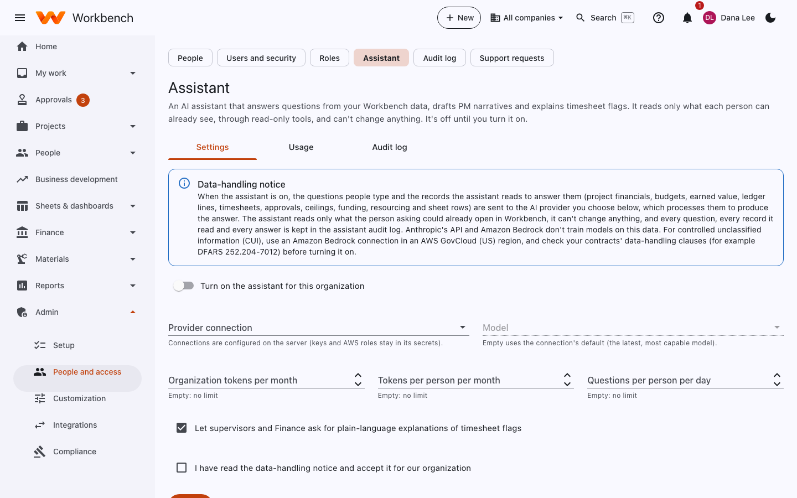

# AI assistant

<p class="roles">Administrators turn it on · Everyone it's enabled for can use it</p>

An AI assistant that answers questions from your Workbench data, drafts project manager narratives and explains
timesheet flags. It reads only what each person can already see, through read-only tools, and can't change anything.
**It's off until you turn it on.**

<figure markdown="span">
  { .shot }
</figure>

## Before you turn it on

Read the **data-handling notice**. When the assistant is on, the questions people type and the records the assistant
reads to answer them (project financials, budgets, earned value, ledger lines, timesheets, approvals, ceilings, funding,
resourcing and sheet rows) are sent to the AI provider you choose, which processes them to produce the answer. Check
this against your contracts, especially any that involve CUI.

## Choosing a provider

Connections are set up on the server (keys stay there), under `Assistant:Connections`. Pick one on this page.

| Provider | Use it for | Configuration |
|---|---|---|
| **Anthropic** | Claude through Anthropic's API | `Provider: Anthropic`, `ApiKey` |
| **Amazon Bedrock** | Claude in your AWS account, including GovCloud for CUI | `Provider: Bedrock`, `Region` |
| **OpenAI-compatible** | OpenAI, Azure OpenAI, or a model you host: Ollama, LM Studio, vLLM, a gateway | `Provider: OpenAiCompatible`, `BaseUrl`, `DefaultModel`, optional `ApiKey` |
| **Claude Code on this computer** | Trying it on your own machine with the Claude Code you are already signed into, no key | `Assistant:EnableClaudeCodeProvider: true` (development only; refused in Production) |

An OpenAI-compatible connection, for example a model running in Ollama on the same computer:

```bash
Assistant__Connections__ollama__Provider=OpenAiCompatible
Assistant__Connections__ollama__BaseUrl=http://localhost:11434/v1
Assistant__Connections__ollama__DefaultModel=llama3.1
```

Or OpenAI itself (`BaseUrl=https://api.openai.com/v1`, `DefaultModel=gpt-4o`, `ApiKey` from a secret). Plain `http` is
accepted only for this computer; anything else must be `https`. Questions that read your data need a model that supports
function calling; drafts (proposals, lead fit) work with any chat model. The Claude Code connection writes drafts only.
Check each provider's data handling against your contracts: the page shows where the data goes for the connection you pick.

## Settings

1. Tick **Turn on the assistant for this organization**.
2. Pick the **provider connection** and **model**. Connections (for example Anthropic, or Amazon Bedrock in AWS GovCloud)
   are configured on the server; keys stay there.
3. Set limits: **organization tokens per month**, **tokens per person per month**, and **questions per person per day**.
   Empty means no limit.
4. Choose the extras, such as **Let supervisors and Finance ask for plain-language explanations of timesheet flags**.
5. Tick **I have read the data-handling notice and accept it for our organization**, and **Save**.

## Usage and audit log

- **Usage**: tokens and questions by month and by person, against the limits.
- **Audit log**: every question, who asked it, which records the assistant read, and the answer.

Details of what it can read and how it's secured: [AI assistant security](../security/ai-assistant.md).
