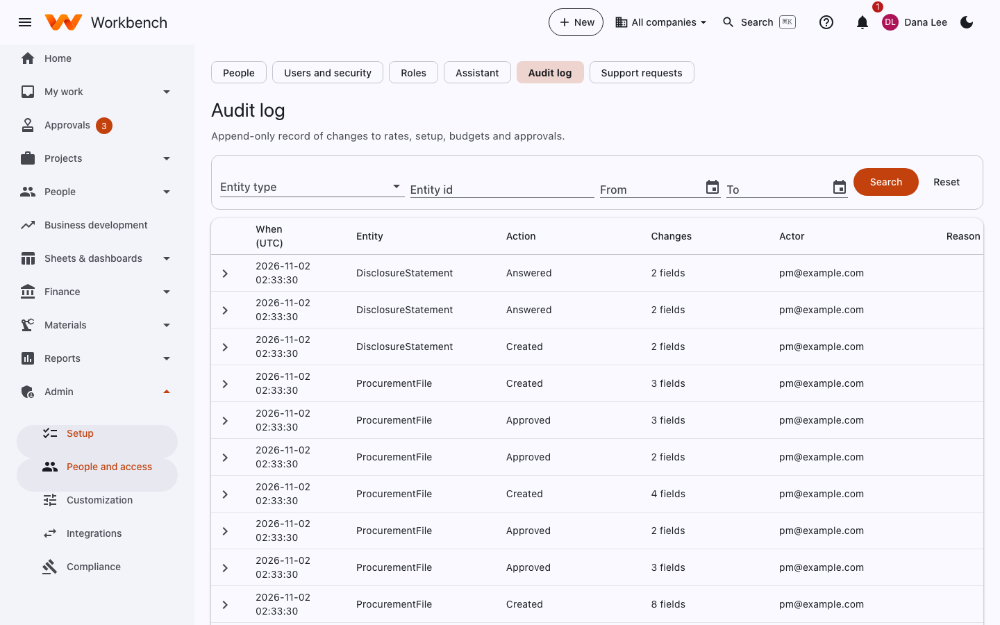
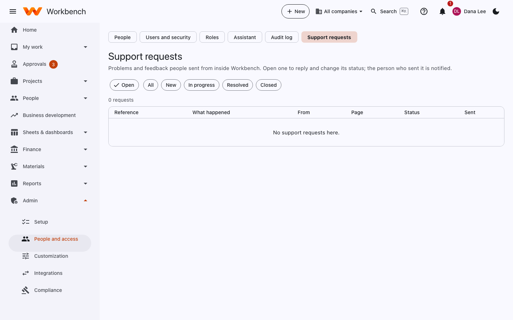

# Audit log and support requests

Administrators · Finance (audit log)

## Audit log

**Admin › People and access › Audit log** is the append-only record of changes to rates, setup, budgets and approvals:
when, which record, what was done, the fields that changed (before and after), who did it and why. Entries can't be
edited or deleted.

<figure markdown="span">
  { .shot }
</figure>

Filter by **entity type**, **entity id** and dates, then **Search**. Expand a row to see each field's old and new value.
Sensitive values (pay rates, bank details, sensitive custom fields) are recorded as changed without the value.

Timesheet corrections have their own history on each timesheet (old hours, new hours, who, when and why), and every
record page has a **History** with its own changes.

## Support requests

Problems and feedback people sent from inside Workbench (**Report a problem / Send feedback**). Open one to reply and
change its status; the person who sent it is notified.

<figure markdown="span">
  { .shot }
</figure>

Each request includes the page the person was on, the Workbench version and any screenshot they attached; never what
they'd typed into forms or a password. Statuses are **New**, **In progress**, **Resolved** and **Closed**.

If the server has a support email address configured, each new request is also emailed there.
