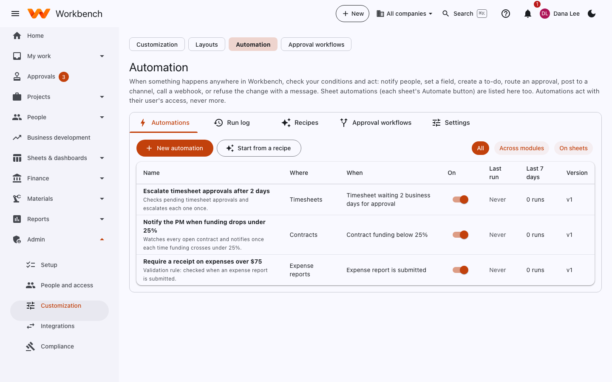

# Automation

Administrators (record automations) · Sheet editors (their own sheets)

When something happens anywhere in Workbench, check your conditions and act: notify people, set a field, create a to-do,
route an approval, post to a channel, call a webhook, or refuse the change with a message. Automations act with their
owner's access, never more.

<figure markdown="span">
  { .shot }
</figure>

Open **Admin › Customization › Automation**.

| Tab | What it's for |
| --- | --- |
| **Automations** | Every automation, sheet ones included (with a link to their sheet). Filter **Across modules** or **On sheets**; switch each on or off. |
| **Run log** | Every run: what triggered it, what it did, and any error. |
| **Recipes** | Ready-made automations to start from. |
| **Approval workflows** | Links to [Approval workflows](approval-workflows.md). |
| **Settings** | Pause everything, and loop protection limits. |

## Build one

**New automation** (or **Start from a recipe**) opens the builder: **When** → **If** → **Then**.

**When** (the trigger):

| Trigger | Fires when |
| --- | --- |
| Something happens to a record | A record is created, updated, has its status changed, is submitted, approved, rejected or deleted |
| A field changes | A field changes, optionally *from* and/or *to* a value |
| A Workbench event | One of the webhook events, such as *timesheet submitted* or *invoice approved* |
| On a schedule | Daily, weekly or monthly at an hour; with a record type, once for each record |
| A date is coming up or has passed | A record's date is N days away, or N days past |
| A threshold is crossed | Funding below X%, project cost over Y% of budget, a timesheet not submitted N days after its period, a document waiting N business days for approval |
| Run by hand or by another automation | **Run now**, or another automation's *Start another automation* action |

**If** (conditions): compare a field (built-in, computed figures such as *Funding remaining (%)*, or custom fields)
with a value: is, is not, greater or less than, contains, starts with, is empty, is one of. Conditions can also check
the role of the person who made the change, and the record's company, org unit or project. Group them with **all** or
**any**, and nest groups. No conditions means it acts every time.

**Then** (actions):

| Action | What it does |
| --- | --- |
| Notify people | An in-app notification (emailed as each person prefers) to an email, a role, a person in a field, or a related person (the submitter, their supervisor, the project manager, the current approvers) |
| Set a field | Changes a custom field or a descriptive built-in field |
| Create a to-do | Adds a to-do to each recipient's home page, optionally due in N days |
| Require an approval | Routes the record through a record approval workflow |
| Post to Teams or Slack | Posts a message through a [connector](integrations.md#connectors) |
| Call a webhook | Sends a signed POST with the record's fields to a webhook endpoint |
| Start another automation | Runs a "by hand" automation on the same record |
| Refuse the change | A validation rule: the change is refused before it's saved, with your message |

Messages can use tokens such as `{contractNumber}`, `{fundingRemainingPercent}`, `{record}`, `{link}` and `{today}`.
**Test it** runs the automation against a record you pick and shows what each condition and action would do, without
changing anything.

## Sheet automations

Each sheet's editors automate their own sheet with the same builder and the sheet's columns: select **Automate** on the
sheet. Triggers: an item is added (by anyone, or by a form), a column changes, a date arrives (on the day or N days
before or after), or a recurring schedule. Actions: set a column, assign someone, notify, send an email, add a sub-item,
create an item (here or in another sheet), move or copy the row to another sheet, request approval, or give a to-do. The
sheet's **Automation** tab lists them with their recent runs.

## Safeguards

- **Acts as someone, never more.** An automation acts as the person whose change fired it (schedules and thresholds:
  whoever last published it), or a designated service user, and every action is checked against that user's access.
- **Loop protection** stops a chain of automations at a depth of 5, when it comes back to the same automation and
  record, or when one automation runs on one record more than 20 times in an hour. Both limits are on **Settings**.
- **Versions.** Every save publishes a new version; runs record the version they used, and an earlier version can be
  restored. Every change is in the audit log.
- **Pause every automation** on the Settings tab stops them all at once, validation rules included.

The full list of triggers, conditions and actions is in [Automation internals](../automation.md).
