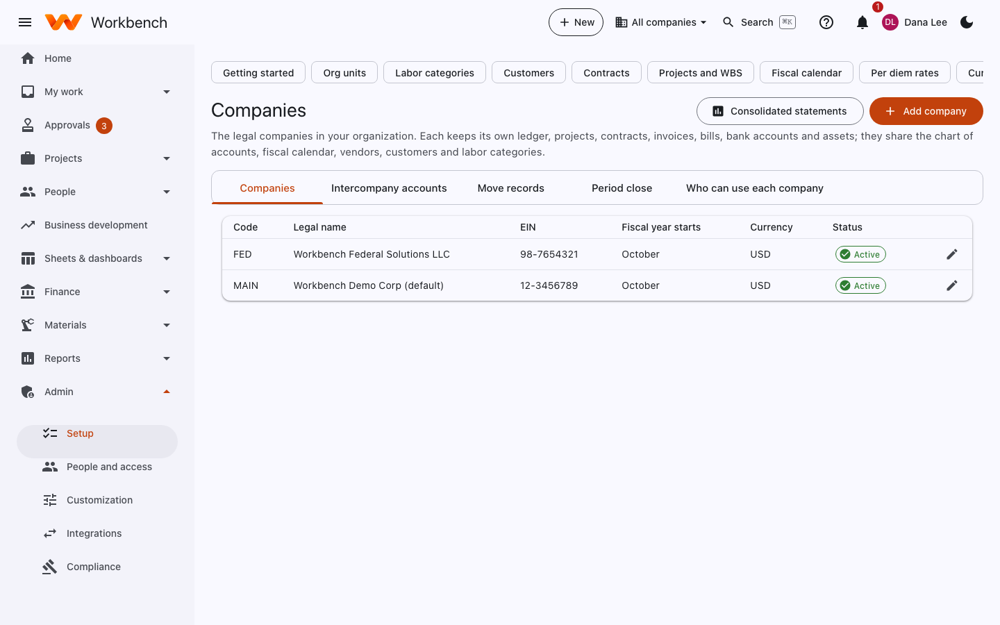

# Multiple companies

Administrators · Finance

One Workbench organization can hold several legal companies. Each keeps its own ledger, projects, contracts, invoices,
bills, bank accounts and assets; they share the chart of accounts, fiscal calendar, vendors, customers and labor
categories.

<figure markdown="span">
  { .shot }
</figure>

**Admin › Setup › Companies**:

| Tab | What it's for |
| --- | --- |
| **Companies** | **Add company** with its code, legal name, EIN, fiscal year start, currency, and billing details (remit-to, CAGE, UEI). |
| **Intercompany accounts** | The due-to and due-from accounts used when one company charges another (for example an employee of one working on the other's project). |
| **Move records** | Move a project, contract or other record to another company, with its history. |
| **Period close** | Close each company's periods separately, or together. |
| **Who can use each company** | Which people may work in each company. |

## Working across companies

- The **company switcher** in the top bar chooses the company people work in, or **All companies** to see everything
  they're allowed to.
- New records go to the chosen company.
- Roles can be limited to some companies ("Finance for company B only"); see
  [Users, roles and sign-in](users-and-access.md#custom-roles).
- **Consolidated statements** (Reports) combine the companies' financial statements and eliminate intercompany balances.

The technical details are in [Multiple companies](../multicompany.md).
