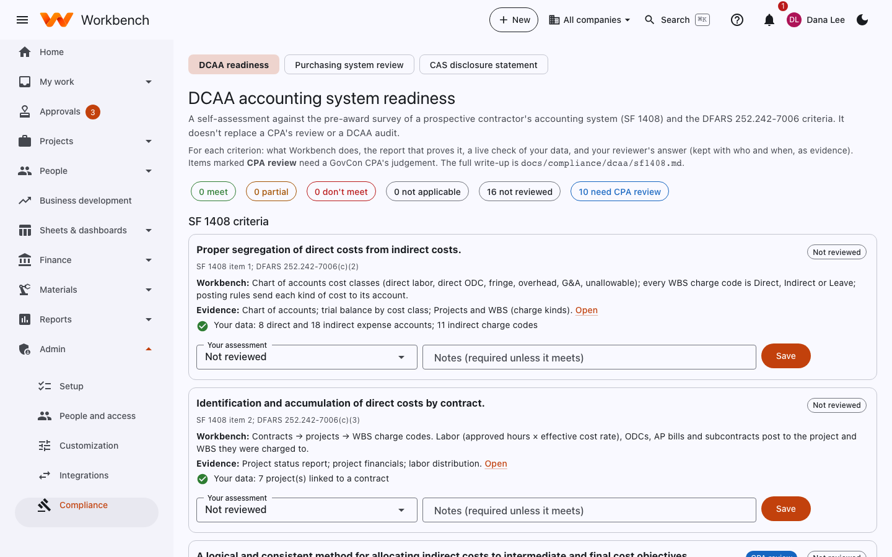
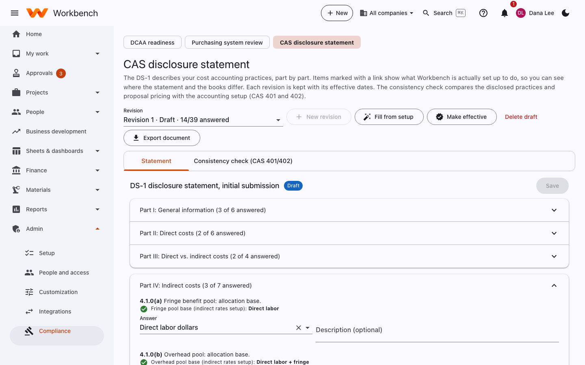

# Compliance readiness

Administrators · Finance · Contracts

Three self-assessments under **Admin › Compliance** help you get ready for the government's reviews of your systems.
None of them replaces a CPA's review or a government audit, but they show what an auditor will look for, check your live
data against it, and keep your answers as evidence.

## DCAA accounting system readiness

A self-assessment against the pre-award survey of a prospective contractor's accounting system (**SF 1408**) and the
**DFARS 252.242-7006** criteria.

<figure markdown="span">
  { .shot }
</figure>

For each criterion you see:

- **Workbench**: what the system does to meet it (for example, cost classes on the chart of accounts and charge types on
  every WBS element, for *Proper segregation of direct costs from indirect costs*).
- **Evidence**: the report that proves it, with a link.
- **Your data**: a live check (for example, *8 direct and 18 indirect accounts, 3 leave codes*).
- **Your assessment**: Meets, Partial, Doesn't meet or Not applicable, with notes (required unless it meets). **Save**
  keeps it with who answered and when.

Items marked **CPA review** need a GovCon CPA's judgement. The full write-up is in [DCAA SF 1408](../compliance/dcaa/sf1408.md).

## Purchasing system review readiness

A contractor purchasing system review (CPSR) samples purchase orders and subcontracts and checks each file for
competition, a price or cost analysis, flowdown clauses, an exclusions check, small business reporting and approvals at
the right dollar level. This page scores a sample the same way and lists what's missing.

<figure markdown="span">
  { .shot }
</figure>

1. Choose the date range and sample size, and **Score sample**.
2. Review the readiness score, the score by element, and **Missing evidence**.
3. Open a document to add its evidence (quotes received, a sole-source justification, the price analysis).
4. **Export review file** for the reviewer.

## CAS disclosure statement

The **DS-1** describes your cost accounting practices, part by part. Items marked with a link show what Workbench is
actually set up to do, so you can see where the statement and the books differ. Each revision is kept with its effective
dates.

<figure markdown="span">
  { .shot }
</figure>

- **New revision** starts a revision; **Fill from setup** answers what Workbench can work out from your setup (pools,
  allocation bases, cost classes).
- Answer the rest part by part and **Save**.
- **Make effective** with its effective date; **Export document** produces the DS-1.
- The **Consistency check (CAS 401/402)** compares the disclosed practices and proposal pricing with the accounting
  setup and lists any differences.

Related: [NIST SP 800-171](../compliance/nist-800-171/README.md) for CUI handling, and the
[accessibility statement](../compliance/accessibility/statement.md).
