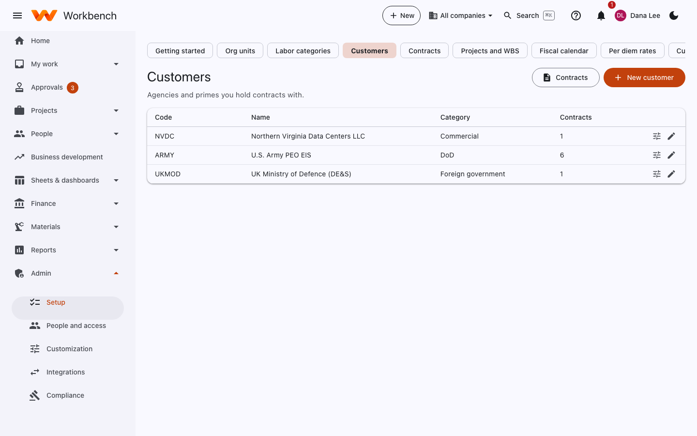
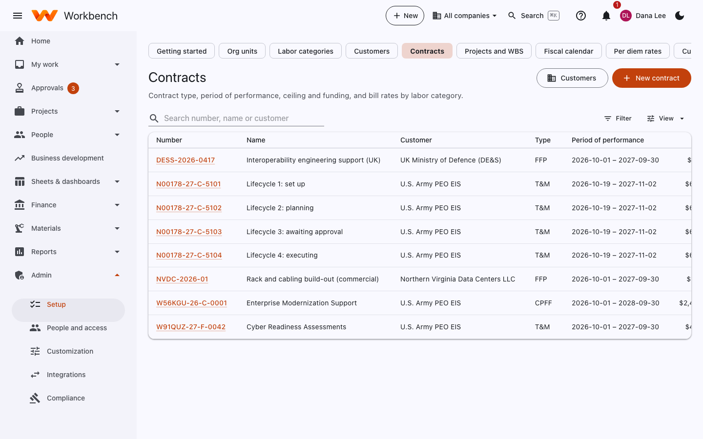
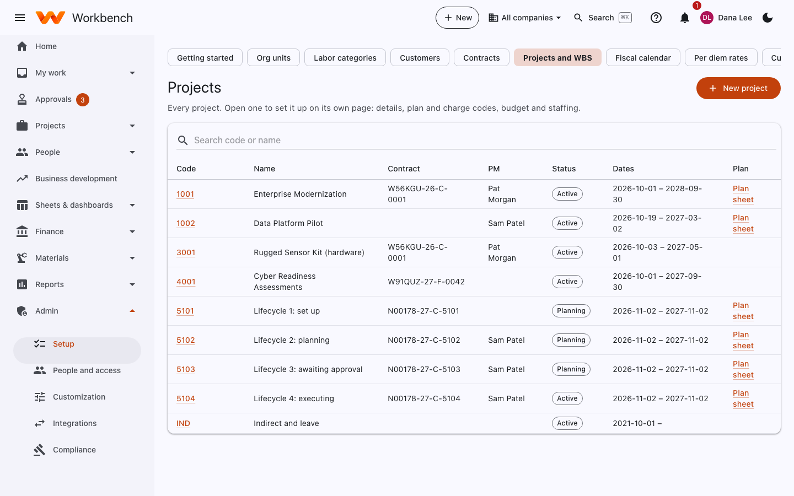

# Customers, contracts and projects

Administrators · Finance · Project managers create their own projects

Contracts and projects are set up under **Admin › Setup**. Create them in this order: customers, then contracts, then
projects.

## Customers

Agencies and primes you hold contracts with: code, name, category (DoD, civilian, commercial, foreign government) and
their contracts. **New customer** adds one; the edit button opens its details, including billing contacts and custom
fields.

<figure markdown="span">
  { .shot }
</figure>

## Contracts

Contract type, period of performance, ceiling and funding, and bill rates by labor category.

<figure markdown="span">
  { .shot }
</figure>

**New contract** (or **+ New › Contract**) and fill in:

- **Number, name, customer** and **type**: FFP, T&M, labor hour, CPFF, CPAF, CPIF, cost, or a mix by CLIN.
- **Period of performance**, base and option periods.
- **CLINs**: each with its type, ceiling and **funding** (the amount actually obligated). Add funding modifications as
  they come.
- **Ceilings**: on the contract, a CLIN, or labor category hours; hard (charging is blocked) or soft (a warning).
- **Bill rates** by labor category and period, for T&M and labor hour CLINs.
- **Fee**: the fixed fee or fee rate for cost-plus CLINs.
- **Billing settings**: invoice format, financing and PIEE routing (see
  [Government billing](../finance/billing.md#government-billing)).

Funding notifications go to the project manager as funding is used up. A **customer view** link can give the contracting
officer read-only access to funding and invoice status: see [Customer view](../security/customer-view.md).

## Projects and WBS

Every project. Open one to set it up on its own page: details, plan and charge codes, budget and staffing.

<figure markdown="span">
  { .shot }
</figure>

**New project** is the same form project managers use (see
[Start a project](../user-guide/projects.md#start-a-project)). A project on a contract starts in **Planning**:

1. Finance adds its **funding** and picks the **labor categories** it may use: the project's Plan tab has a **Set up for planning** checklist for this, and its **Tell the project manager** button notifies the manager once funding, categories and a manager are in place. For a won opportunity, Finance is told and gets a to-do; the handoff form takes an optional **Funded so far** amount, which funds the base CLINs (option years are funded when exercised). Business development sees the status on the opportunity's Outcome tab until the project is live.
2. The project manager builds the **plan** (the WBS) and assigns people.
3. The plan goes **live**. It becomes the baseline budget, and the charge codes open for time. A plan within the
   project's ceiling (or funding) goes live as the manager builds it, with nothing to submit, and so do later changes
   inside it; one past it waits for Finance.

The project page's **Setup** tab holds:

- **Details**: code, name, contract, manager, company, dates, org unit, and custom fields.
- **Charge codes**: each WBS element's charge type (**Direct**, **Indirect** or **Leave**), whether it's open for
  charging, and **who can charge** it (everyone, the people staffed on it, or a named list).
- **Sync with the plan**: how the plan sheet and the WBS stay in step.
- **Ceilings and closeout** (under **More**): hours or dollar ceilings on WBS elements, and closing a finished project.

### Indirect and leave codes

Indirect work (overhead, G&A, bid and proposal) and leave (paid time off, holiday) are charged to projects too, usually
**IND** and **LV**, whose WBS elements are marked Indirect and Leave. Every employee can charge them unless you restrict
them.

### Who sees a project

Employees see the projects they charge to or are staffed on; project managers see the money for their own projects;
Finance sees everything. Details are in [Project visibility](../project-visibility.md).
