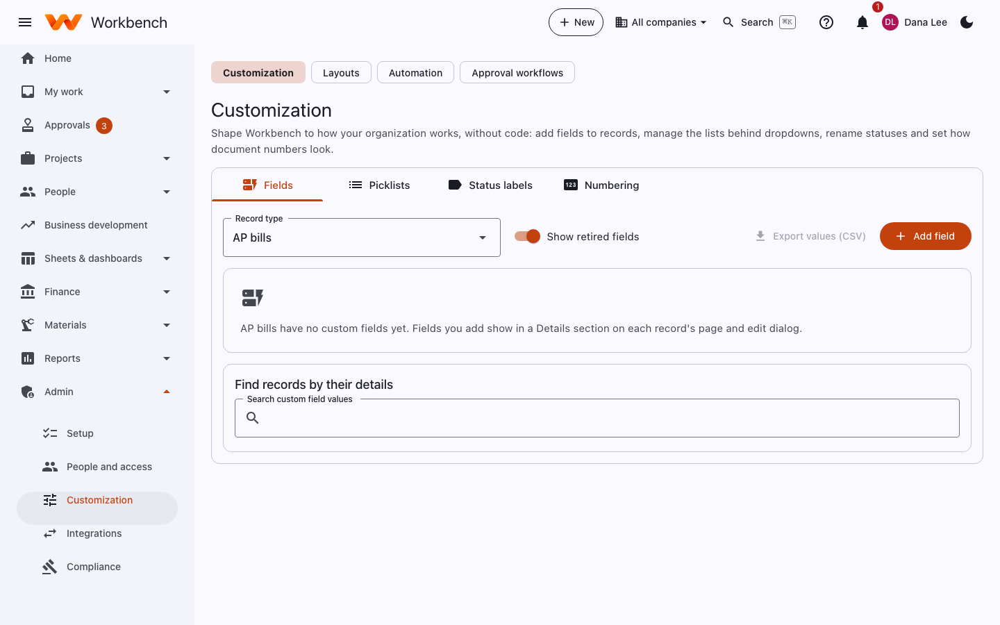
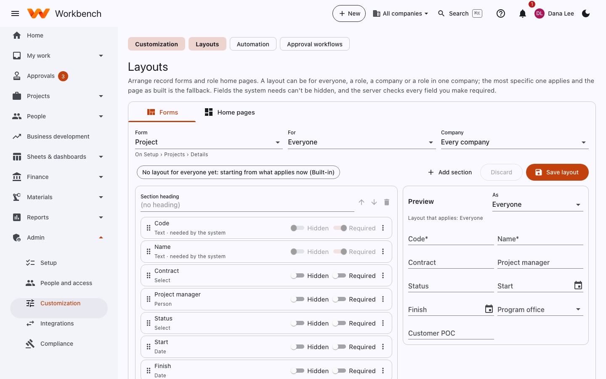

# Customization and layouts

Administrators

Shape Workbench to how your organization works, without code: add fields to records, manage the lists behind dropdowns,
rename statuses, set how document numbers look, and arrange forms and home pages.

## Customization

**Admin › Customization** has four tabs. Pick the **record type** at the top: projects, contracts, WBS elements,
employees, vendors, customers, purchase orders, AP bills, invoices, expense reports, timesheets, parts or opportunities.

<figure markdown="span">
  { .shot }
</figure>

### Fields

**Add field** adds a custom field to the record type. Fields show in a **Details** section on each record's page and
edit dialog, in search, and as columns in the report writer.

| Type | Entered as |
| --- | --- |
| Text, long text | As typed |
| Number, currency | `1234.5` (`$` and thousands separators accepted) |
| Date | A date picker |
| Yes / no | A checkbox |
| Picklist, multi-select | A dropdown from a picklist |
| Person | An active user |
| Link to a record | A record of a type you choose |
| Web address | A full `https://` link |

Each field has a label, help text, **required**, a default for new records, **read-only once approved** (for example
once an invoice is approved), and **sensitive** (its value is never written to the audit log). **Retiring** a field hides
it; its values stay and come back if you restore it. A field's type can't change once it has values.

- **Show retired fields** lists retired ones.
- **Export values (CSV)** downloads every record of the type with its custom values.
- **Find records by their details** searches records by any custom field.

### Picklists

The lists behind dropdowns: custom field picklists and many of Workbench's own (expense types, opportunity sources,
NCR dispositions). Add, reorder, rename and retire values; retired values stay on records that use them.

### Status labels

Rename statuses to your own words (for example *Submitted* → *Awaiting PM review*) and add **sub-statuses** under a
status for finer tracking. The underlying status, and what it allows, doesn't change.

### Numbering

How document numbers look: prefix, padding and the next number for invoices, purchase orders, requisitions, bills, sales
orders, work orders and so on (for example `INV-000123` or `2026-0123`).

## Layouts

Arrange record forms and role home pages. A layout can be for everyone, a role, a company or a role in one company; the
most specific one applies and the page as built is the fallback. Fields the system needs can't be hidden, and the server
checks every field you make required.

<figure markdown="span">
  { .shot }
</figure>

### Forms

1. Pick the **Form** (for example Project), **For** whom (everyone or a role) and the **Company**.
2. **Add section** to group fields under a heading; drag fields to reorder them; switch each to **Hidden** or
   **Required**.
3. Check the **Preview**, then **Save layout**. **Discard** throws away unsaved changes.

### Home pages

Choose the widgets on each role's home page, their order and size, and which are **pinned** (people can't hide them).
People can still rearrange the rest with **Customize** on their own home page.

The technical details (storage, the API, how values reach reports) are in [Customization internals](../customization.md).
