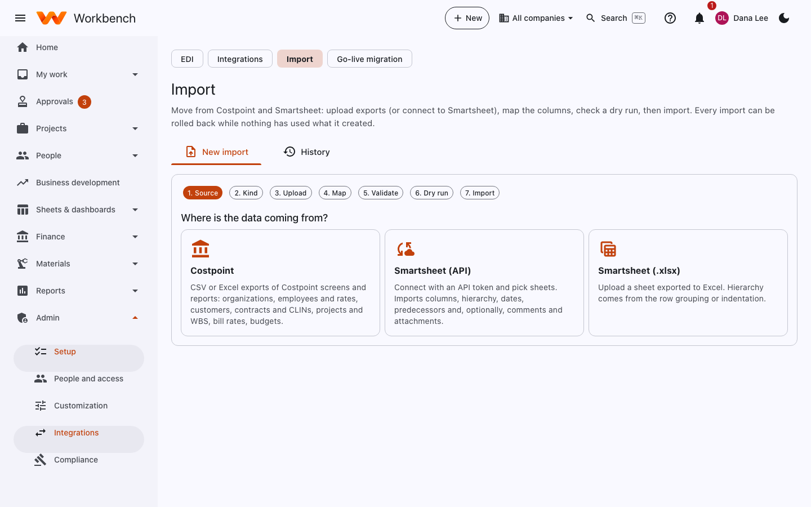
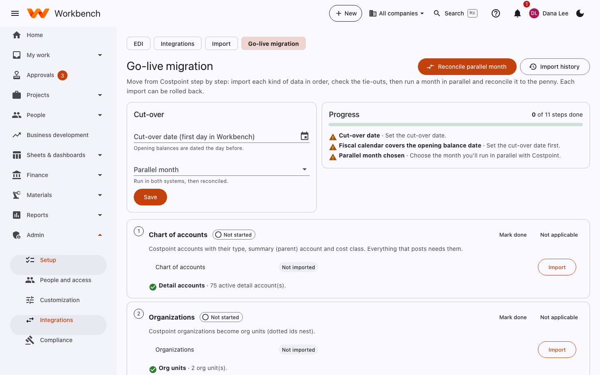

# Importing and go-live

Administrators · Finance

## Import

**Admin › Integrations › Import** moves data from Costpoint and Smartsheet: upload exports (or connect to Smartsheet),
map the columns, check a dry run, then import. Every import can be rolled back while nothing has used what it created.

<figure markdown="span">
  { .shot }
</figure>

### What you can import

- **Costpoint** (CSV or Excel exports of Costpoint screens and reports): org units, employees with labor categories and
  cost rates, customers, contracts with CLINs and funding, projects with their WBS, bill rates and budgets.
- **Smartsheet (API)**: connect with an API token and pick sheets, with their hierarchy, predecessors, comments and
  attachments.
- **Smartsheet (.xlsx)**: a sheet exported to Excel. Hierarchy comes from the row grouping or indentation.

A Smartsheet sheet can be linked to a project's WBS as its plan.

### Steps

1. **Source** and **Kind**: where the data comes from and what it is.
2. **Upload** the file (or pick the Smartsheet sheets).
3. **Map** your columns to Workbench's fields. Workbench guesses most of them. **Save mapping and validate**.
4. **Validate**: fix the problems it lists in your file, then validate again.
5. **Dry run**: see exactly what would be created or changed, without saving anything.
6. **Import**.

Import in this order so each file can find what it refers to: org units, labor categories, employees, customers,
contracts, projects, rates, budgets. Sample files with the expected columns are in `samples/import` in the Workbench
repository.

### Rolling back

Every import is kept under **History**. **Roll back** undoes it, as long as nothing has been added on top since (for
example time charged to an imported project).

## Go-live migration

**Go-live migration** moves you from Costpoint step by step: import each kind of data in order, check the tie-outs, then
run a month in parallel and reconcile it to the penny.

<figure markdown="span">
  { .shot }
</figure>

1. Set the **cut-over date** (the first day in Workbench). Opening balances are dated the day before.
2. Pick the **parallel month**: the month you'll run in both systems.
3. Work through the eleven steps, in order: **Chart of accounts**, **Organizations**, **Employees and rates**,
   **Customers**, **Contracts and CLINs**, **Projects and WBS**, **Open AP and AR**, **GL opening balances**, **Fixed
   assets**, **Smartsheet plans** and the **Parallel month**. Each step shows what's been imported and a tie-out against
   the Costpoint totals. **Import** opens the importer for that step; **Mark done** or **Not applicable** ticks it off.
4. Run the parallel month in both systems, then **Reconcile**: compare each Costpoint report with Workbench's for the
   month and sign each one off. **Reconcile parallel month** at the top of the page opens the same reconciliation.
5. When the parallel month ties out, cut over.

The full plan, with the Costpoint reports to run for each step, is in [Costpoint cutover](../migration/costpoint-cutover.md).
