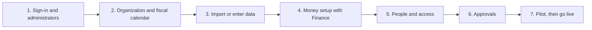

# Admin guide

Administrators · Finance leads for the money setup · Hosting administrators for the server

This guide is for the people who set up and run Workbench for their company: adding users and roles, connecting single
sign-on, setting up the organization, contracts and projects, changing approval rules, customizing fields and layouts,
automating work, importing data from Costpoint and Smartsheet, and connecting other systems.

Everything here is under **Admin** in the menu, which only administrators (and holders of the relevant permissions) see.

## Where to start

If you're setting up a new company, follow [the setup checklist](setup.md) in order. It's about a day of work spread over
a week, with your controller or Finance lead for the money steps.

## The Admin menu

| Group | Pages | Guide |
| --- | --- | --- |
| **Setup** | Getting started, org units, labor categories, customers, contracts, projects and WBS, fiscal calendar, per diem rates, currencies, card programs, sales and use tax, organization, companies | [Setup checklist](setup.md), [Organization](organization.md), [Contracts and projects](contracts-projects.md) |
| **People and access** | People, users and security, roles, assistant, audit log, support requests | [Users and access](users-and-access.md), [Assistant](assistant.md), [Audit and support](audit-and-support.md) |
| **Customization** | Customization (fields, picklists, statuses, numbering), layouts, automation, approval workflows | [Customization](customization.md), [Automation](automation.md), [Approval workflows](approval-workflows.md) |
| **Integrations** | EDI, integrations (webhooks, API keys, connectors, Teams, GitLab), import, go-live migration | [Integrations](integrations.md), [Import and go-live](import-and-migration.md) |
| **Compliance** | DCAA readiness, purchasing system review, CAS disclosure statement | [Compliance readiness](compliance.md) |

Running the server itself (installing, configuring, backups, monitoring) is in [Hosting and operations](hosting.md).

!!! tip "Two administrators, always"
    Make sure at least two people hold the Admin role so you never lock yourself out. Workbench won't let the last
    active administrator lose the role or be deactivated.
