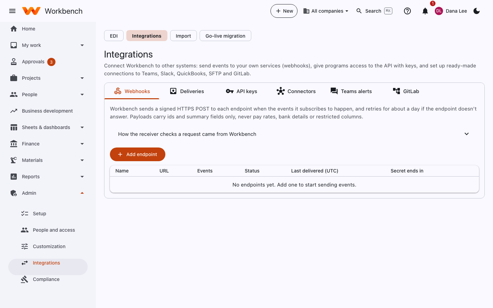
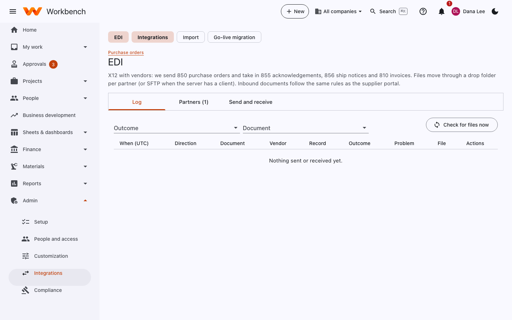

# Integrations

Administrators

**Admin › Integrations** connects Workbench to other systems: send events to your own services (webhooks), give programs
access to the API with keys, and set up ready-made connections to Teams, Slack, QuickBooks, SFTP and GitLab.

<figure markdown="span">
  { .shot }
</figure>

## Webhooks

Workbench sends a signed HTTPS POST to each endpoint when the events it subscribes to happen (a timesheet approved, an
invoice posted, a project created and so on), and retries for about a day if the endpoint doesn't answer. Payloads carry
ids and summary fields only, never pay rates, bank details or restricted columns.

1. **Add endpoint**: the URL and the events.
2. Copy the signing secret and use it in your receiver to check each request came from Workbench (**How the receiver
   checks a request** shows how).
3. **Deliveries** lists every attempt and its response; resend one from there.

Details and payload examples: [Webhooks](../integrations/webhooks.md).

## API keys

Programs use the REST API (`/api/v1/…`) with an API key. Each key acts as a service user with the roles you choose for
it, and can be limited to areas of the API. Create a key, copy it once (it's never shown again), and revoke it when it's
no longer needed. Key use is recorded in the security events. See [API keys](../integrations/api-keys.md).

## Connectors

Ready-made connections under **Connectors**, each with its own settings and a run log. Secret settings (webhook
addresses, SFTP passwords and keys) are encrypted and never shown again.

| Connector | What it does |
| --- | --- |
| **Microsoft Teams** | Posts the events you choose to a channel as a card. **Post a test message** checks the setup. |
| **Slack** | Posts the events you choose to a channel. |
| **General ledger export (QuickBooks)** | A company's posted journal lines for a date range, as a QuickBooks `.iif` file or CSV, on a schedule. |
| **Report export (CSV or SFTP)** | Saved reports as CSV or Excel files on a schedule, optionally uploaded to an SFTP server. |

Workbench keeps a copy of each exported file, downloadable from the run log for 30 days. See
[Connectors](../integrations/connectors.md).

### Teams alerts

Connect one Teams channel for people's own notifications: paste the address of a Teams Workflows "Post to a channel when
a webhook request is received" flow. Each person then chooses, on their Notifications page, which of their notifications
also go to Teams (waiting for my approval, decisions on my requests, assigned to me and mentions, timesheet reminders).
See [Calendar and Teams](../integrations/calendar-and-teams.md).

### GitLab

Link GitLab projects to Workbench sheets so issues and their status stay in step. See [GitLab](../integrations/gitlab.md).

## EDI

X12 with vendors: Workbench sends **850** purchase orders and takes in **855** acknowledgements, **856** ship notices and
**810** invoices. Files move through a drop folder per partner (or SFTP when the server has a client). Inbound documents
follow the same rules as the supplier portal.

<figure markdown="span">
  { .shot }
</figure>

- **Partners**: each vendor's EDI identifiers, folder and which documents they exchange.
- **Send and receive**: send pending POs and **Check for files now** for inbound files (it also runs on a schedule).
- **Log**: every document sent or received, its outcome and any problem.

## Calendar feeds

Each person can subscribe to their own calendar feed (leave, holidays, task due dates, timesheet deadlines) from the
[Leave](../user-guide/leave.md#add-to-my-calendar) page. Feeds are read-only and revocable.
