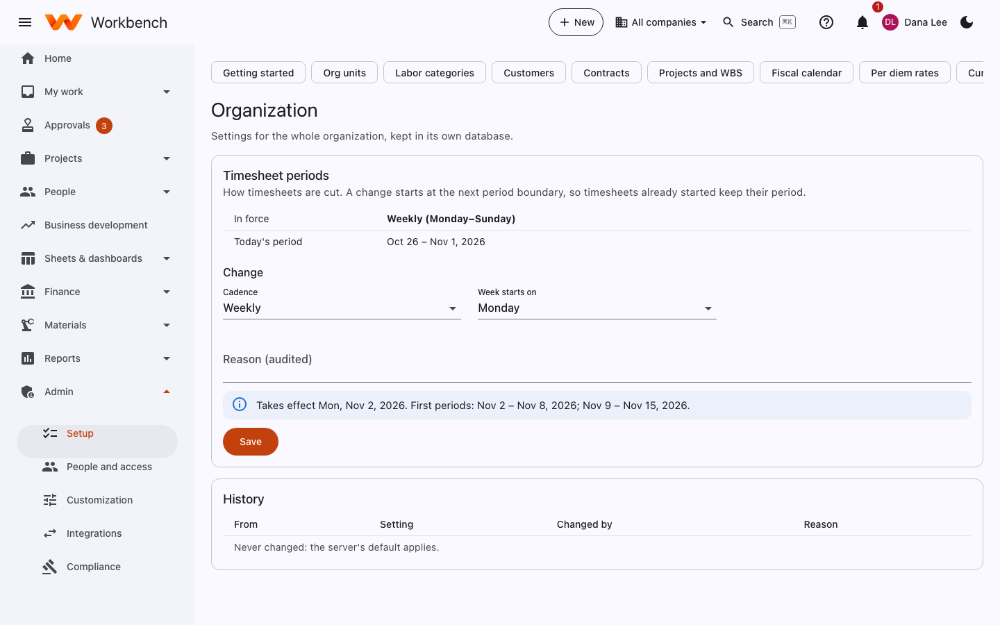
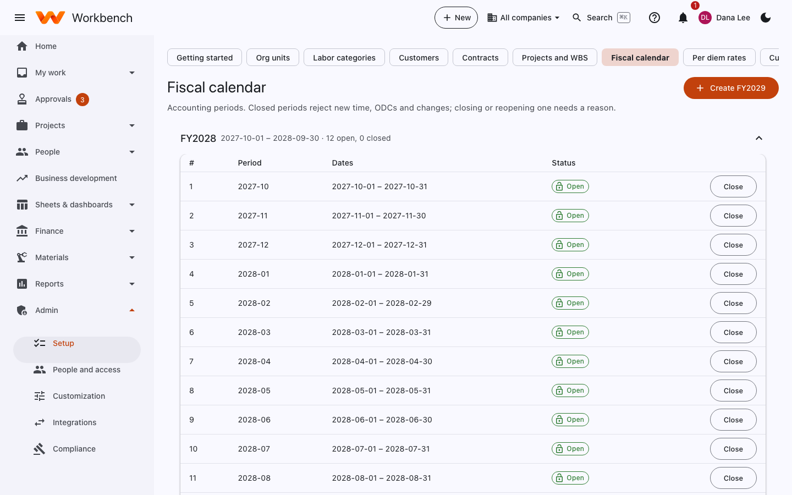
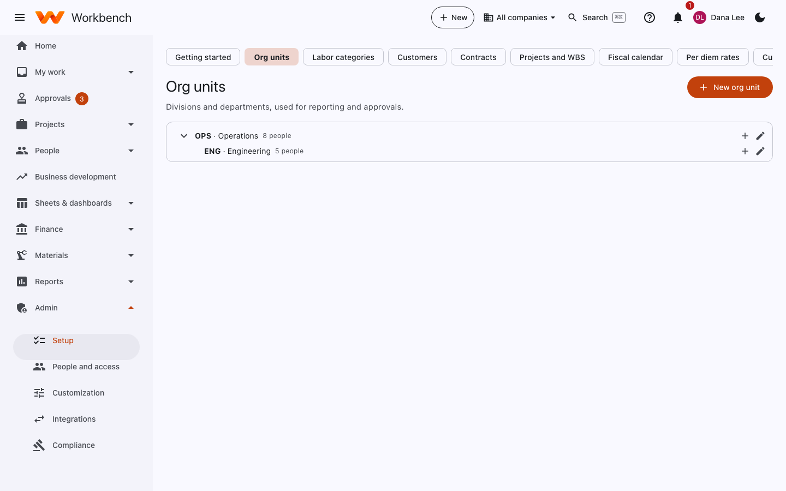
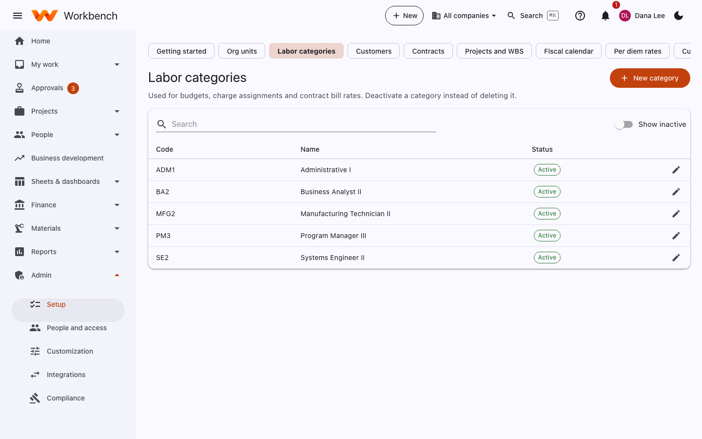
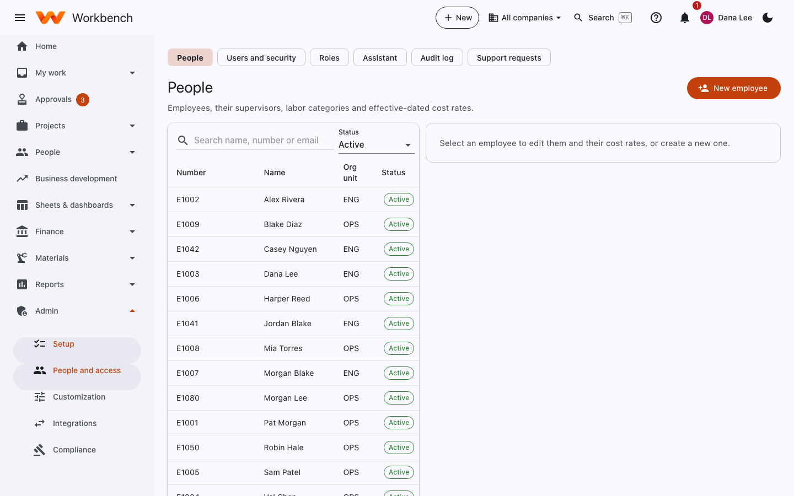
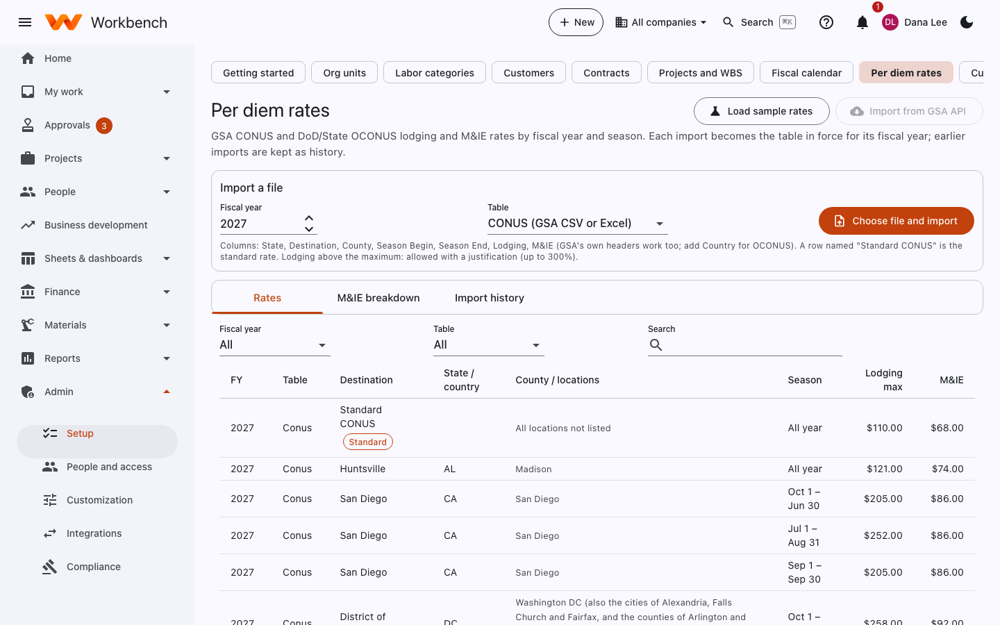

# Organization and calendars

Administrators · Finance

## Organization

**Admin › Setup › Organization** holds settings for the whole organization.

<figure markdown="span">
  { .shot }
</figure>

**Timesheet periods** decide how timesheets are cut:

| Cadence | Periods |
| --- | --- |
| **Weekly** | Seven days from the week start day you choose |
| **Biweekly** | Two weeks from an anchor date |
| **SemiMonthly** | The 1st–15th and the 16th–end of the month |
| **Monthly** | The calendar month |

A change takes effect from the next period boundary, so timesheets already started keep their period. Workbench shows
the date it takes effect and the first periods under the new setting. A reason is required, and every change is listed
under **History**.

## Fiscal calendar

Accounting periods by fiscal year. Closed periods reject new time, ODCs and postings; closing or reopening one needs a
reason.

<figure markdown="span">
  { .shot }
</figure>

- **Create FY…** adds the next fiscal year's twelve periods.
- **Close** on a period is the same as closing it from [Period close](../finance/accounting.md#period-close), but without
  the checklist; Finance normally closes from there.

Company holidays (used by timesheets, leave and plan schedules) are set on the working calendar.

## Org units

Divisions and departments, used for reporting, approvals ("the org unit's manager") and indirect cost pools. They form a
tree: **New org unit** adds one under another.

<figure markdown="span">
  { .shot }
</figure>

## Labor categories

Job titles the contracts price and bill by (contracts may call them PLCs or LCATs). Used for budgets, charge assignments
and contract bill rates. Deactivate a category instead of deleting it.

<figure markdown="span">
  { .shot }
</figure>

## People

**Admin › Setup › People** holds employees as Finance sees them: number, name, org unit, supervisor, labor category,
employment type (salaried or hourly, exempt or not), standard hours, and **effective-dated cost rates**. A new rate
applies from its effective date; earlier hours keep the rate in force when they were worked.

<figure markdown="span">
  { .shot }
</figure>

The **supervisor** decides who approves each person's timesheet. A person's user account (sign-in and roles) is linked by
email; see [Users, roles and sign-in](users-and-access.md#link-a-user-to-an-employee). HR keeps the rest of the
personnel record under [People and HR](../user-guide/people.md#for-hr).

## Per diem rates

GSA CONUS and DoD/State OCONUS lodging and M&IE (meals and incidentals) rates by fiscal year and season, used for travel
requests and expense reports.

<figure markdown="span">
  { .shot }
</figure>

- **Choose file and import**: the GSA CONUS file (CSV or Excel) or the DoD/State OCONUS file. Each import becomes the
  table in force for its fiscal year; earlier imports are kept under **Import history**.
- **Import from GSA API** downloads the rates directly when the server has an api.data.gov key.
- **M&IE breakdown** shows the breakfast, lunch, dinner and incidentals split used to deduct provided meals.

Lodging above the GSA maximum either needs a justification (allowable up to a cap, by default 300%) or is unallowable,
as set in the server's configuration.

## Currencies, card programs and sales tax

| Page | What you set up |
| --- | --- |
| **Currencies and rates** | The currencies you use and their exchange rates by date, for foreign-currency bills, invoices and revaluation. |
| **Card programs** | Each corporate card program: the issuer, whether the company or the cardholder pays, the liability account, and how many days cardholders have to submit charges. |
| **Sales and use tax** | Tax jurisdictions and rates, which customers and items are taxable, and the accounts tax posts to. |
