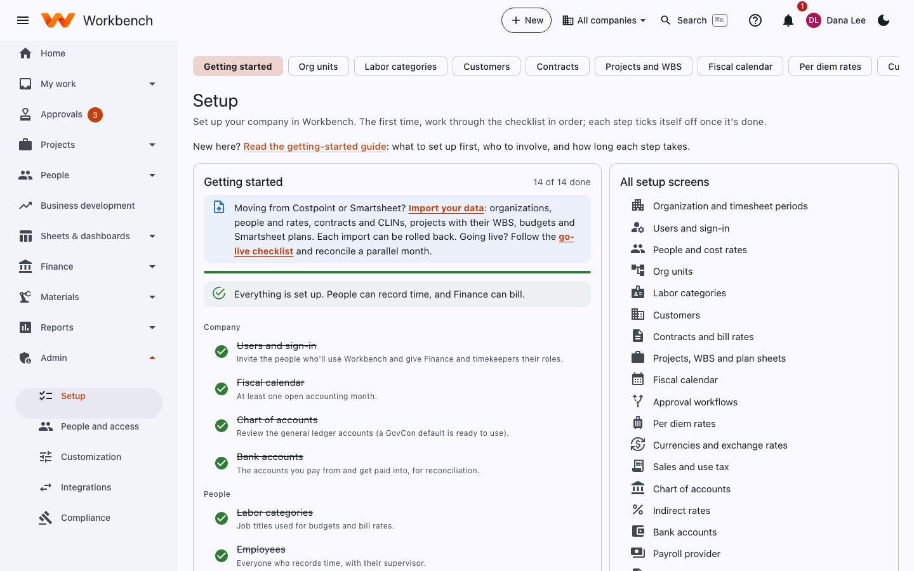

# Setup checklist

<p class="roles">Administrators, with Finance for steps 4–7</p>

**Admin › Setup › Getting started** is a checklist that ticks itself off as you finish each step, with a link to the page
for each. On the right, **All setup screens** lists every setup page.

<figure markdown="span">
  { .shot }
</figure>

Work through it in this order; each step depends on the one before.

## 0. Say what kind of company you are (1 minute)

The Setup page asks this first, until someone answers: **government contractor**, **professional services** or
**engineering and construction**. It decides the words Workbench uses (agreement or contract, billing line or CLIN,
authorized budget or funded value) and whether the federal-only pages show. Nothing in your data changes, and you can
change it later under **Setup › Organization**. See [Company type and wording](company-type.md).

## 1. Sign-in and your administrators (30 minutes)

- Connect your company sign-in so people use their usual work account, or use built-in Workbench accounts. See
  [Users, roles and sign-in](users-and-access.md#how-people-sign-in).
- Make sure at least two people are administrators.

## 2. Your organization (15 minutes)

In **Organization**, set the timesheet period (weekly, every two weeks, twice a month or monthly). Then set up the
**Fiscal calendar** (most government contractors run October to September). See
[Organization and calendars](organization.md).

## 3. Bring your data over, or type it in (1–3 hours)

If you're moving from Costpoint, Unanet or Smartsheet, **Import** is the fastest route: org units, people, customers,
contracts and CLINs, projects with their WBS, rates and budgets. Every import can be rolled back. See
[Importing and go-live](import-and-migration.md).

Otherwise create them in **Setup** in this order: **Org units → Labor categories → People → Customers → Contracts →
Projects and WBS**.

## 4. Money setup (with Finance, 2–3 hours)

- **Chart of accounts**: install the default GovCon chart and adjust it (Finance › Accounting › Chart of accounts).
- **Cost rates** for each person (Setup › People), and **bill rates** on each contract (Setup › Contracts).
- **Indirect rates**: your provisional fringe, overhead and G&A rates (Finance › Revenue & compliance › Indirect rates).
- **Bank accounts** in Cash, and your **payroll provider** in Payroll.
- **Billing details** (company name, remit-to address, CAGE code and UEI) for invoices.

## 5. People and access (1 hour)

Invite users and give them roles: see [Users, roles and sign-in](users-and-access.md). Set each person's supervisor in
**People**: supervisors approve timesheets.

## 6. Approvals (30 minutes)

The built-in approval rules work out of the box (supervisor approves time, project manager approves project costs).
Change them only if you need to: see [Approval workflows](approval-workflows.md).

## 7. Try it, then go live

1. Have two or three people enter a week of time and an expense report.
2. Approve them, post them and run a test invoice.
3. When you're happy, announce the start date and point people to this guide and the in-app help center. Each person
   gets a short welcome tour the first time they sign in.

For a full move from Costpoint (opening balances, a parallel month), use **Go-live migration**: see
[Importing and go-live](import-and-migration.md#go-live-migration). Role-based training material (a one-hour agenda and a
quick-reference card per role) is in [Training](../training/README.md).

## Sample data and starter outlines

**Choosing the demo data.** A development or demo host fills an empty database with sample data. Two sets ship:

- **Government** (the default): a federal contractor with cost-plus contracts, Costpoint-style accounting and a capture
  pipeline.
- **Commercial**: *Kestrel Bay Consulting*, a nine-person professional-services firm (every name is invented). Three clients
  (a time-and-materials analytics engagement, a monthly agency-style retainer, a fixed-fee redesign), a pipeline of eleven
  commercial deals across every stage, three projects built from the starter outlines with their plans, staffing and an
  approved budget, four weeks of timesheets, and four invoices (one part-paid, one paid, one sent and one draft). Dates are
  relative to the day the database is created. The same people sign in as in the government demo (Dana Lee is the
  administrator, Pat Morgan is Finance, Blake Diaz is business development).

Pick it with the `Demo:Dataset` setting, set before the first start, on an **empty** database (a database that already has
data keeps it):

```bash
Demo__Dataset=Commercial ASPNETCORE_ENVIRONMENT=Development dotnet run --project src/Workbench.Web --launch-profile http
```

For the public demo host set `Demo__Dataset=Commercial` next to `Demo__Enabled=true` (see
[docs/demo-hosting.md](../demo-hosting.md)). `Government`, or no value, is the government set; any other value stops startup
with a message, so a typo can't quietly seed the wrong data. Neither set is created in Production.

**Starter outlines.** **New project › Copy from… › Starter outline** offers outlines beyond the original three, each with the
roles the work usually needs:

| Outline | Phases | Usual roles |
|---|---|---|
| Consulting engagement | Engagement management, Discovery, Design, Delivery, Handover | Engagement Partner, Engagement Manager, Senior Consultant, Consultant, Analyst |
| Agency retainer | Account management, Monthly deliverables, Reporting and review | Account Director, Account Manager, Strategist, Creative Director, Designer, Copywriter |
| Software implementation | Project management, Requirements and design, Configuration and build, Testing, Training and go-live, Hypercare | Implementation Lead, Solution Architect, Developer, Data Migration Analyst, QA Analyst, Trainer |
| Engineering design phases | Concept design, Preliminary design, Detailed design, Construction support | Principal Engineer, Project Engineer, Design Engineer, CAD Designer, QA/QC Reviewer |

When Finance starts a project on a contract from an outline, the roles that exist as active labor categories with the same
name become the project's labor categories (otherwise the contract's apply). Add labor categories with those names under
**Setup › Labor categories** to use this. Moving a pipeline across from another CRM: see
[Importing deals](../user-guide/importing-deals.md).
