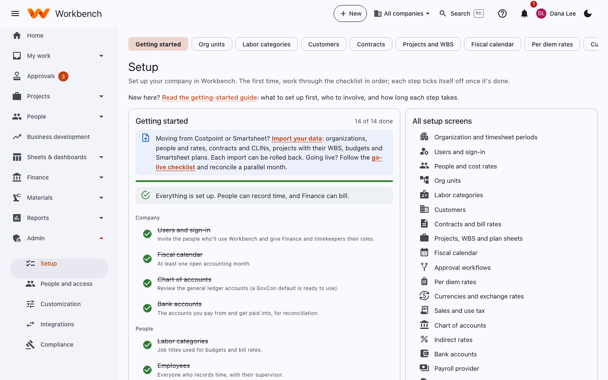

# Setup checklist

Administrators, with Finance for steps 4–7

**Admin › Setup › Getting started** is a checklist that ticks itself off as you finish each step, with a link to the page
for each. On the right, **All setup screens** lists every setup page.

<figure markdown="span">
  { .shot }
</figure>

Work through it in this order; each step depends on the one before.

## 1. Sign-in and your administrators (30 minutes)

- Connect your company sign-in so people use their usual work account, or use built-in Workbench accounts. See
  [Users, roles and sign-in](users-and-access.md#how-people-sign-in).
- Make sure at least two people are administrators.

## 2. Your organization (15 minutes)

In **Organization**, set the timesheet period (weekly, every two weeks, twice a month or monthly). Then set up the
**Fiscal calendar** (most government contractors run October to September). See
[Organization and calendars](organization.md).

## 3. Bring your data over, or type it in (1–3 hours)

If you're moving from Costpoint, Unanet or Smartsheet, **Import** is the fastest route: org units, people, customers,
contracts and CLINs, projects with their WBS, rates and budgets. Every import can be rolled back. See
[Importing and go-live](import-and-migration.md).

Otherwise create them in **Setup** in this order: **Org units → Labor categories → People → Customers → Contracts →
Projects and WBS**.

## 4. Money setup (with Finance, 2–3 hours)

- **Chart of accounts**: install the default GovCon chart and adjust it (Finance › Accounting › Chart of accounts).
- **Cost rates** for each person (Setup › People), and **bill rates** on each contract (Setup › Contracts).
- **Indirect rates**: your provisional fringe, overhead and G&A rates (Finance › Revenue & compliance › Indirect rates).
- **Bank accounts** in Cash, and your **payroll provider** in Payroll.
- **Billing details** (company name, remit-to address, CAGE code and UEI) for invoices.

## 5. People and access (1 hour)

Invite users and give them roles: see [Users, roles and sign-in](users-and-access.md). Set each person's supervisor in
**People**: supervisors approve timesheets.

## 6. Approvals (30 minutes)

The built-in approval rules work out of the box (supervisor approves time, project manager approves project costs).
Change them only if you need to: see [Approval workflows](approval-workflows.md).

## 7. Try it, then go live

1. Have two or three people enter a week of time and an expense report.
2. Approve them, post them and run a test invoice.
3. When you're happy, announce the start date and point people to this guide and the in-app help center. Each person
   gets a short welcome tour the first time they sign in.

For a full move from Costpoint (opening balances, a parallel month), use **Go-live migration**: see
[Importing and go-live](import-and-migration.md#go-live-migration). Role-based training material (a one-hour agenda and a
quick-reference card per role) is in [Training](../training/README.md).
