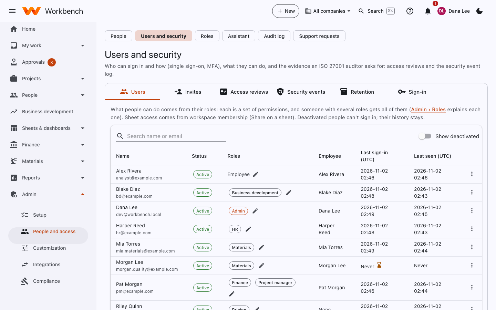
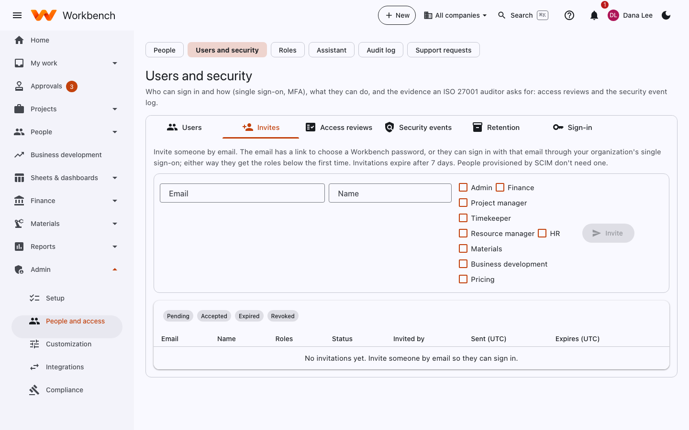
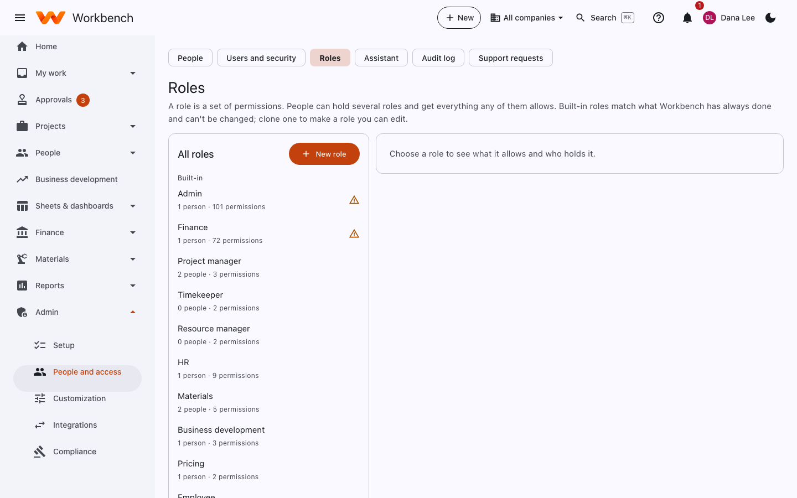
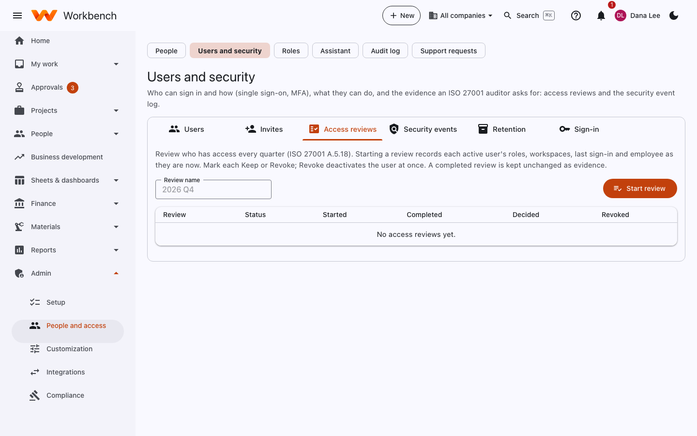

# Users, roles and sign-in

Administrators

Open **Admin › People and access › Users and security**. It covers who can sign in and how (single sign-on, MFA), what
they can do, and the evidence an ISO 27001 auditor asks for: access reviews and the security event log.

| Tab | What it's for |
| --- | --- |
| **Users** | Everyone who can sign in, their status, roles, linked employee, last sign-in and last seen |
| **Invites** | Invite people by email with their roles |
| **Access reviews** | Quarterly reviews of who has access |
| **Security events** | Sign-ins, failures, lockouts, role changes and other security events |
| **Retention** | How long records are kept, and legal holds |
| **Sign-in** | How people sign in: single sign-on, built-in accounts, MFA, group mappings |

## Users

<figure markdown="span">
  { .shot }
</figure>

- Select a user's roles to change them (the pencil beside their roles).
- **Show deactivated** includes people who've left.
- The menu on each row: **Link employee…**, **Email a password reset link**, **Reset MFA…**, **Sign out everywhere**,
  and **Deactivate…** or **Reactivate**.

### When someone leaves

**Deactivate** the user. They can't sign in, their open sessions end at once, and everything they did stays in the
history. Users are never deleted. If your identity provider uses SCIM, deactivating them there does the same.

### Link a user to an employee

A user is matched to their employee record by email. If the emails differ, link them on the **Users** tab. The link is
what puts the right timesheet, expenses and leave in front of them.

## Invite someone

On the **Invites** tab, enter their work email and name, tick their roles, and select **Invite**. The email has a link
to choose a Workbench password, or they can sign in with that email through your organization's single sign-on; either
way they get the roles the first time. Invitations expire after 7 days; filter by **Pending**, **Accepted**,
**Expired** and **Revoked**. People provisioned by SCIM don't need one.

<figure markdown="span">
  { .shot }
</figure>

By default only invited people (or people provisioned by your identity provider) can sign in.

## Roles

A role is a set of permissions. People can hold several roles and get everything any of them allows. Everyone is an
**Employee**: they enter their own time, expenses, travel and leave, request purchases, and see the projects they work on.

| Built-in role | What it adds |
| --- | --- |
| **Admin** | Everything, including users, roles, security, approval workflows, customization and integrations |
| **Finance** | Accounting, billing, payables, cash, assets, payroll, revenue, indirect rates and most of setup |
| **Project manager** | Creating projects, and managing and seeing the money on their own projects |
| **Timekeeper** | Sees everyone's timesheets |
| **Resource manager** | Plans staffing across all projects |
| **HR** | Personnel records, positions, onboarding, compensation and benefits |
| **Materials** | Parts, inventory, manufacturing, quality and shipping |
| **Business development** | The pipeline, opportunities, accounts and leads |
| **Pricing** | Proposal pricing |

Some access comes from what people do rather than a role: supervisors approve their team's time, a project's manager
sees its money, and receivers named on a purchase order can receive it. Sheets have their own access through workspaces
(Viewer, Commenter, Editor, Owner).

### Custom roles

**Admin › Roles** lists every role, its permissions and who holds it. Built-in roles can't be changed; **clone** one to
make a role you can edit, or start a **New role** and tick its permissions (sensitive ones, such as pay rates or bank
details, are marked). Nobody can grant a permission they don't hold themselves.

<figure markdown="span">
  { .shot }
</figure>

Giving someone a role, you can **limit where it applies**: to some companies, org units, projects or contracts
("Finance for company B only"). The full permission list and how scopes work are in [Permissions](../security/permissions.md).

## Access reviews

Review who has access every quarter (ISO 27001 A.5.18). **Start review** records each active user's roles, workspaces,
last sign-in and employee as they are now. Mark each person **Keep** or **Revoke**; Revoke deactivates the user at once.
A completed review is kept unchanged as evidence, and can be exported.

<figure markdown="span">
  { .shot }
</figure>

## How people sign in

The **Sign-in** tab shows how sign-in is set up. There are two ways, and you can use both:

=== "Single sign-on (recommended)"

    People sign in through your company's identity provider using OpenID Connect, so your password rules and
    multi-factor authentication apply. Your IT team:

    1. Registers Workbench as a web application in the identity provider (Microsoft Entra ID, Okta or any OIDC provider).
    2. Sets the redirect address to your Workbench address followed by `/signin-oidc`.
    3. Gives the Workbench server the provider's address (authority), the client id and the client secret. Secrets go in
       environment variables or a vault, never in a file.

    Step-by-step guides: [Entra ID](../security/sso-entra.md) and [Okta](../security/sso-okta.md). If you use Workbench
    as a hosted service, send these details to your Workbench support contact instead.

    **Group mappings** give Workbench roles from identity provider groups, at first sign-in or at every sign-in.

=== "Built-in accounts"

    Workbench keeps its own accounts: email, a password (at least 12 characters) and an authenticator app code. Accounts
    lock for 15 minutes after 5 failed attempts; **Forgot your password?** sends a reset link that works for an hour.
    See [Built-in accounts](../security/built-in-accounts.md).

**SCIM provisioning**: your identity provider can create, update and deactivate users automatically. Point it at your
Workbench address followed by `/scim/v2` with the bearer token your hosting administrator set.

**Sessions** end after 30 minutes without activity and after 12 hours in any case; deactivating someone signs them out
everywhere at once. Sensitive actions ask people to confirm it's them again.

## Security events and retention

- **Security events**: sign-ins, failed sign-ins, lockouts, MFA changes, role and permission changes, API key use and
  exports of sensitive data. Filter and export them for your security reviews.
- **Retention**: how long each kind of record is kept before it's purged, and **legal holds** that stop records from
  being purged while a dispute or audit is open.
