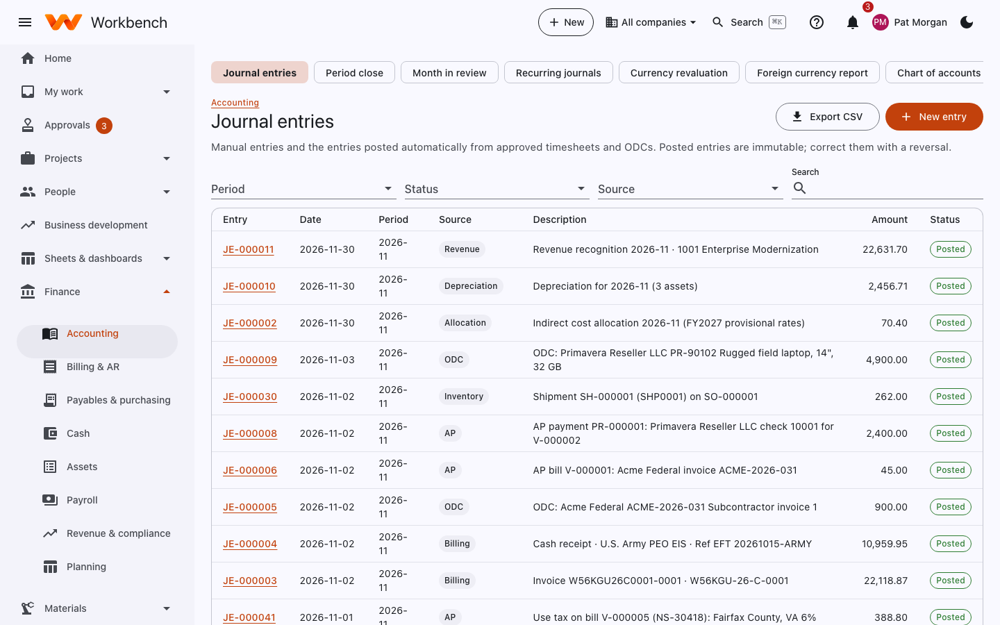
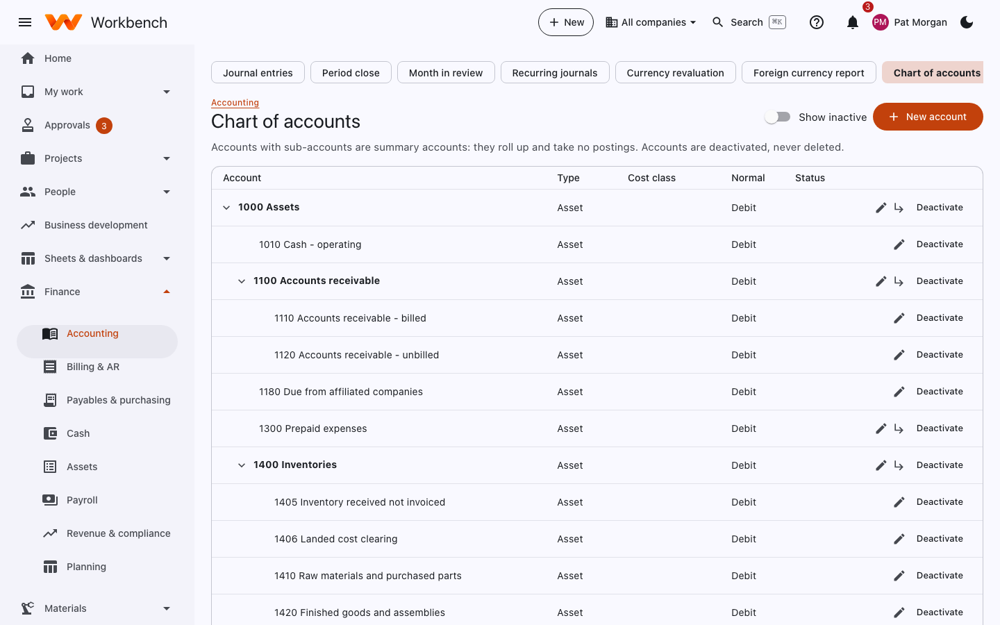
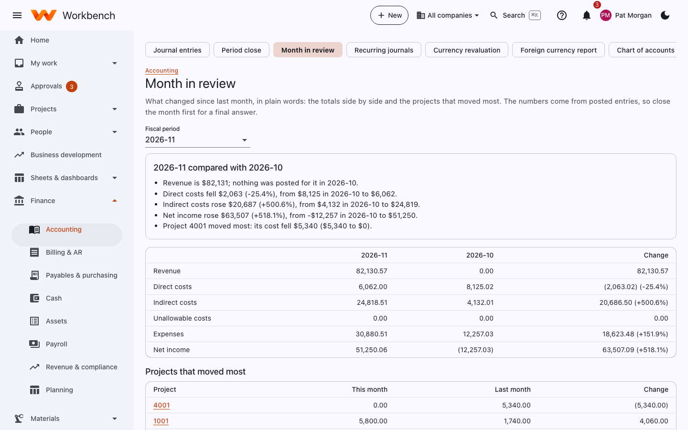
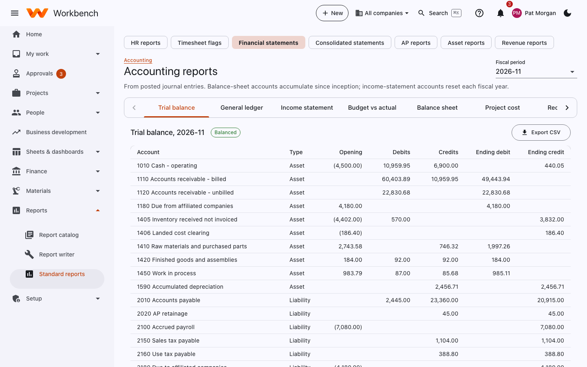

# Accounting and period close

Finance

The **Finance › Accounting** pages: journal entries, period close, month in review, recurring journals, currency
revaluation, the foreign currency report, the chart of accounts, posting rules, and the sales and use tax return.

## Journal entries

Manual entries and the entries posted automatically from approved timesheets, expenses, ODCs, bills, invoices, payroll,
depreciation, allocation and revenue runs. Each shows its source, period, description, amount and status.

<figure markdown="span">
  { .shot }
</figure>

- **New entry** (or **+ New › Journal entry**) creates a manual entry: date, description, and lines with account, org
  unit, project/WBS, debit and credit. It must balance. Manual entries go to Finance for approval (someone other than the
  preparer) before they post.
- **Posted entries are immutable.** Correct them with a reversal: open the entry and select **Reverse**.
- Filter by period, source and status; **Export CSV** downloads the list.

### Recurring journals

Entries that repeat every month (rent, prepaid amortization, accrued items). Set them up once under **Recurring
journals** with their schedule; each period's entries are generated for review and posting.

## Chart of accounts

Accounts with sub-accounts are summary accounts: they roll up and take no postings. Accounts are deactivated, never
deleted. Each account has a type (asset, liability, equity, revenue, expense), a normal balance and, for costs, a **cost
class** (direct labor, direct ODC, fringe, overhead, G&A, unallowable) that drives indirect rates and DCAA reporting.

<figure markdown="span">
  { .shot }
</figure>

A new installation can start from the default GovCon chart (Admin › Setup › Getting started), or import yours.

### Posting rules

**Posting rules** decide which accounts each kind of transaction posts to: labor by charge type (direct, indirect,
leave), ODCs by cost type, AP, AR, revenue, payroll liabilities and so on. They come set up; change them only with your
controller.

## Period close

Closing a month locks it: no more postings, and no time or expense changes dated in it. Open **Finance › Accounting ›
Period close** and pick the period.

<figure markdown="span">
  { .shot }
</figure>

Each check shows a tick or what's left to do, with a link to fix it:

1. **All timesheets approved**: every timesheet in the period is approved or rejected.
2. **All ODCs and expenses approved or rejected.**
3. **Everything approved is posted**: **Post backlog** posts anything approved but not yet in the ledger.
4. **Payables**: bills for the month entered and posted.
5. **Payroll** posted for each pay date in the month.
6. **Depreciation** run for the month.
7. **Allocation posted**: the indirect cost allocation, so projects carry their fringe, overhead and G&A.
8. **Revenue run** posted.
9. **Unbilled revenue accrual** (optional) posted from Billing.
10. **Bank reconciliation** completed for each account.
11. **Trial balance balanced.**

When everything passes, select **Close** and confirm with the period's name. **Close anyway…** closes with checks still
open, with a reason (recorded in the audit log).

To change a closed month, select **Reopen period** with a reason, make the change, and close it again. The fiscal
calendar (**Admin › Setup › Fiscal calendar**) also lists every period and its status.

## Month in review

What changed since last month, in plain words: the totals side by side and the projects that moved most. The numbers
come from posted entries, so close the month first for a final answer.

<figure markdown="span">
  { .shot }
</figure>

## Financial statements

**Reports › Financial statements** (also **Accounting reports**) runs from posted journal entries for any period, open or
closed. Balance-sheet accounts accumulate since inception; income-statement accounts reset each fiscal year.

<figure markdown="span">
  { .shot }
</figure>

Tabs: **Trial balance**, **General ledger**, **Income statement**, **Budget vs actual**, **Balance sheet**, **Project
cost** and **Reconciliation** (subledgers against the GL). **Export CSV** on each. With more than one company,
**Consolidated statements** combine them and eliminate intercompany balances.

## Currencies

If you bill or buy in other currencies:

- **Admin › Setup › Currencies and rates** holds exchange rates.
- **Currency revaluation** revalues open foreign-currency balances at month-end rates and posts the unrealized gain or loss.
- **Foreign currency report** lists open foreign-currency items and their exposure.

## Sales and use tax

**Sales and use tax return** totals the tax collected on invoices and the use tax accrued on purchases, by jurisdiction,
for a filing period. Jurisdictions and rates are set under **Admin › Setup › Sales and use tax**.
