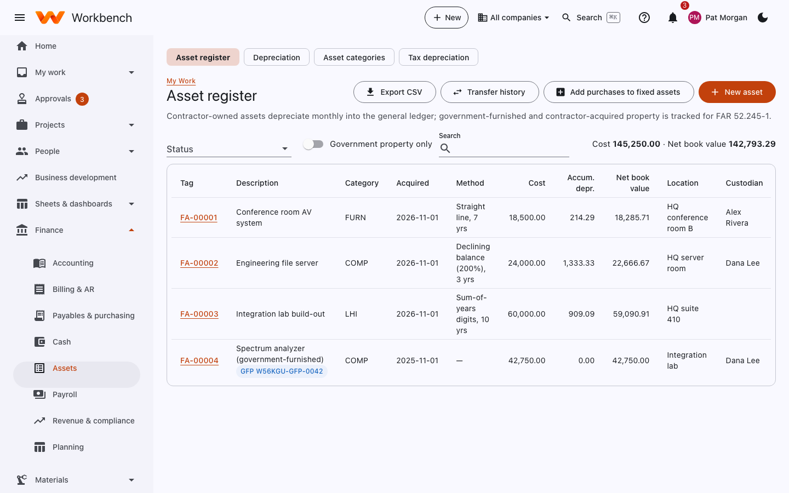
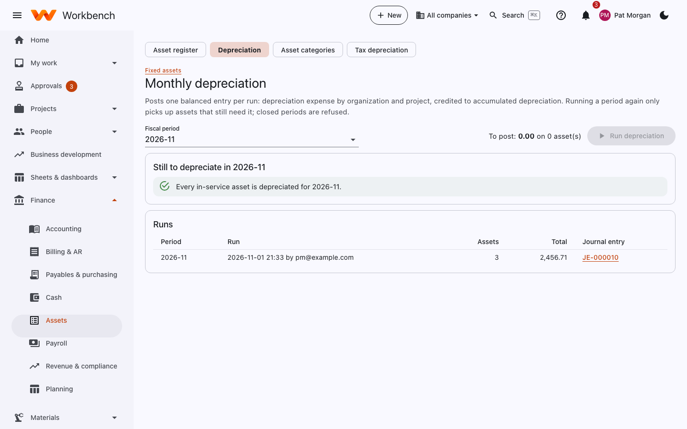

# Fixed assets

Finance

Contractor-owned assets depreciate monthly into the general ledger; government-furnished and contractor-acquired
property is tracked for FAR 52.245-1.

## Asset register

Every asset with its tag, description, category, acquisition date, depreciation method and life, cost, accumulated
depreciation, net book value, location and custodian. Government property shows its contract
(*GFP W56KGU-26-C-0001*) and isn't depreciated.

<figure markdown="span">
  { .shot }
</figure>

- **New asset** adds one by hand.
- **Add purchases to fixed assets** (the **Capitalize** page) turns AP bill lines at or above the capitalization
  threshold (by default $5,000) into assets.
- **Transfer history** and **Asset transfers** move assets between locations, custodians, org units or companies.
- **Government property only** filters to GFP and CAP for property reporting.
- **Export CSV** downloads the register.

Open an asset to change it, see its depreciation schedule, or **Dispose** of it (sale, scrap, loss): the gain or loss
posts to the disposal account.

## Depreciation

**Monthly depreciation** posts one balanced entry per run: depreciation expense by organization and project, credited to
accumulated depreciation. Pick the period and select **Run depreciation**. Running a period again only picks up assets
that still need it; closed periods are refused. It's one of the period close checks.

<figure markdown="span">
  { .shot }
</figure>

## Categories and tax depreciation

- **Asset categories** set the default method, life and GL accounts for each kind of asset (furniture, computers,
  leasehold improvements).
- **Tax depreciation** keeps a separate tax book (MACRS, bonus depreciation and Section 179) beside the book depreciation,
  for the tax return.

## Asset reports

**Reports › Asset reports** has tabs for the **Roll-forward** (opening cost, additions, disposals, depreciation and
closing balance), the **Depreciation schedule**, **Categories**, **Government property**, **Book to tax**, the
**Mid-quarter test** and **Form 4562**.
