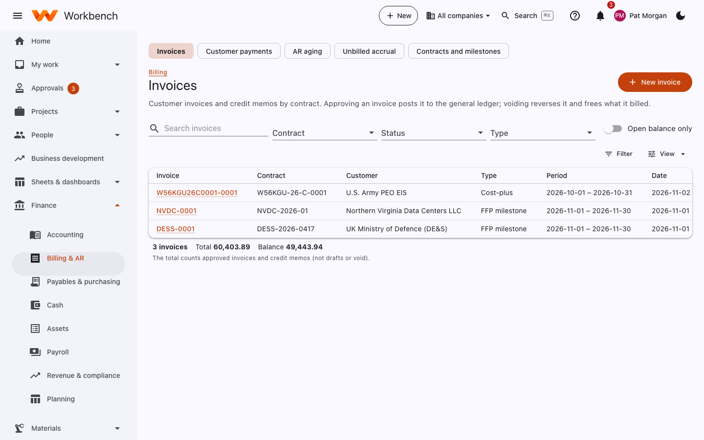
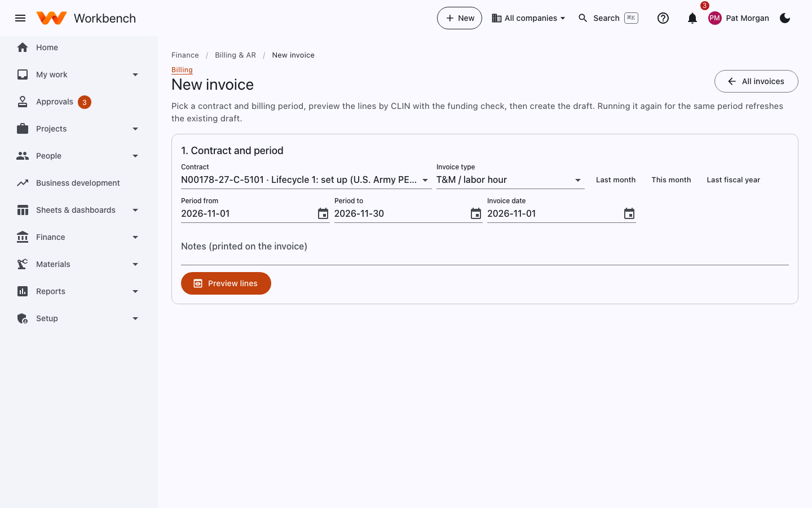
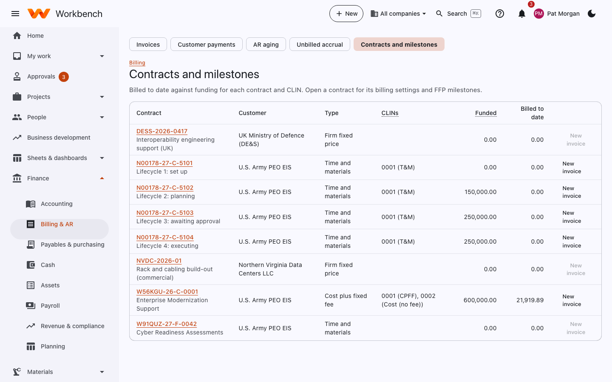
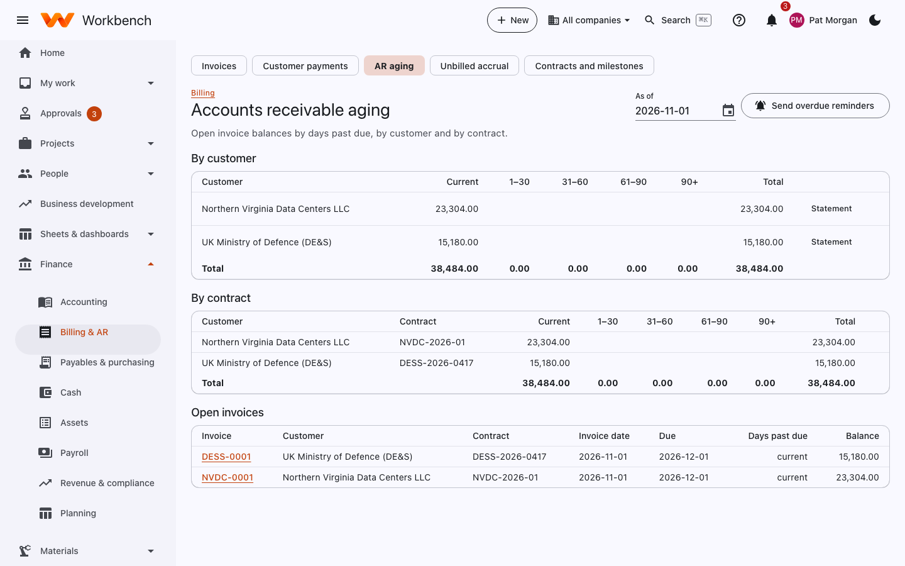

# Billing and receivables

Finance

The **Finance › Billing & AR** pages: invoices, customer payments, AR aging, the unbilled accrual, and contracts and
milestones.

## Invoices

Customer invoices and credit memos by contract. Approving an invoice posts it to the general ledger; voiding reverses it
and frees what it billed.

<figure markdown="span">
  { .shot }
</figure>

### Create an invoice

1. Select **New invoice** (or **+ New › Invoice**).
2. Pick the contract and the billing period (**Last month**, **This month** or dates), the invoice type and date, and
   any notes to print on it.
3. Select **Preview lines**. Workbench gathers what can be billed, by CLIN, with the funding check:
    - **T&M**: approved hours at each labor category's bill rate, plus materials.
    - **Cost-plus**: allowable cost to date, burdened at provisional rates, plus fee, less what's already billed.
    - **FFP**: completed milestones (or delivered units).
4. Create the draft. Running it again for the same period refreshes the existing draft.

<figure markdown="span">
  { .shot }
</figure>

Hours and costs can only be billed once. Unallowable costs are never included. Totals stay within each CLIN's funded
amount and any ceiling; **Add adjustment** adds a line with a clear description when needed.

### Approve, print and send

1. **Approve and post**. The invoice posts to the general ledger (AR and revenue or unbilled).
2. **Print** in the contract's format (SF 1034 public voucher, or your own layout), or send it to PIEE (below).
3. **Mark sent**.

To fix a posted invoice, **Void** it or issue a **Credit memo**; never edit it.

## Government billing

Open **Contracts and milestones**, pick the contract, and fill in **Government billing**:

- **Invoice format**: the SF 1034 public voucher (long invoices continue on SF 1035 sheets) or your own layout.
- **Contract financing**: none, progress payments, or performance-based payments.
- **PIEE routing**: the issue-by, admin-by and pay office DoDAACs (and ship-to for a Combo), and how delivery invoices
  are sent.

<figure markdown="span">
  { .shot }
</figure>

### Progress payments (SF 1443)

1. Turn on progress payments with the rate (usually 80%, or 90% for a small business) and the liquidation rate.
2. Select **SF 1443 requests**, choose the date costs run through, and select **Preview SF 1443**. Costs come from
   approved time and costs on the contract's projects; with paid costs only, what's still owed to vendors is left out.
3. Change a figure only if you have better information (for example the cost to complete), then **Create request**.
4. Approve the draft invoice it creates. It's recorded as contract financing, not revenue.

### Performance-based payments

Add the events on the contract with their amounts and completion criteria (together at most 90% of the price). When one
is done, select **Complete** and record the evidence, then **Bill completed events**.

Every FFP or T&M invoice on a financed contract gets a **Liquidation** line: the liquidation rate of the delivery, up to
what's still outstanding. The contract page shows what's been billed, liquidated and is left.

### Send it to PIEE (WAWF)

On an approved invoice, the **PIEE (WAWF)** panel lists anything missing. When it's complete, select **Download PIEE
file**, upload it in PIEE, then **Mark submitted** with the PIEE number. Record **Accepted** or **Rejected** (with the
reason) when PIEE answers. Nothing is sent to PIEE automatically.

## Customer payments

**Customer payments › Record payment**: the customer, date, amount and reference (check or EFT number), then apply it to
one or more invoices. Payments post to cash and AR and show on the bank reconciliation.

## AR aging

Open invoice balances by days past due (current, 1–30, 31–60, 61–90, 90+), by customer and by contract, as of a date.
**Statement** prints a customer statement. **Send overdue reminders** emails customers who are late.

<figure markdown="span">
  { .shot }
</figure>

## Unbilled accrual

Revenue earned but not yet billed at month-end (for example hours approved after the invoice cut-off). **Unbilled
accrual** computes it by contract and posts an entry that reverses at the start of the next month. It's one of the
period close checks.
