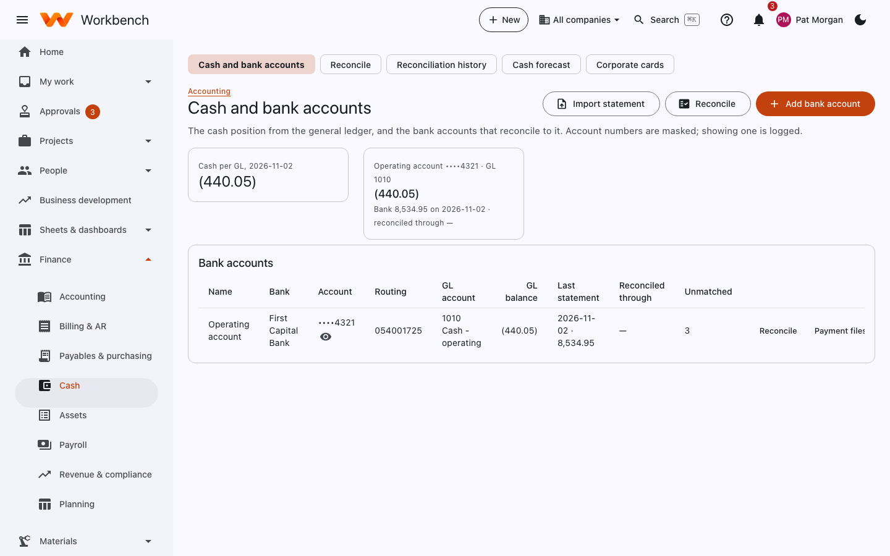
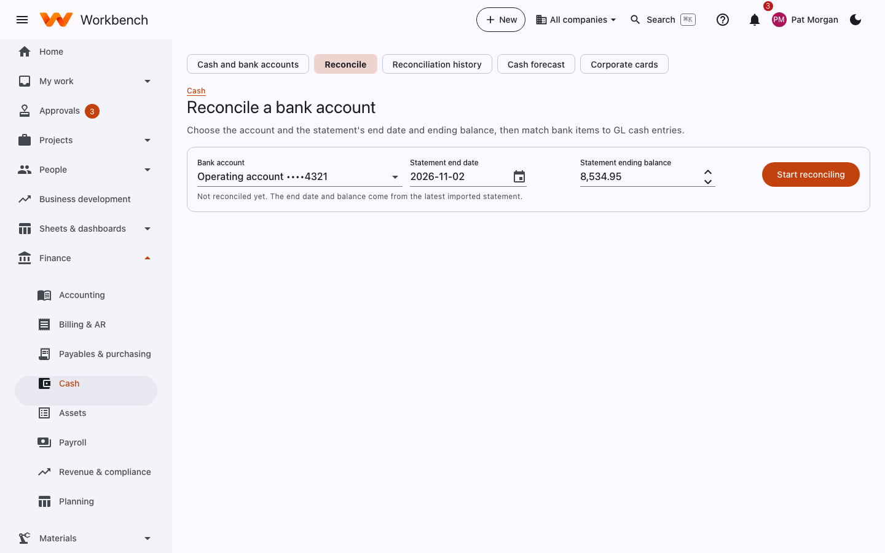
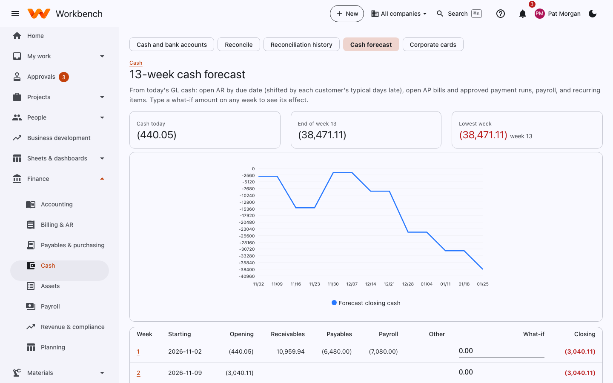
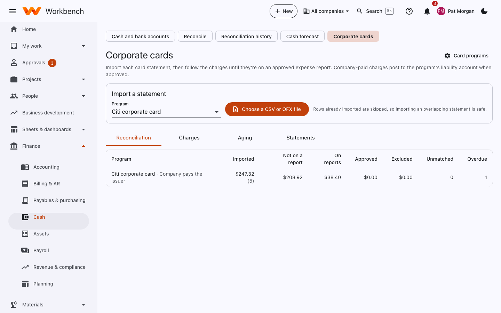

# Cash, banks and cards

Finance

## Cash and bank accounts

The cash position from the general ledger, and the bank accounts that reconcile to it. Each account shows its bank,
masked account number, GL account and balance, the last statement, what it's reconciled through, and unmatched items.
Account numbers are masked; showing one is logged.

<figure markdown="span">
  { .shot }
</figure>

**Add bank account** links a bank account to its GL cash account. **Payment files** sets up the ACH and positive pay
formats your bank accepts.

## Reconcile a bank account

Reconcile each bank account every month, before you close it.

1. **Import statements**: pick the account and the statement file (CSV or OFX from your bank) and select **Import**.
   Rows already imported are skipped.
2. **Reconcile**: pick the account and enter the statement's end date and ending balance, then **Start reconciling**.
3. **Auto-match** pairs statement lines with payments, deposits and journal entries by amount and date.
4. Match what's left by hand: select a statement line and the book entry it belongs to. **Unmatch** undoes a wrong pair.
5. For bank fees or interest that aren't in the books yet, **Post and match** posts the entry and matches it in one step.
6. When the difference is zero, **Complete**.

<figure markdown="span">
  { .shot }
</figure>

A completed reconciliation is kept in **Reconciliation history** and ticks off the month-end check. To change one,
**Reopen** it.

## 13-week cash forecast

From today's GL cash: open AR by due date (shifted by each customer's typical days late), open AP bills and approved
payment runs, payroll, and recurring items. Type a what-if amount on any week to see its effect.

<figure markdown="span">
  { .shot }
</figure>

**Add** adds a recurring or one-off item (rent, a loan payment, an expected receipt). **Save settings** keeps the
assumptions.

## Corporate cards

Import each card statement, then follow the charges until they're on an approved expense report. Company-paid charges
post to the program's liability account when approved.

<figure markdown="span">
  { .shot }
</figure>

1. Pick the card program and **Choose a CSV or OFX file** to import the statement. Each charge is matched to its
   cardholder.
2. Cardholders see their charges under **Expenses › Card charges** and add them to expense reports.
3. Follow progress on the tabs: **Reconciliation** (by program: imported, not on a report, on reports, approved,
   excluded, unmatched, overdue), **Charges**, **Aging** and **Statements**.

Card programs (the issuer, who pays, the liability account, how long cardholders have) are set up under **Admin › Setup ›
Card programs**.
