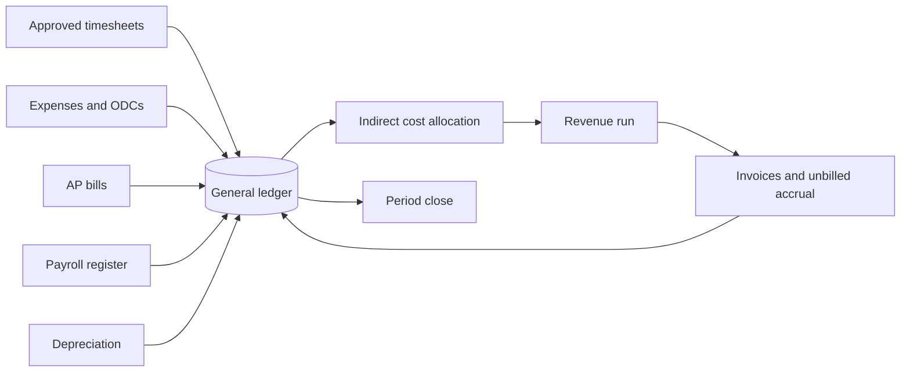

# Finance guide

Finance · Some pages also for project managers and administrators

Everything under **Finance** in the menu: the general ledger and month-end close, billing and receivables, payables and
purchasing, cash and banks, fixed assets, payroll, revenue recognition, indirect rates and incurred cost, and corporate
budgets. Workbench posts to the ledger as work happens: approved timesheets, expenses, bills, invoices, payroll and
depreciation all create journal entries, so most of month-end is checking rather than keying.

## How the money flows

## The monthly cycle

A typical month; your controller sets the actual close calendar.

| When | What | Where |
| --- | --- | --- |
| All month | Bills entered and approved, POs received, invoices drafted | [Payables](payables.md), [Billing](billing.md) |
| End of month | Remind people to submit timesheets and expenses; clear the approvals inbox | [Approvals](../user-guide/approvals.md) |
| Close day 1 | Post the backlog; import the payroll register; run depreciation | [Accounting](accounting.md), [Payroll](payroll.md), [Assets](assets.md) |
| Close day 2 | Run the indirect cost allocation; approve EACs and post the revenue run | [Revenue and compliance](revenue.md) |
| Close day 2–3 | Bill: T&M, cost-plus, milestones; post the unbilled accrual | [Billing](billing.md) |
| Close day 3 | Reconcile each bank account and the card program | [Cash](cash.md) |
| Close day 3 | Work through the close checklist and close the period | [Period close](accounting.md#period-close) |
| After close | Review **Month in review** and the financial statements | [Accounting](accounting.md#month-in-review) |
| Yearly | True up indirect rates; prepare the incurred cost submission | [Revenue and compliance](revenue.md) |

## Pages in this guide

- [Accounting and period close](accounting.md): journal entries, chart of accounts, posting rules, recurring journals,
  currency revaluation, period close, month in review, financial statements.
- [Billing and receivables](billing.md): invoices (T&M, cost-plus, FFP), government billing (SF 1034, SF 1443, PIEE),
  customer payments, AR aging, unbilled accrual.
- [Payables and purchasing](payables.md): vendors, purchase orders, receiving, AP bills, three-way match, payment runs,
  subcontracts, RFQs, the supplier portal.
- [Cash, banks and cards](cash.md): bank accounts, statement import, reconciliation, the 13-week cash forecast,
  corporate cards.
- [Fixed assets](assets.md): the asset register, capitalizing bills, depreciation, tax depreciation, transfers,
  government property.
- [Payroll](payroll.md): sending hours to your payroll provider and posting the register.
- [Revenue and compliance](revenue.md): revenue recognition and EACs, indirect rates, total time accounting, incurred
  cost submissions.
- [Corporate budgets](planning.md): budget versions, budget vs actual, planning cycles.
