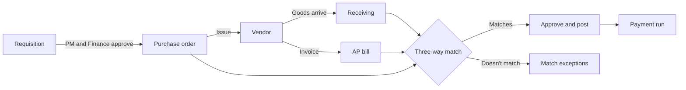
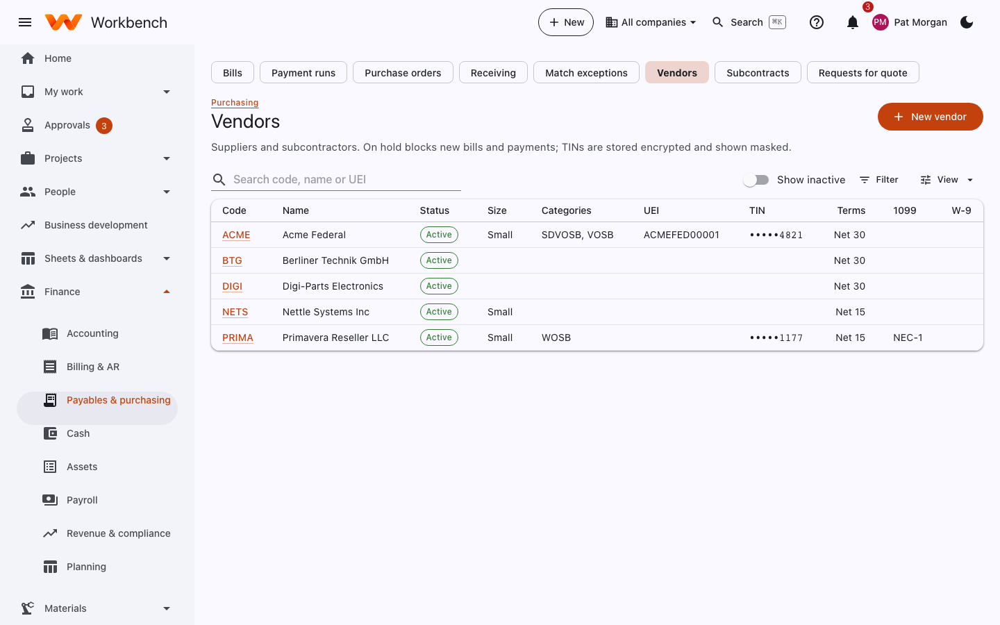
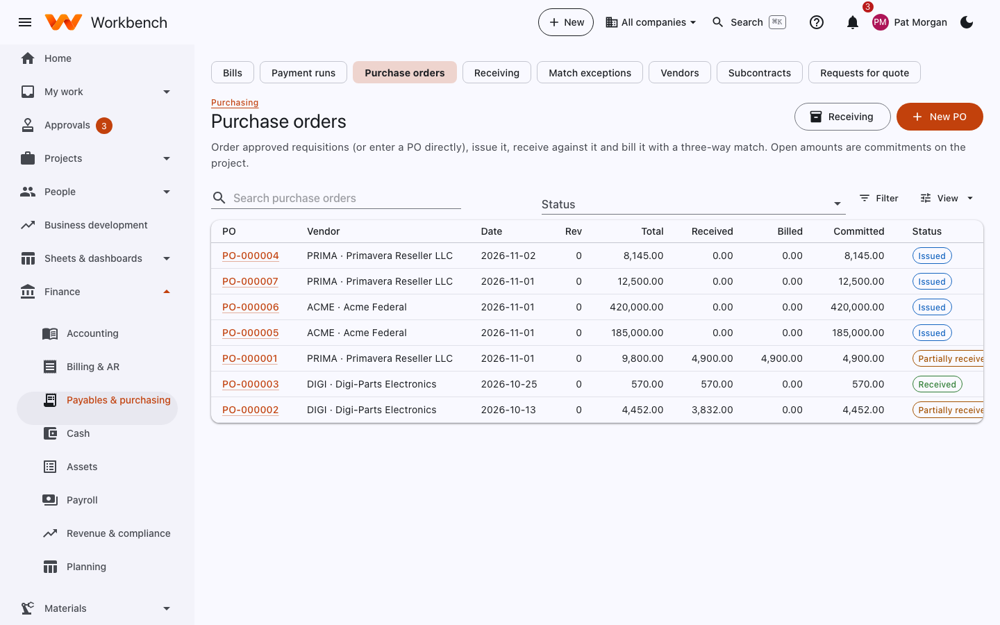
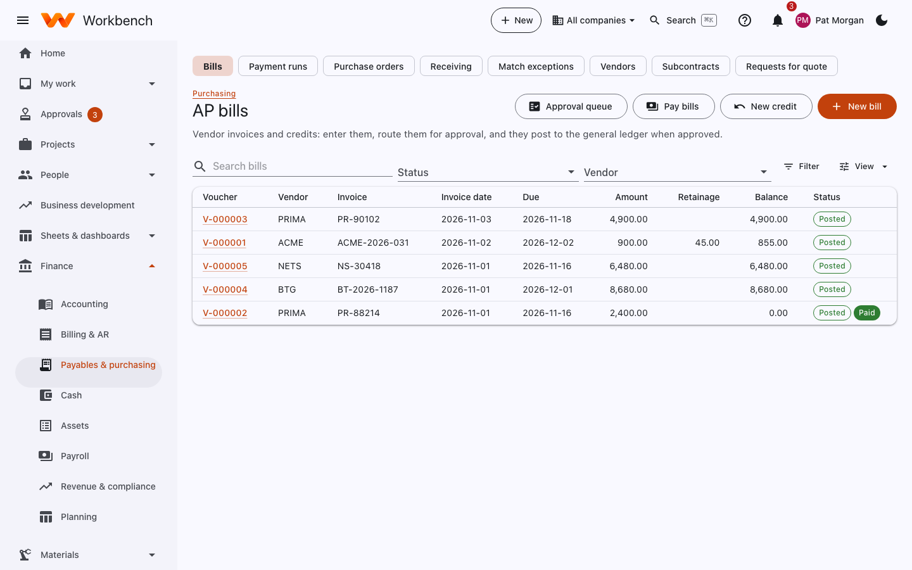
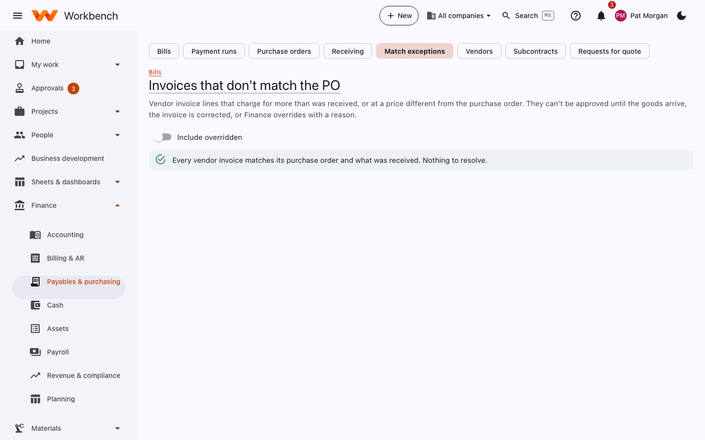
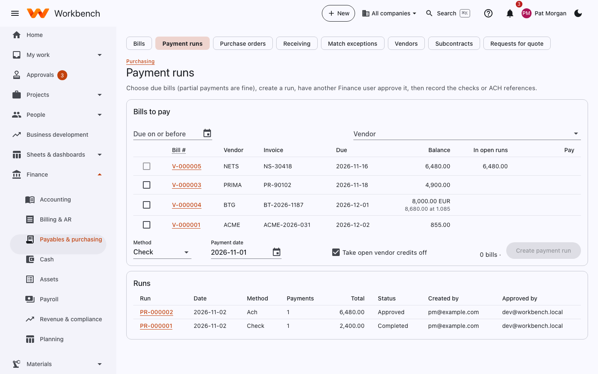

# Payables and purchasing

Finance and purchasing · Project managers approve · Anyone can request

The **Finance › Payables & purchasing** pages follow a purchase from request to payment:

## Vendors

Suppliers and subcontractors: code, name, status, business size and socioeconomic categories (SDVOSB, WOSB and so on),
UEI, TIN, payment terms, 1099 and W-9. **On hold** blocks new bills and payments. TINs and bank details are stored
encrypted and shown masked; a change to a vendor's bank details goes to Finance for approval before it's used.

<figure markdown="span">
  { .shot }
</figure>

## Purchase orders

Order approved requisitions (or enter a PO directly), issue it, receive against it and bill it with a three-way match.
Open amounts are commitments on the project, shown on its Financials tab.

<figure markdown="span">
  { .shot }
</figure>

- **New PO**, or **Create from requisitions** to combine approved requisitions for one vendor.
- Add terms, ship-to, the receivers (people who'll record what arrives) and flowdown clauses.
- **Issue** sends it to the vendor (by email, the supplier portal or EDI). Changes after issue make a new revision.
- **Receiving** lists POs waiting on goods; receivers record what arrives (see
  [Purchase requests and receiving](../user-guide/requisitions.md#receive-what-arrives)).

### Subcontracts and RFQs

- **Subcontracts**: subcontract agreements with their ceiling, funding, flowdowns, small business reporting and the
  documents a purchasing system review checks.
- **Requests for quote**: send an RFQ to several vendors, record their quotes, compare them and award one (the
  competition record for the file).

### Supplier portal

Vendors can be invited to a **supplier portal** where they acknowledge POs, send ship notices and submit invoices
themselves, and see their payment status. See [Supplier portal](../security/supplier-portal.md). Vendors set up for EDI
exchange the same documents as X12 files (see [Integrations](../admin-guide/integrations.md#edi)).

## AP bills

Vendor invoices and credits: enter them, route them for approval, and they post to the general ledger when approved.

<figure markdown="span">
  { .shot }
</figure>

1. Select **New bill** (or **+ New › Vendor bill**), or open a PO and select **Create bill from PO**.
2. Enter the vendor, invoice number, dates and lines. A line from a PO takes its charge code from the PO. Lines can be
   project costs (by WBS and cost type), indirect expenses, inventory, or a fixed asset to capitalize.
3. Attach the vendor's invoice and **Submit**. It goes to the project managers of the charged projects (and Finance for
   lines with no project manager).

**New credit** enters a vendor credit memo, to apply against later bills. **Retainage** held on a subcontract bill is
tracked and released separately.

### Three-way match

For PO lines, Workbench checks the bill against the PO and what was received. If the quantity is more than was
received, or the price differs from the PO by more than the tolerance (5% by default), the line appears under **Match
exceptions** and can't be approved until the goods arrive, the invoice is corrected, or Finance selects **Override** with
a reason.

<figure markdown="span">
  { .shot }
</figure>

## Payment runs

1. Open **Payment runs**, choose the bank account and a due-date cutoff. Approved bills due by then are listed; partial
   payments are fine. **Take open vendor credits off** applies credits.
2. Tick what to pay, pick the method (check or ACH) and the payment date, and **Create payment run**.
3. Another Finance user approves the run.
4. Export the **ACH file** (and **Positive pay** file if your bank uses it) or print checks.
5. **Record payments and post**.

<figure markdown="span">
  { .shot }
</figure>

Payments post to the general ledger and show on the bank reconciliation.

## AP reports

**Reports › AP reports** has tabs for **AP aging**, the **Vendor ledger**, **1099** totals, **Small business**
subcontracting and **Subcontract status**.
