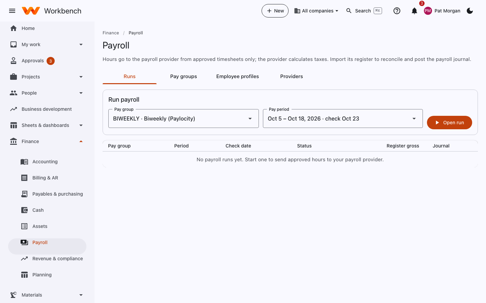

# Payroll

Finance

Workbench doesn't calculate pay: your payroll provider does. Hours go to the provider from approved timesheets only, and
the provider's register comes back to reconcile and post the payroll journal, so labor cost in the books matches what
people were paid.

<figure markdown="span">
  { .shot }
</figure>

## Run payroll

On **Runs**, pick the pay group (for example *BIWEEKLY – Biweekly (Paylocity)*) and the pay period, and select **Open
run**. The run page walks through six steps:

1. **Pay group and period**: what you picked.
2. **Preview approved hours**: approved hours for the period by employee: regular, overtime and leave, with pay rates.
   Anyone with unapproved time is flagged so you can chase it.
3. **Export hours to the provider**: through its API if it's connected, or download the hours file and upload it there.
4. **Import the payroll register**: when the provider has run payroll, bring back its register (by API, or **Choose
   register file** and **Import register**).
5. **Reconcile**: the register's gross pay against what Workbench expected for each person: worked and leave pay,
   deductions, net, the labor variance and anything unexplained.
6. **Post the payroll journal**: gross pay by charge code, employer taxes and benefits to fringe, and the liabilities.

**Void run** cancels a run that hasn't been posted.

## Pay groups, profiles and providers

| Tab | What you set up |
| --- | --- |
| **Pay groups** | Each pay schedule (weekly, biweekly, semi-monthly), its provider and pay dates. |
| **Employee profiles** | Each person's pay group, provider employee ID, pay type (salaried or hourly) and earning codes. |
| **Providers** | The connection to each payroll provider. |

Supported providers:

- **Paylocity**: employee sync and hours over its REST API (set up by the server administrator), or by file.
- **ADP Workforce Now, Paychex Flex and Gusto**: connect with your own API credentials under **Providers** (stored
  encrypted), or use files without a connection.
- Any other provider: hours export and register import as CSV files.

Benefit deductions come from [Benefits administration](../user-guide/people.md#benefits-administration); pay rates from
approved [compensation](../user-guide/people.md#compensation) changes.
