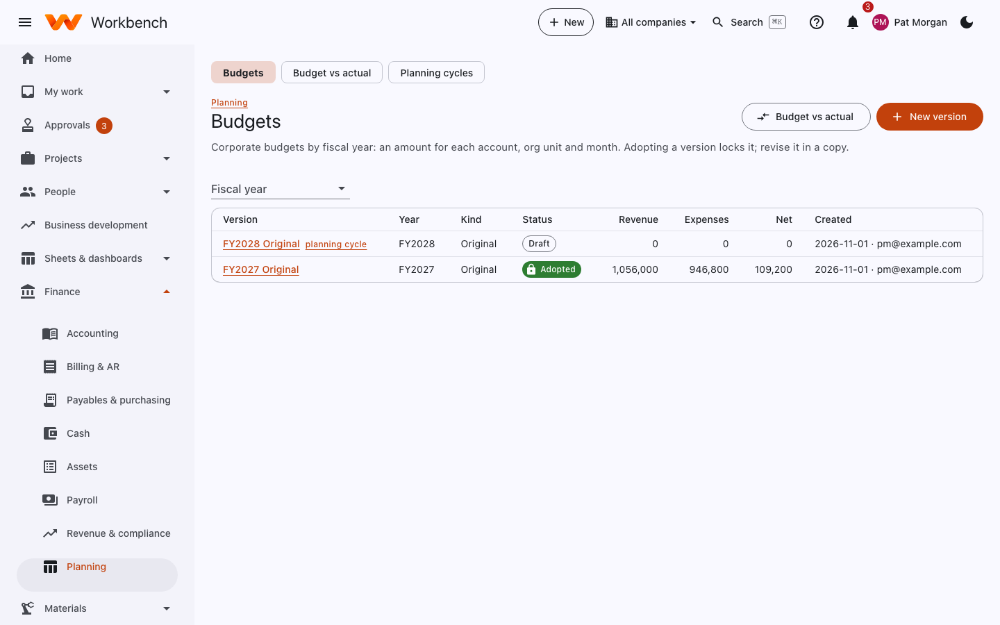
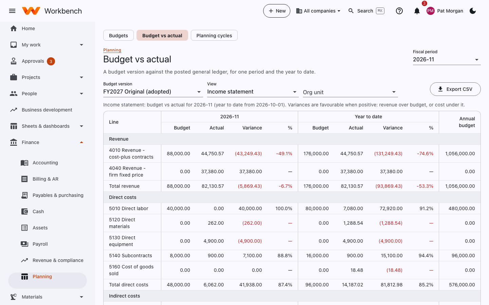

# Corporate budgets

Finance · Org unit budget owners

Corporate budgets are by fiscal year: an amount for each account, org unit and month. They're separate from project
budgets (which live on each project).

## Budget versions

<figure markdown="span">
  { .shot }
</figure>

- **New version** starts a budget for a fiscal year: an **Original** (the plan for the year), a **Revised** (a change
  during the year) or a **Forecast** (the expected outcome). It can start empty or copy another version's amounts
  (months are matched by their number in the year).
- Open a version to enter amounts by account, org unit and month, or import them from Excel.
- **Adopting** a version locks it and makes it the one budget vs actual uses. To change it, revise a copy.

## Planning cycles

A **planning cycle** collects budgets from org unit owners:

1. Finance opens a cycle for a version, with the org units, the accounts each owner fills in, and a due date.
2. Owners see it as a to-do and under **My work › My budgets**. They enter their numbers and **Submit**.
3. Finance reviews each submission in Approvals and approves it or returns it with comments.
4. When everything's in, Finance adopts the version.

## Budget vs actual

A budget version against the posted general ledger, for one period and the year to date, by account and optionally by
org unit. Variances are favourable when positive: revenue over budget, or cost under it. **Export CSV** downloads it.

<figure markdown="span">
  { .shot }
</figure>
