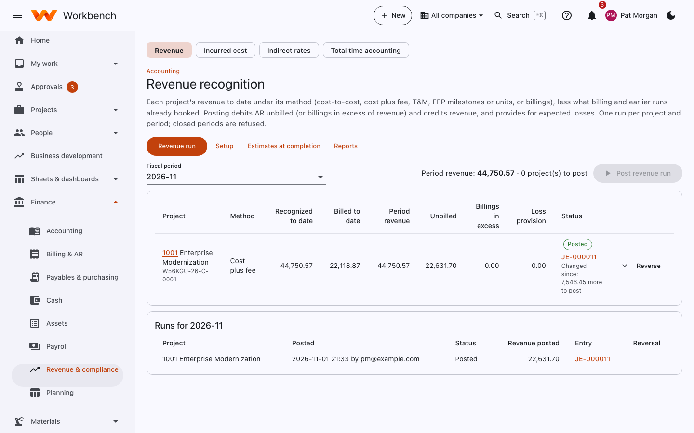
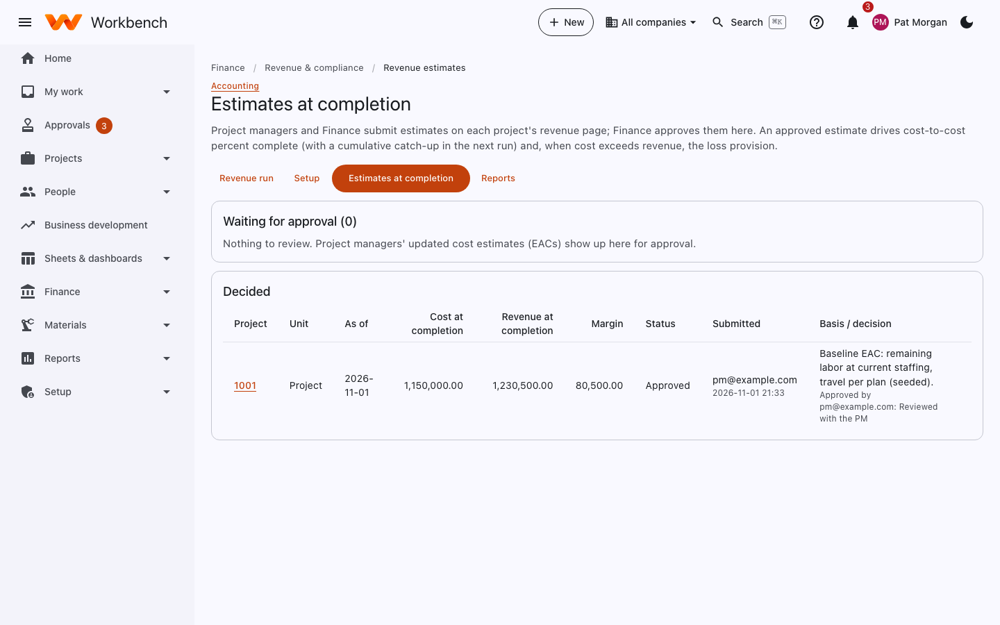
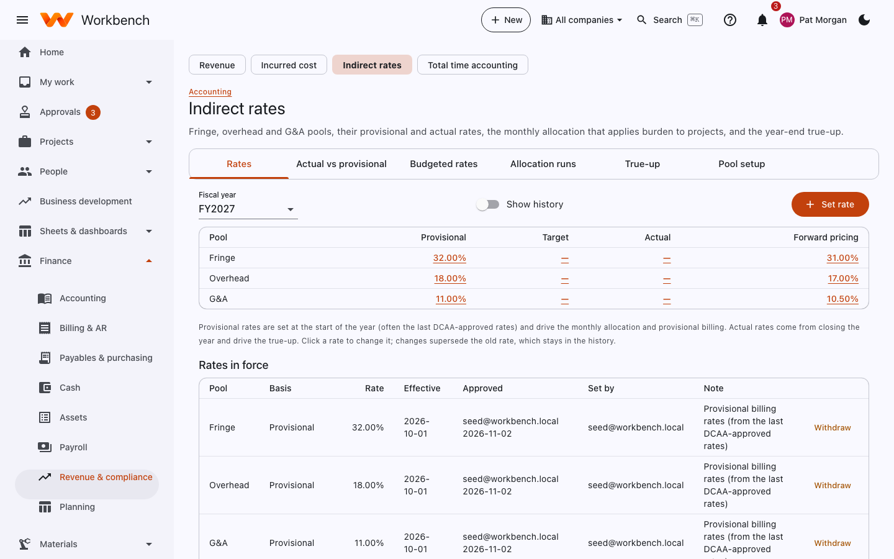
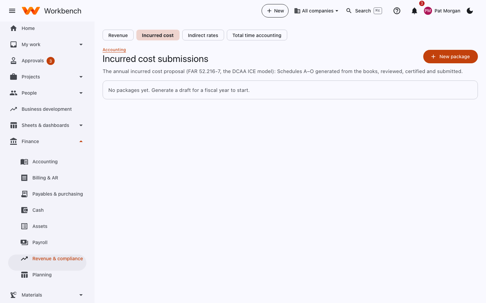

# Revenue and compliance

Finance · Project managers submit estimates

## Revenue recognition

Revenue is recorded when it's earned, not when it's billed. Each project has a method: cost-to-cost percent complete,
cost plus fee, T&M as worked, FFP milestones or units delivered, or billings.

<figure markdown="span">
  { .shot }
</figure>

### Before the run

- Project managers submit their estimates at completion (EAC) on each project's revenue page; Finance approves them under
  **Revenue estimates**. Projects without a current estimate are flagged.
- Record deliveries for milestone or units-delivered projects (**Record delivery**).
- Approved time and costs for the month should be posted, and the indirect allocation run.

### Run it

1. Open **Finance › Revenue & compliance › Revenue** and pick the period.
2. Review each project's revenue to date, this period's amount and the difference from billing (unbilled, or billed in
   excess of revenue). Where cost will exceed revenue, a loss provision is shown.
3. Select **Post revenue run**. It posts one journal entry per project.

If something was wrong, **Reverse** the run, fix the cause and post it again. One run per project and period; closed
periods are refused.

### Estimates at completion

<figure markdown="span">
  { .shot }
</figure>

An approved estimate drives cost-to-cost percent complete (with a cumulative catch-up in the next run) and, when cost
exceeds revenue, the loss provision. **Revenue setup** sets each project's method and the accounts used.

## Indirect rates

Fringe, overhead and G&A pools, their provisional and actual rates, the monthly allocation that applies burden to
projects, and the year-end true-up.

<figure markdown="span">
  { .shot }
</figure>

| Tab | What you do there |
| --- | --- |
| **Rates** | Provisional billing rates, targets and forward pricing rates by pool and fiscal year. **Set rate** adds one (effective dated, approved). |
| **Actual vs provisional** | This year's actual rates from the GL against provisional, by month, and the under- or over-applied amount. |
| **Budgeted rates** | Rates from the corporate budget, for planning and pricing. |
| **Allocation runs** | Run the monthly allocation: it spreads each pool over its base and posts the burden to projects. A period close check. |
| **True-up** | At year-end, recompute burden at actual (or final negotiated) rates and post the difference by project. |
| **Pool setup** | Which accounts make up each pool and what base it's spread over (direct labor, total cost input, value added). |

## Total time accounting

For salaried exempt employees who work more than their standard hours: **Total time accounting** spreads their pay over
all hours worked (an effective hourly rate), so each project carries a fair share of the labor cost. This is the
DCAA-accepted way to handle uncompensated overtime; your disclosed practice decides whether it's on.

## Incurred cost submission

Every year, within six months of year-end, contractors with cost-type contracts send the government their actual costs
and indirect rates (FAR 52.216-7, the DCAA ICE model).

<figure markdown="span">
  { .shot }
</figure>

1. Select **New package** for the fiscal year.
2. **Generate draft**. Workbench builds Schedules A–O from the general ledger, indirect cost pools, billing and payables.
3. Fill in the inputs it can't know (for example executive compensation details) and **Save inputs**. **Regenerate**
   after any correction in the books.
4. Review each schedule. **Mark reviewed** when someone other than the preparer has checked it.
5. An officer of the company selects **Certify**. Workbench records who certified and when.
6. **Export .xlsx** (or **Print view**), submit it to DCAA and select **Mark submitted**.

!!! warning
    Make sure every month of the year is closed and indirect rates are final before you certify.
