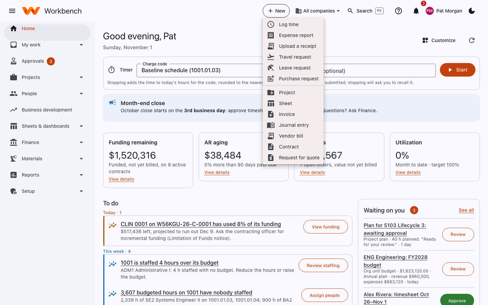
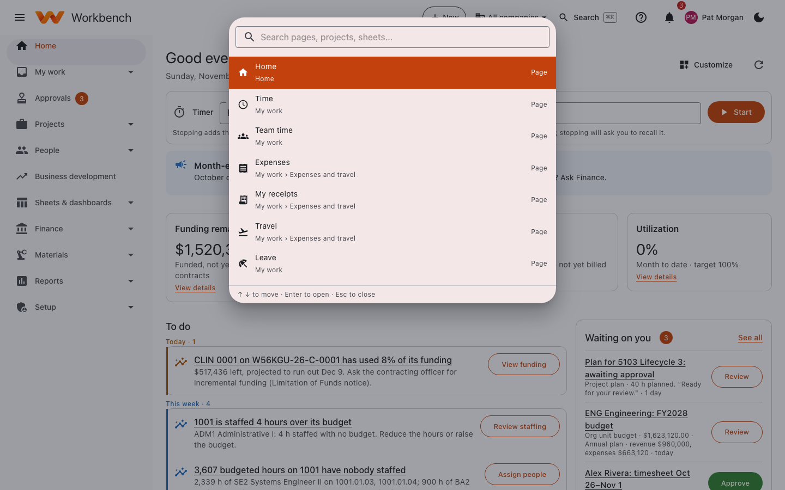

# Finding your way around

## The top bar

From left to right:

- **☰** shows or hides the menu (on a small screen the menu is hidden until you open it).
- **+ New** starts something new (see below).
- **All companies** (when your organization has more than one company) chooses which company's records you see.
- **Search** opens the command palette.
- **?** opens help for the page you're on.
- **🔔** shows your notifications; the red number is how many are unread.
- **Your name** opens your account menu: **Notification settings**, **Mobile view**, the ++n++ shortcut,
  **Report a problem / Send feedback**, **My support requests**, **Password and sign-in** (built-in accounts) and
  **Sign out**.
- **☾** switches between light and dark mode.

## The menu

The menu on the left is organized by task and only shows what your role uses:

| Section | What's in it | Who sees it |
| --- | --- | --- |
| **Home** | Your to-do list | Everyone |
| **My work** | Time, expenses and travel, leave, purchase requests, budgets you own, receiving | Everyone |
| **Approvals** | One inbox for everything waiting on you | Anyone who approves something |
| **Projects** | All projects, resourcing, project costs, proposal pricing | Everyone (more for managers) |
| **People** | The directory, org chart, your profile and benefits; HR administration | Everyone (more for HR) |
| **Business development** | Pipeline, opportunities, accounts, leads, forecast | Business development |
| **Sheets & dashboards** | Shared sheets and dashboards | Everyone |
| **Finance** | Accounting, billing, payables, cash, assets, payroll, revenue, planning | Finance |
| **Materials** | Parts, inventory, manufacturing, quality, shipping | Materials |
| **Reports** | The report catalog, standard reports and the report writer | Everyone (each report shows only what you may see) |
| **Admin** | Setup, people and access, customization, integrations, compliance | Administrators |

Pages that belong together show as tabs across the top of each page, so you can move between, for example, **Bills**,
**Payment runs** and **Purchase orders** without going back to the menu.

## Create something new (++n++)

Select **+ New** at the top, or press ++n++ when you're not typing in a field, to start the things you do most: log time,
an expense report, a receipt, a travel or leave request, a purchase request. People whose role needs them also see a
project, a sheet, an invoice, a journal entry, a vendor bill, a contract and more. Each item opens the same form as the
page it belongs to.

<figure markdown="span">
  { .shot }
  <figcaption>The <b>+ New</b> menu for a project manager in Finance.</figcaption>
</figure>

You can turn the ++n++ shortcut off (or back on) from your account menu.

## Search (++ctrl+k++)

Press ++ctrl+k++ (++cmd+k++ on a Mac), or select **Search**, and start typing. You can jump to any page you're allowed to
open, a project, a sheet, a dashboard or a help article, or type "new" to start anything on the **+ New** menu. Use the
arrow keys and ++enter++, or click a result.

<figure markdown="span">
  { .shot }
  <figcaption>Search finds pages, projects, sheets, dashboards and help.</figcaption>
</figure>

## Lists: filter, sort and views

Most lists (projects, invoices, bills, vendors, people and so on) work the same way:

- Type in the **search** box to narrow the list.
- **Filter** adds conditions on any column.
- Click a column heading to sort by it.
- **View** chooses the columns and saves the current filters and sort as a named view you can come back to.

## Companies

If your organization has more than one legal company, the **All companies** menu in the top bar lets you see one
company's records or all of them together. New records go to the company you choose when you create them. See
[Multiple companies](../admin-guide/companies.md).
