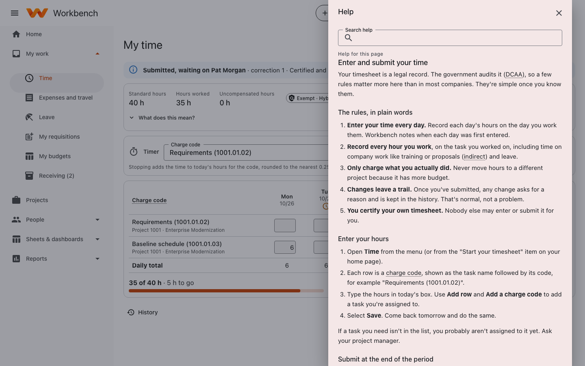
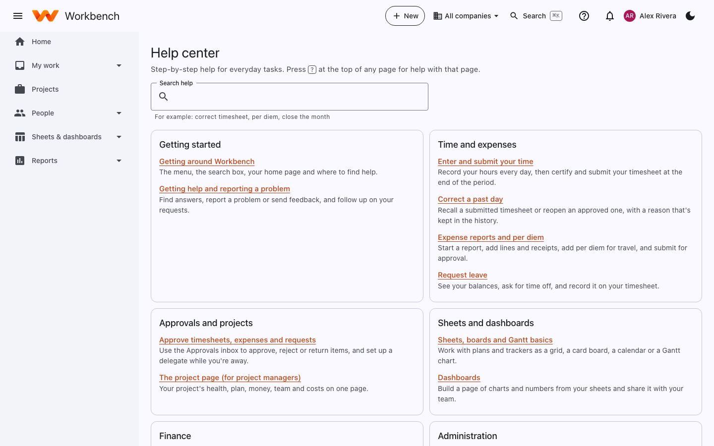
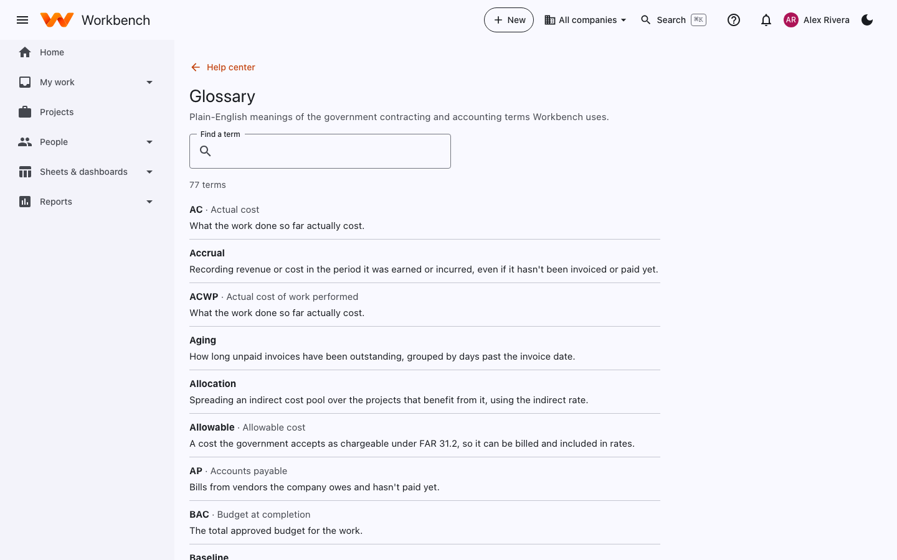
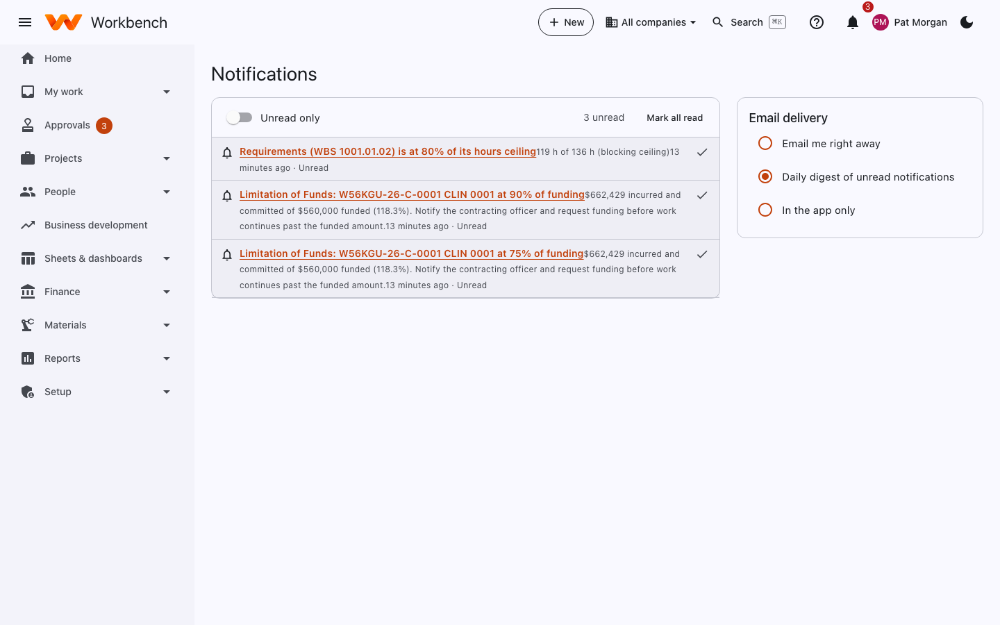

# Help, notifications and feedback

## Help for the page you're on

Select **?** at the top of any page. The help panel opens beside the page with the article for what you're looking at,
a search box for the rest, and links to the welcome tour and **What's new**.

<figure markdown="span">
  { .shot }
  <figcaption>The help panel on the timesheet page.</figcaption>
</figure>

## The help center and glossary

The **Help center** (**Home › Help center**, or search for it) lists every article by topic: getting started, time and
expenses, approvals and projects, sheets and dashboards, finance and administration.

<figure markdown="span">
  { .shot }
</figure>

The **Glossary** explains the government contracting and accounting terms Workbench uses: EAC, CLIN, fringe, G&A,
unallowable and 70-odd more. Words with a dotted underline anywhere in the app link to it: hover over one, or move to it
with ++tab++. This guide has the same list under [Glossary of terms](../reference/glossary.md).

<figure markdown="span">
  { .shot }
</figure>

## Notifications

The bell at the top shows notifications: an approval waiting on you, your timesheet approved or returned, funding
running low on a contract you manage, a task assigned to you, a mention in a comment, and so on. Select one to go to the
record. **Notifications** shows them all, with **Unread only** and **Mark all read**.

<figure markdown="span">
  { .shot }
  <figcaption>Notifications, with your email delivery choice on the right.</figcaption>
</figure>

Under **Email delivery** choose how you also get them by email:

- **Email me right away**: one email per notification.
- **Daily digest of unread notifications** (the default): one email each morning with what you haven't read.
- **In the app only**: no email.

You can also get a calendar feed of your leave, holidays, deadlines and task due dates in Outlook or Google Calendar: see
[Add to my calendar](../user-guide/leave.md#add-to-my-calendar).

## Report a problem or send feedback

1. Open your account menu (your name, top right) and choose **Report a problem**. If you see an error message, use its
   **Report this** button instead.
2. Say what happened in a sentence, and add what you were trying to do and what you expected.
3. Optionally attach a screenshot (an image up to 10 MB).
4. Select **Send**.

Workbench adds the page you were on and the version of Workbench. It never sends what you typed into the page's forms or
any password. Your administrators see your report (it may also be emailed to your support team), and you get a
notification when its status changes. Your reports and their status are under **My support requests**; quote the
reference number, for example *SR-000042*, if you contact support about one.

## What's new

**What's new** (in the help panel, or **Home › What's new**) lists recent changes to Workbench, newest first.
