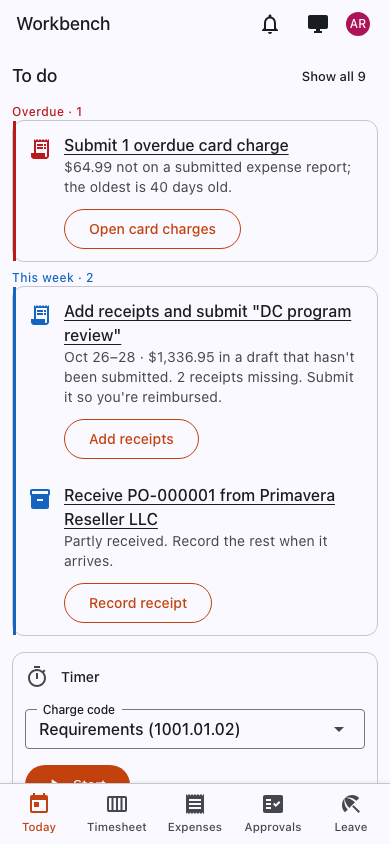

# Workbench on your phone

Workbench works in your phone's browser. On a small screen it opens the **mobile view** (`/m`), a simplified page with
what people do away from a desk:

- **Today**: your to-do list, the same as on the home page.
- **Timer and time**: start and stop the timer, or enter today's hours with **−** and **+**.
- **Receipts**: take a photo of a receipt and upload it; it waits in [My receipts](../user-guide/expenses.md#my-receipts)
  until you attach it to an expense line.
- **Approvals**: approve or return timesheets, expenses and requests.
- **Leave**: request time off.

<figure markdown="span">
  { .shot .phone }
  <figcaption>The mobile view. The bar at the bottom switches between Today, Timesheet, Expenses, Approvals and Leave.</figcaption>
</figure>

On a phone, opening Workbench goes to the mobile view. To use the full site instead, select **Full site**; the phone remembers that choice. To go back, choose **Mobile view** from your account menu.

## Warehouse pages

People who work in a warehouse have three phone pages built for a scanner or the phone's camera:

| Page | What it's for |
| --- | --- |
| **Receive on a phone** (`/m/receive`) | Receive a purchase order line by scanning the part, then the lot or serial. |
| **Pick on a phone** (`/m/pick`) | Pick released sales order lines for shipping. |
| **Count on a phone** (`/m/count`) | Count a location during a physical inventory. |

See the [Materials guide](../materials/index.md).

## Desktop app

There's also a Workbench desktop app for Windows and macOS. It shows the same pages as the browser and signs in the same
way; your administrator tells you whether to use it and which server to connect to.
