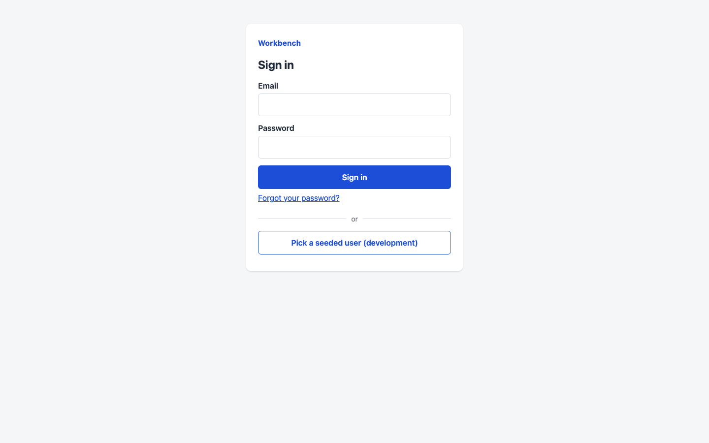
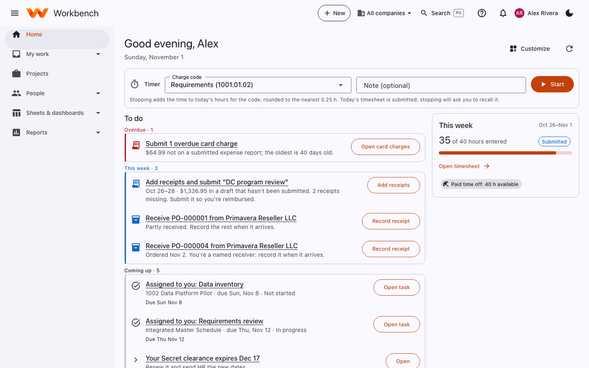
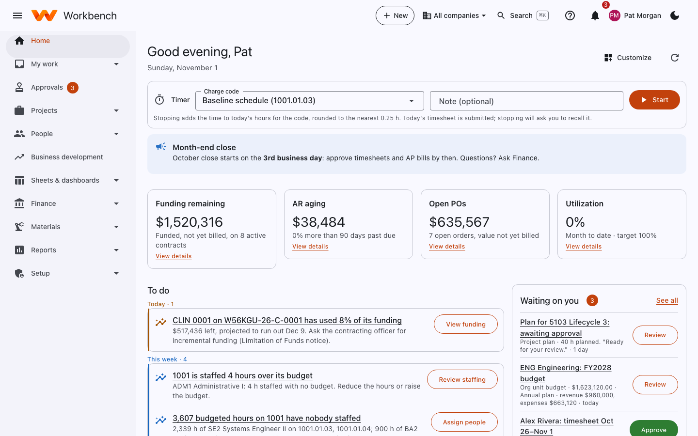

# Signing in and your home page

## Sign in

Open the Workbench address your company gave you. How you sign in depends on how your administrator set it up:

- **With your work account (single sign-on).** Select **Sign in with** your company's identity provider (for example
  Microsoft or Okta) and sign in as you do for email. Your company's password rules and multi-factor authentication apply.
- **With a Workbench account.** Enter your email and password, then the code from your authenticator app. The first
  time, use the link in your invitation email to choose a password and set up the authenticator.

<figure markdown="span">
  { .shot }
  <figcaption>The sign-in page for built-in Workbench accounts.</figcaption>
</figure>

Forgot your password? Select **Forgot your password?** on the sign-in page and follow the emailed link (it works for an
hour). If your account is locked after too many attempts, wait 15 minutes or ask an administrator.

!!! note "Sessions"
    You're signed out after 30 minutes without activity, and after 12 hours in any case. Some sensitive actions, such
    as showing a full bank account number, ask you to confirm it's you again.

## The welcome tour

The first time you sign in, a short tour shaped to your role points out where things are. Use **Next** to step through
it or **Skip tour** to close it. You can take it again any time from the help panel (**?**).

<figure markdown="span">
  { .shot }
  <figcaption>The welcome tour, step 1 of 5, for an employee.</figcaption>
</figure>

## Your home page

**Home** is a to-do list built for you. It shows what's overdue, what's due this week and what's coming up: a timesheet
to submit, an expense report missing receipts, a purchase order to receive, a task assigned to you, or something
waiting for your approval. Each item has a button that takes you straight to it. When there's nothing left you'll see
*You're all caught up*.

<figure markdown="span">
  { .shot }
  <figcaption>An employee's home page: the timer, the to-do list, and This week with hours entered and leave balances.</figcaption>
</figure>

What's on it:

| Part | What it does |
| --- | --- |
| **Timer** | Pick a charge code, add an optional note and select **Start**. Stopping adds the time to today's hours for that code, rounded to the nearest quarter hour. |
| **To do** | Grouped into **Overdue**, **Today**, **This week** and **Coming up**. **Show more** opens the rest of a group. |
| **This week** | Hours entered against your standard hours, your timesheet status, a link to the timesheet and your leave balances. |
| **Waiting on you** | For approvers: the oldest items in your Approvals inbox. Timesheets can be approved right here with **Approve**. |
| **Numbers** | For managers and Finance: tiles such as funding remaining, AR aging, open purchase orders and utilization, each with **View details**. |
| **Announcements** | Notes from Finance or your administrators, such as when the month-end close starts. |

<figure markdown="span">
  { .shot }
  <figcaption>A project manager in Finance sees key numbers, a close reminder and what's waiting for their approval.</figcaption>
</figure>

**Customize** (top right) lets you move the home page's widgets with the arrows and hide the ones you don't need; widgets your administrator pinned stay. Choose **Done** to keep your layout. Your administrator may also
have set up a home page layout for your role (see [Layouts](../admin-guide/customization.md#layouts)).
