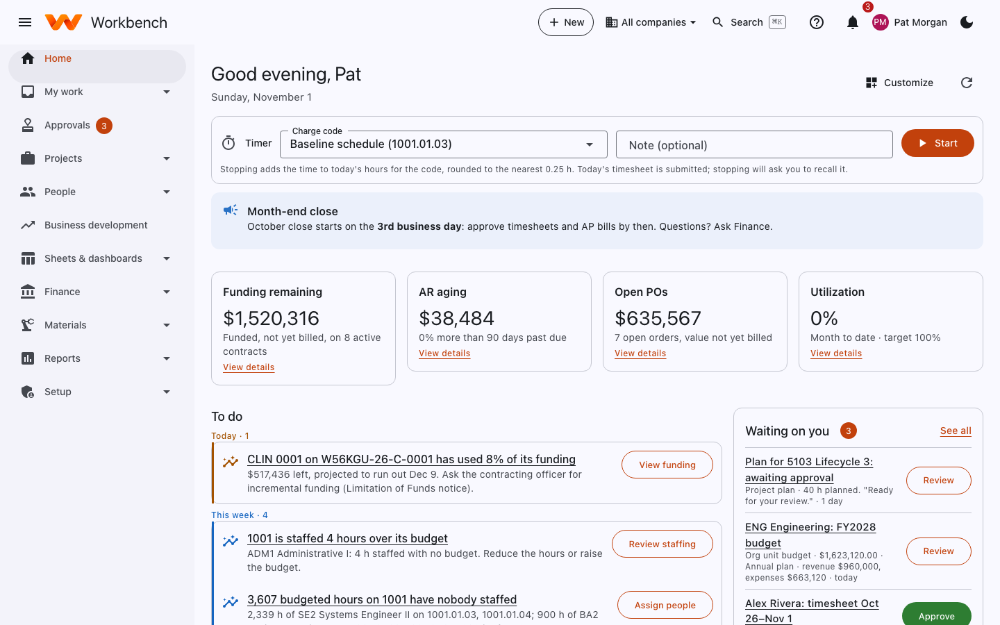

---
hide:
  - navigation
---

# Workbench guide

Workbench is one system for running a government contractor: timesheets that stand up to a DCAA audit, expenses and
travel, projects with their WBS, budgets and plans, billing and the books, purchasing, people, business development and
materials, plus shared sheets, boards, Gantt charts and dashboards for the work in between. It replaces Costpoint,
Unanet, Smartsheet, Asana and Microsoft Project with one place to sign in.

This guide shows you how to use it, page by page, with a screenshot of each.

<figure markdown="span">
  { .shot }
  <figcaption>Your home page is a to-do list built for you. This is what a project manager in Finance sees.</figcaption>
</figure>

## Find your part of the guide

-   :material-rocket-launch-outline:{ .lg .middle } **New to Workbench?**

    ---

    Sign in, learn the menu, the **+ New** button, search and the help panel.

    [:octicons-arrow-right-24: Getting started](getting-started/index.md)

-   :material-clock-outline:{ .lg .middle } **Everyone**

    ---

    Timesheets, expenses and receipts, travel, leave, purchase requests, your profile and benefits.

    [:octicons-arrow-right-24: My work](user-guide/time.md)

-   :material-briefcase-outline:{ .lg .middle } **Project managers and supervisors**

    ---

    Approvals, the project page, planning the WBS, staffing, project costs and earned value.

    [:octicons-arrow-right-24: Projects](user-guide/projects.md)

-   :material-table-large:{ .lg .middle } **Teams**

    ---

    Sheets with grid, board, calendar and Gantt views, automations, forms and dashboards.

    [:octicons-arrow-right-24: Sheets and dashboards](user-guide/sheets.md)

-   :material-bank-outline:{ .lg .middle } **Finance**

    ---

    The general ledger and month-end close, billing and PIEE, payables, cash, assets, payroll, revenue and incurred cost.

    [:octicons-arrow-right-24: Finance guide](finance/index.md)

-   :material-factory:{ .lg .middle } **Materials and manufacturing**

    ---

    Parts and inventory, bills of materials, work orders, MRP, quality, sales orders and shipping.

    [:octicons-arrow-right-24: Materials guide](materials/index.md)

-   :material-account-group-outline:{ .lg .middle } **HR and business development**

    ---

    Positions, onboarding, compensation and benefits; the pipeline, opportunities and proposal pricing.

    [:octicons-arrow-right-24: People and HR](user-guide/people.md)

-   :material-shield-account-outline:{ .lg .middle } **Administrators**

    ---

    First-time setup, users and roles, single sign-on, approval workflows, customization, automation, imports and
    integrations.

    [:octicons-arrow-right-24: Admin guide](admin-guide/index.md)

## What you see depends on your role

Workbench only shows the pages your role uses. An employee's menu has **Home**, **My work**, **Projects**, **People**,
**Sheets & dashboards** and **Reports**; Finance, HR, business development, materials and administrators see more.
If this guide describes a page you can't find, you probably don't need it, or your administrator hasn't given you that
role yet. See [Users, roles and sign-in](admin-guide/users-and-access.md#roles) for who sees what.

!!! tip "Help inside the app"
    Every page in Workbench has a **?** button at the top that opens help for that page. This guide goes into more
    depth and covers the administration that the in-app help leaves out.

## About the screenshots

The screenshots are taken from Workbench's demo data: the company **Workbench Federal Services LLC**, the contract
**W56KGU-26-C-0001 Enterprise Modernization Support** for the U.S. Army PEO EIS, and project **1001 Enterprise
Modernization**. The people in them are the demo users (Alex Rivera, an analyst; Pat Morgan, a program manager in
Finance; Dana Lee, the administrator; and others). Your own screens show your company's data, and may have fields,
labels or layouts your administrator has customized.
