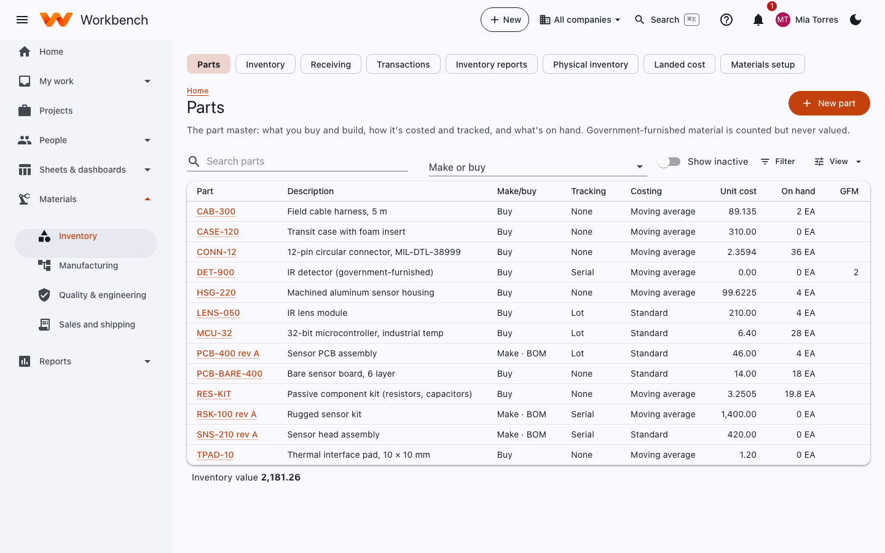
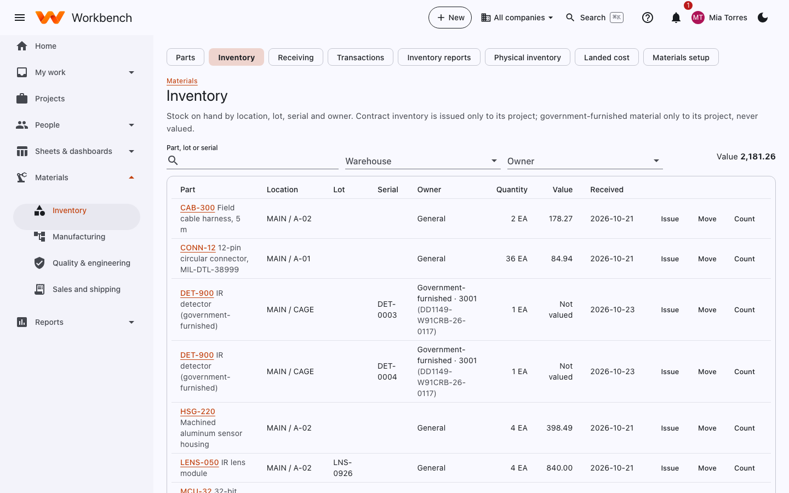

# Parts and inventory

Materials

## Parts

The part master: what you buy and build, how it's costed and tracked, and what's on hand. Government-furnished material
is counted but never valued.

<figure markdown="span">
  { .shot }
</figure>

Select **New part** (or open one) to set:

- **Make or buy**, and for bought parts the preferred vendor and lead time in days.
- **Tracking**: none, by **lot**, or by **serial** number.
- **Costing**: **moving average** or **standard** cost.
- Reorder point and safety stock (used by [MRP](manufacturing.md#mrp)), unit of measure, and revisions.

## Inventory

Stock on hand by location, lot, serial and owner. Contract inventory is issued only to its project; government-furnished
material only to its project, never valued.

<figure markdown="span">
  { .shot }
</figure>

On each row:

- **Issue** sends stock to a project (charging its WBS element) or a work order.
- **Move** transfers it to another location.
- **Count** records a cycle count; differences post as an adjustment.

## Receiving

Purchase order lines waiting to arrive. Receive them into a location, with lot or serial numbers where the part is
tracked. A part with an inspection plan goes to the [inspection queue](quality.md) before it's available. Receiving also
works on a phone or scanner (**Receive on a phone**).

## Transactions

Every receipt, issue, move, count adjustment, build and shipment, with who did it and when. It's the audit trail for
each part.

## Physical inventory

A full count: **Start a count** for a scope (a warehouse or some bins), then **Freeze and write tags** so stock in scope
can't move while it's counted. Count each tag (on paper or **Count on a phone**), review the differences and any
recounts, and post the adjustments in one entry.

## Landed cost

Add freight, duty and other costs that arrive on a separate bill to the receipts they belong to: **New charge**, pick the
receipts, and choose how to spread it. Each receipt's landed unit cost, and the part's cost, is updated.

## Inventory reports

Tabs for **Valuation** as of a date, **Aging**, **Work in process**, **Lot / serial trace** (where a lot or serial came
from and went) and **Government-furnished** material by contract.
