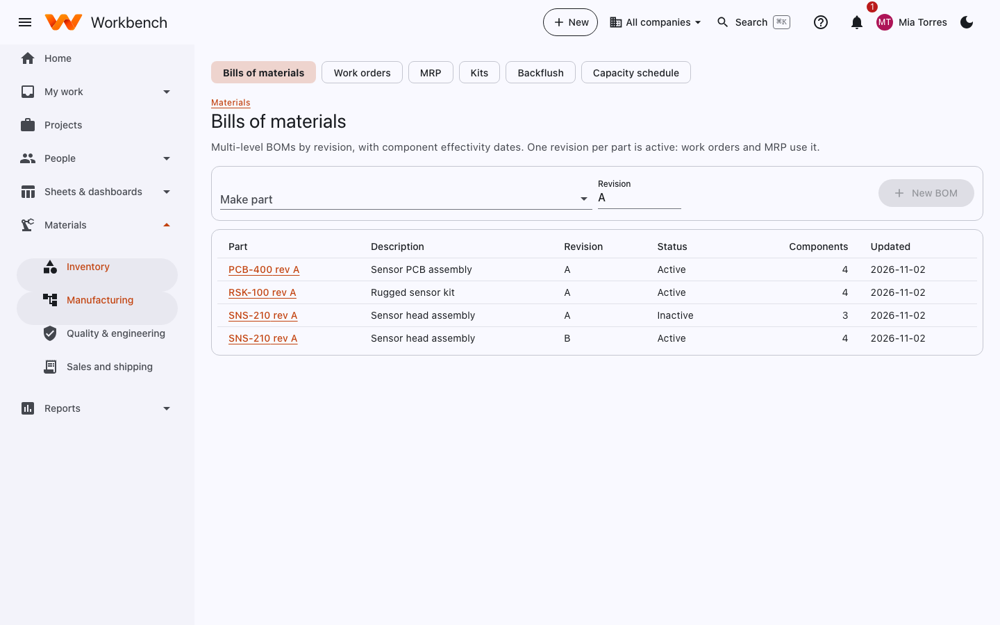
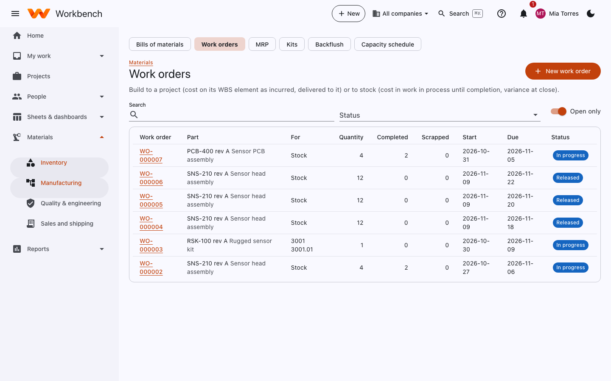
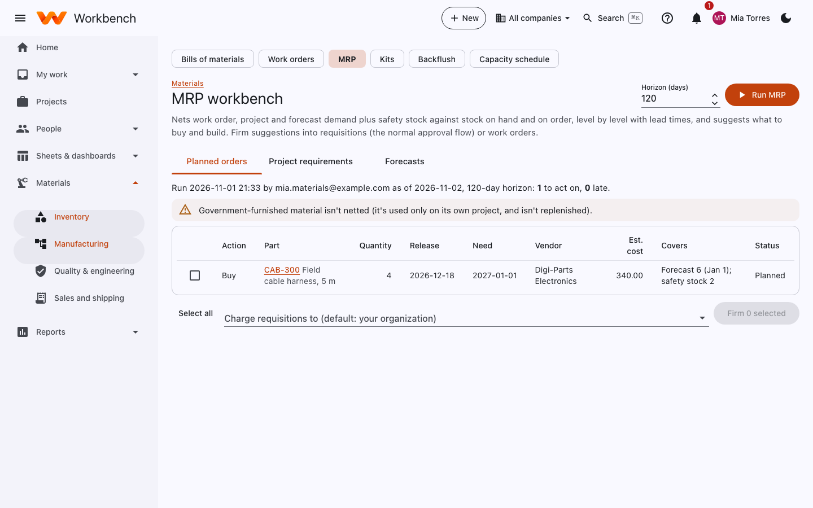

# Manufacturing

Materials · Manufacturing

## Bills of materials

Multi-level BOMs by revision, with component effectivity dates. One revision per part is active: work orders and MRP use
it.

<figure markdown="span">
  { .shot }
</figure>

**New BOM**: pick the make part and the revision, then add components with their quantity per assembly, scrap factor
and effectivity dates. A component can itself have a BOM (a subassembly). Changing an active BOM goes through an
[engineering change](quality.md#engineering-changes).

## Work orders

Build to a **project** (cost on its WBS element as incurred, delivered to it) or to **stock** (cost in work in process
until completion, variance at close).

<figure markdown="span">
  { .shot }
</figure>

1. **New work order**: the part, quantity, dates, and whether it's for stock or a project.
2. **Release** it: the components it needs are reserved and appear on a pick list.
3. Issue the components (or let **backflush** issue them automatically on completion), record labor against the work
   order's charge code, and record completed and scrapped quantities.
4. **Close** it. For stock builds, any difference between actual and standard cost posts as a variance.

**Kits** bundle parts that are issued together without being built (a field kit, a spares package). **Backflush** lists
completions waiting to issue their components. The **capacity schedule** shows released work orders against each work
center's available hours.

## MRP

The MRP workbench nets work order, project and forecast demand plus safety stock against stock on hand and on order,
level by level with lead times, and suggests what to buy and build.

<figure markdown="span">
  { .shot }
</figure>

1. Set the horizon (days) and select **Run MRP**.
2. Review **Planned orders**: what to buy or build, how many, when to release and when it's needed. Late suggestions
   are flagged. **Project requirements** and **Forecasts** show the demand behind them.
3. Tick suggestions and **Firm** them: buys become [requisitions](../user-guide/requisitions.md) (through the normal
   approval flow), builds become work orders. Choose which org unit requisitions are charged to.

Government-furnished material isn't netted against company demand: it's only used on its own contract.
