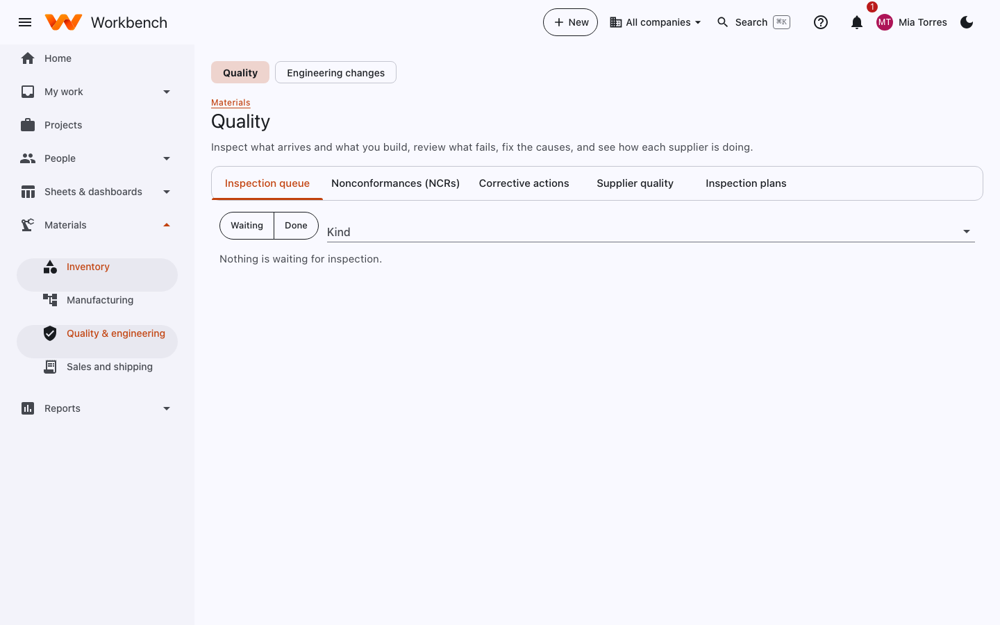

# Quality and engineering

Quality · Materials review board · Change control board

## Quality

Inspect what arrives and what you build, review what fails, fix the causes, and see how each supplier is doing.

<figure markdown="span">
  { .shot }
</figure>

| Tab | What you do there |
| --- | --- |
| **Inspection queue** | Receipts and completed builds waiting for inspection. Record the result for each characteristic; passed stock becomes available, failed stock opens an NCR. |
| **Nonconformances (NCRs)** | What failed, how many, and the disposition: use as is, rework, return to vendor or scrap. Dispositions go to the material review board (and Finance above the threshold) for approval. |
| **Corrective actions** | Root cause and corrective action for repeat or serious nonconformances, with owners and due dates. |
| **Supplier quality** | Each vendor's acceptance rate, NCRs and on-time delivery. |
| **Inspection plans** | Which parts are inspected, at what sample size, and the characteristics to check. |

## Engineering changes

Changes to parts and BOMs (a new revision, a substitute component, a drawing update) are proposed as an **engineering
change**, reviewed by the change control board (and Finance above the threshold), and made effective on a date. Open
work orders and stock affected by the change are listed so you can decide what to do with them.
