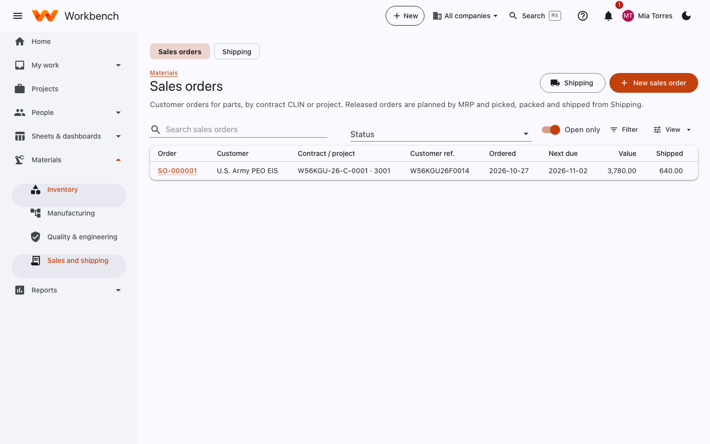
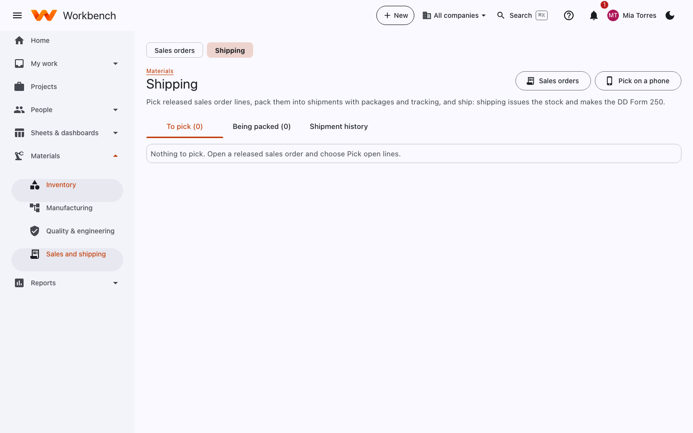

# Sales orders and shipping

Materials · Shipping

## Sales orders

Customer orders for parts, by contract CLIN or project. Released orders are planned by MRP and picked, packed and shipped
from Shipping.

<figure markdown="span">
  { .shot }
</figure>

1. **New sales order**: the customer, the contract and CLIN (or project), the customer's reference, and lines with part,
   quantity, price and due date.
2. **Release** it. MRP plans what's needed, and the lines become available to pick.

## Shipping

Pick released sales order lines, pack them into shipments with packages and tracking, and ship: shipping issues the
stock and makes the DD Form 250.

<figure markdown="span">
  { .shot }
</figure>

1. On a released sales order, select **Pick open lines**. A pick list is made for the warehouse (on paper or **Pick on a
   phone**), which records the lots and serials picked.
2. **Being packed**: pack the picked lines into a shipment, with packages, weights, carrier and tracking numbers.
3. **Ship**. The stock is issued, the sales order line is marked shipped, and the **DD Form 250** (Material Inspection
   and Receiving Report) is generated for government deliveries. Billing can invoice the shipment.

**Shipment history** lists everything shipped with its paperwork.
