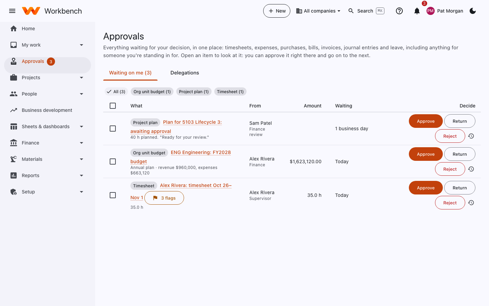

# Approvals

Supervisors, project managers, Finance, and anyone something is waiting on

Everything waiting for your decision is in one place: **Approvals**. It covers timesheets, expense reports, travel,
leave, purchase requisitions, vendor bills, invoices, journal entries, project plans, org unit budgets and HR changes,
including anything for someone you're standing in for. The number beside **Approvals** in the menu is how many are
waiting; your home page lists the oldest under **Waiting on you**.

<figure markdown="span">
  { .shot }
  <figcaption>The Approvals inbox. The chips at the top filter by kind of request.</figcaption>
</figure>

## Approve, return or reject

1. Select an item to see its details: hours by day, expense lines and receipts, what's being bought, the plan.
2. Choose:
    - **Approve** to pass it on (to the next approver, or done).
    - **Return** to send it back for changes, with a comment. The person fixes it and resubmits.
    - **Reject** to end the request, with a reason the person sees.
3. Workbench opens the next item, so you can work down the list.

Tick several items to approve them together. Timesheets can also be approved straight from your home page.

### What to check on a timesheet

- Every working day has hours, including leave and holidays.
- Hours are on the right tasks. You know what your people worked on; if something looks wrong, return it.
- Corrections have a clear reason.
- Any **flags** (for example *3 flags*): weekend hours, entries made late, charges to a code near its ceiling. Flags are
  prompts to look, not reasons to reject.

You can't approve your own timesheet or expenses; those go to your own supervisor (or as your administrator set up the
[approval workflow](../admin-guide/approval-workflows.md)).

## Who approves what

Out of the box:

| Request | Approved by |
| --- | --- |
| Timesheet | The person's supervisor (optionally also the manager of each project it charges) |
| Leave request | The supervisor |
| Expense report | The supervisor |
| Travel request | The supervisor, then the project manager |
| Purchase requisition | The project managers, then Finance over the threshold or for charges with no manager |
| Vendor bill | The project managers of the charged projects (Finance for charges with no manager) |
| Project ODC | The project manager |
| Invoice, journal entry, org unit budget | Finance |
| HR change | HR |
| Pay change | HR, then Finance over the threshold |
| Opportunity gate | Business development |
| Nonconformance (NCR), engineering change | The material review or change control board (Materials), then Finance over the threshold |
| Vendor bank details change | Finance |

When someone would approve their own request, the step is skipped, goes to their supervisor, or waits for another
approver, depending on the kind of request.

Your administrator can change these: see [Approval workflows](../admin-guide/approval-workflows.md).

## Going away? Delegate

On the **Delegations** tab select **Delegate**, then choose a colleague and the dates. While it's active they see your
items in their inbox and can act for you; the record shows they approved on your behalf. Workflows can also send
reminders, and escalate to your supervisor, when items wait too long.
