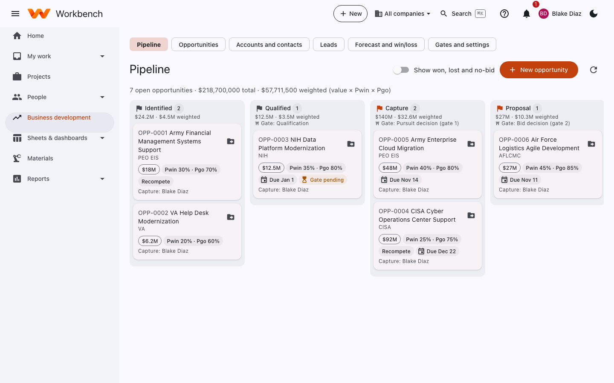
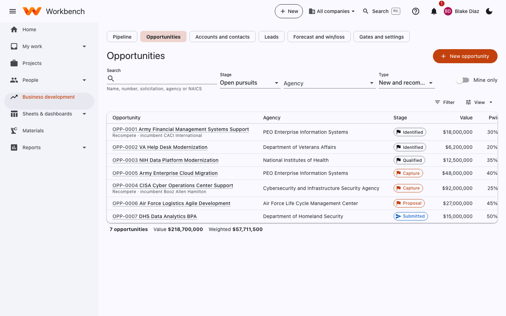
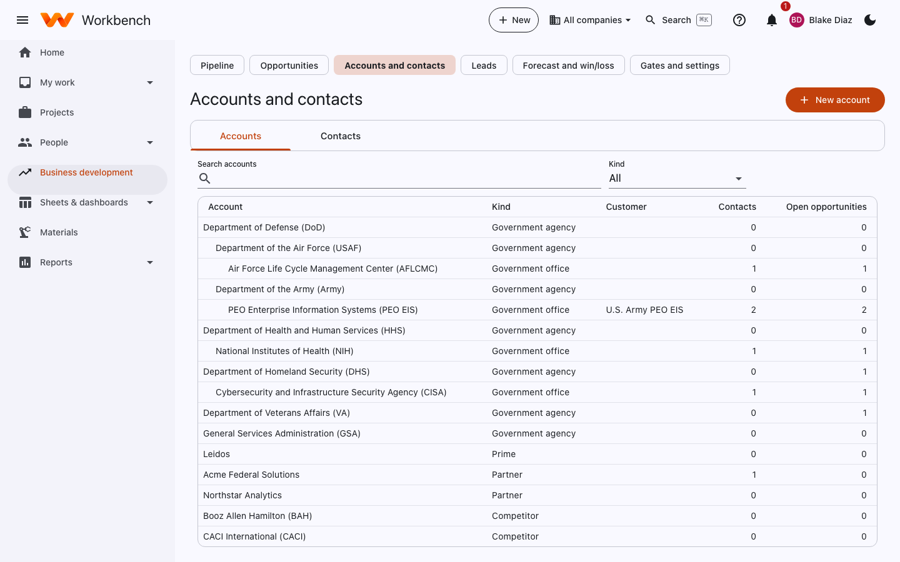
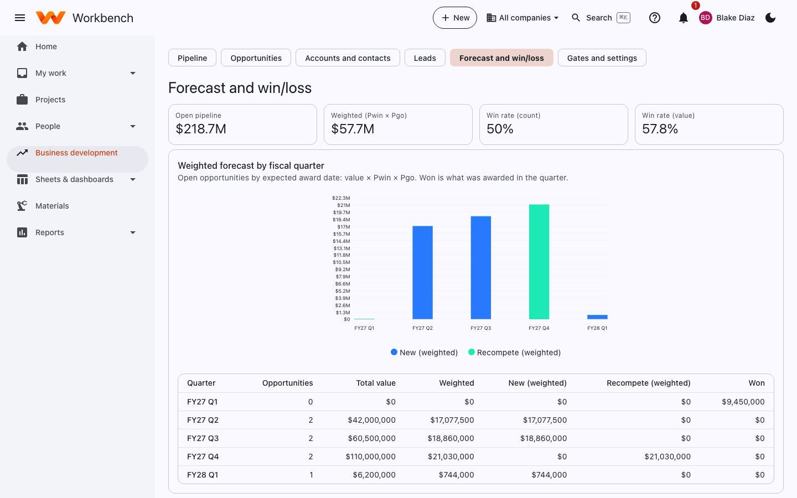

# Business development

Business development · Capture managers · Pricing

The **Business development** pages track pursuits from the first lead to award: the pipeline, opportunities with their
gates, the agencies and people you work with, and the forecast.

## Pipeline

A board of open opportunities by stage (Identified, Qualified, Capture, Proposal, Submitted). Each card shows the value,
Pwin (probability of win) and Pgo (probability the customer goes ahead), the due date and the capture manager. Drag a
card to move it to the next stage; some stages need a gate approval first. The header totals the value and the weighted
value (value × Pwin × Pgo).

<figure markdown="span">
  { .shot }
</figure>

**Show won, lost and no-bid** adds closed opportunities. **New opportunity** starts one.

## Opportunities

The same opportunities as a list you can search and filter: by stage, agency and type (new or recompete). **Mine only**
shows yours.

<figure markdown="span">
  { .shot }
</figure>

Open an opportunity for its tabs:

| Tab | What's there |
| --- | --- |
| **Details** | Solicitation number, agency, NAICS, set-aside, contract type, value, Pwin and Pgo, key dates |
| **Team and competition** | The incumbent, competitors and teaming partners (**Add competitor**, **Add partner**). A company you type by name links to the account of the same name when there is exactly one |
| **Requirements** | The compliance matrix, read from the solicitation (see below) |
| **Gates** | Gate reviews (for example the bid/no-bid decision) and their decisions; a gate goes to an approver |
| **Activity** | Notes, calls and meetings |
| **B&P** | Bid and proposal hours charged to the pursuit, approved and not yet approved |
| **Outcome** | Won, lost or no-bid, with the reasons; for a win, **Create contract and project** sets up the award |
| **History** | Every change |

A [proposal](pricing.md) can be linked to the opportunity to price it.

### Requirements: read the solicitation

On the **Requirements** tab, paste the text of Sections L and M and the work statement, or choose the PDF or Word file,
and select **Read it**. Workbench lists every sentence that says something *shall* or *must* happen or *will be
evaluated*, in the solicitation's own words, with its reference (for example L.3.2). Each line gets:

- a type: **Instruction** (how to write and submit the proposal), **Evaluation** (how it is scored) or **Work to perform**;
- the proposal section that should answer it, which you can change;
- a status (**Open**, **Addressed**, **Not applicable**) and a note, like where it is answered or who owns it.

The tab shows how many lines are addressed, filters by type, and exports the matrix to CSV. Dates it finds, such as
questions due and proposals due, are added to the **Schedule** tab (a date already there is left alone). Reading an
amendment later adds only the lines that are new.

The **Proposal** tab uses the matrix: the "Understanding of the requirement" section lists how the solicitation says
proposals will be judged and what they must contain, and the assistant is told to answer those points. Lines marked
**Not applicable** are left out.

PDFs need a text layer; a scan can't be read, so paste its text instead. Everything on the tab is text from the
document: Workbench never invents a requirement. If the administrator has turned on the
[assistant](../admin-guide/assistant.md), it also drops lines that aren't real requirements and picks each line's type and
section; it never rewrites a line.

## Accounts and contacts

The agencies, offices, primes, partners and competitors you deal with, in a tree (department, agency, office), and the
people at each.

<figure markdown="span">
  { .shot }
</figure>

## Leads

New leads from SAM.gov saved searches (by NAICS code and agency) and CSV imports, waiting to become opportunities.
Select **Pursue** to turn one into an opportunity, or **Dismiss** it. Solicitations already in the pipeline, or seen
before, are skipped.

## Forecast and win/loss

The open pipeline, the weighted forecast by fiscal quarter (new business and recompetes), and your win rate by count and
by value.

<figure markdown="span">
  { .shot }
</figure>

## Gates and settings

Administrators and business development leads set the stages, the gate reviews between them (who approves a bid
decision), and the lists used on opportunities.
