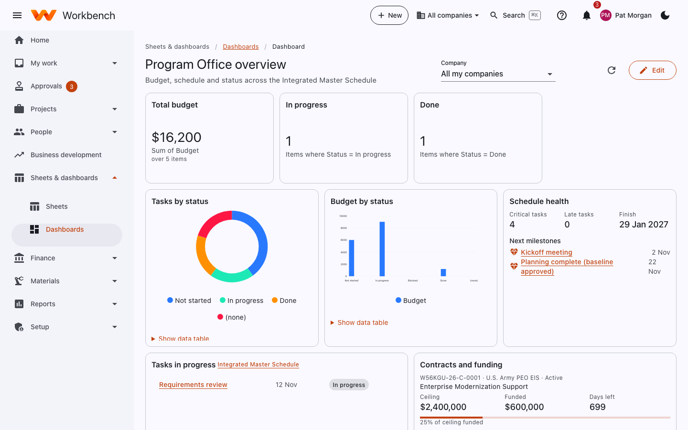
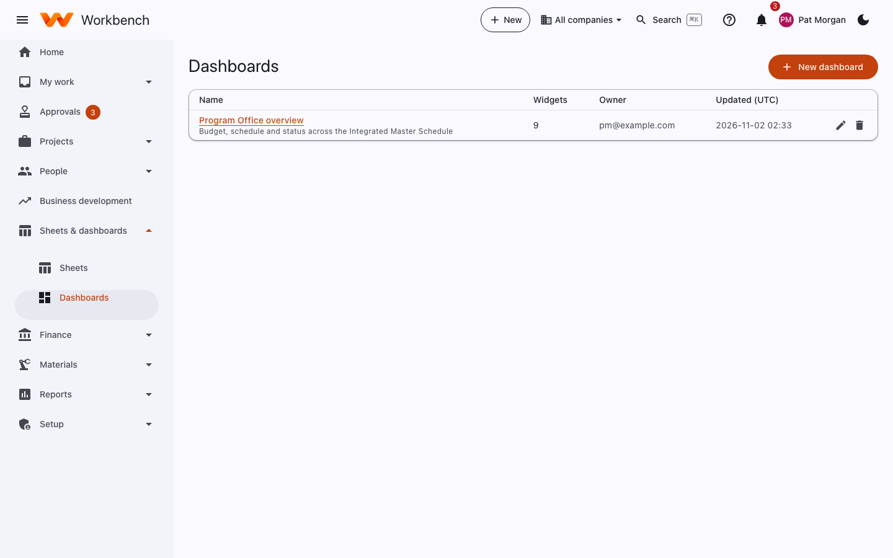

# Dashboards

Everyone · Only a dashboard's owner (or an administrator) can change it

A dashboard brings numbers and charts from your sheets together on one page.

<figure markdown="span">
  { .shot }
  <figcaption>A dashboard built from the Integrated Master Schedule.</figcaption>
</figure>

## Create one

1. Open **Sheets & dashboards › Dashboards** and select **New dashboard**. Give it a name and, if your team should see it,
   put it in your team's workspace.
2. Select **Edit**, then add widgets:
    - **Number**: a count, sum or average of a column, for example *Sum of Budget* or *Items where Status = In progress*.
    - **Chart**: items grouped by a dropdown or person column, counted or summed.
    - **List**: a sheet's items filtered by a column value, sorted by finish date.
    - **Schedule health**: the critical path, late tasks and upcoming milestones of a schedule.
    - **Project financials**: budget, actual cost, EAC and % spent for a project's plan.
    - **Earned value**: CPI, SPI, EAC and the S-curve for a project.
    - **Contract funding**: ceiling, funded value and days left in the period of performance.
    - **Text**: notes and links.
3. Pick the sheet and columns each widget uses. Arrange and resize them, then save.

**Show data table** under a chart shows the numbers behind it. The **Company** filter at the top limits the dashboard to
one company.

<figure markdown="span">
  { .shot }
</figure>

## Sharing

A dashboard in a workspace is visible to that workspace's members. Widgets never show more than you could see on the
sheet itself, so a column hidden from someone stays hidden on the dashboard too. Project financials and earned value
figures are only shown to Finance, administrators and the project's manager.
