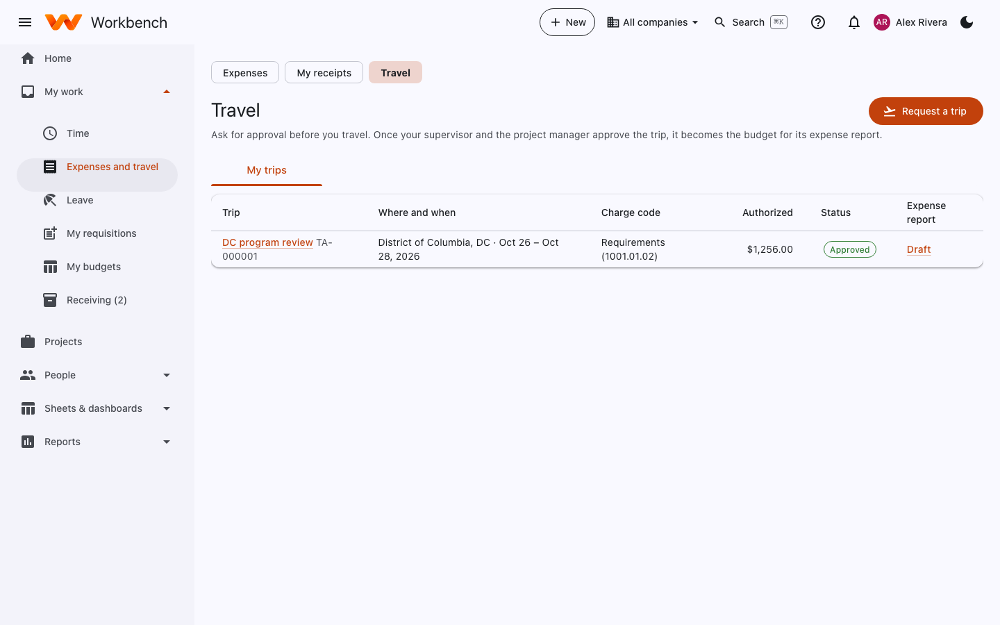
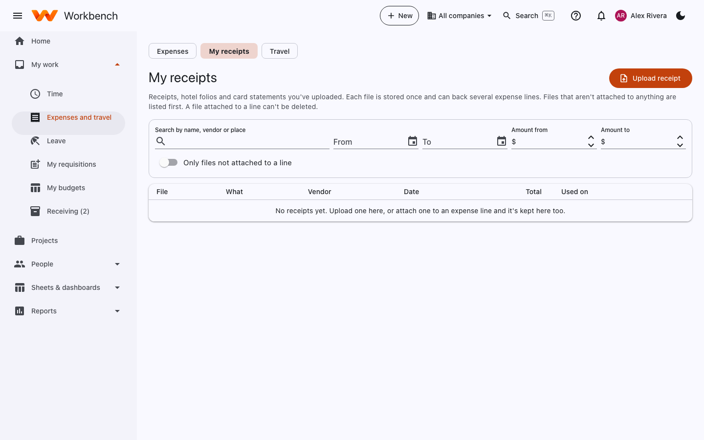
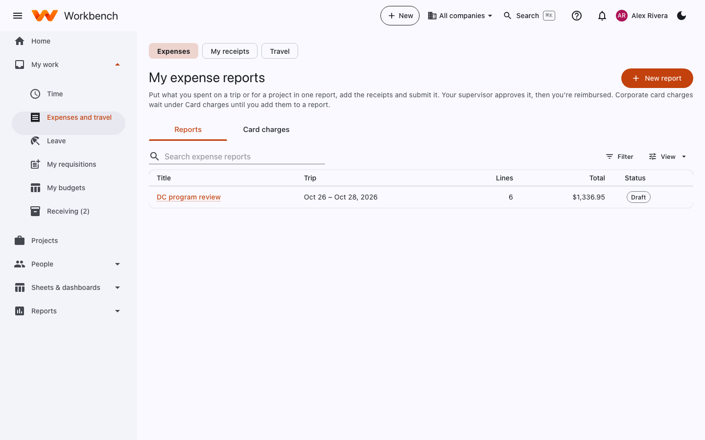
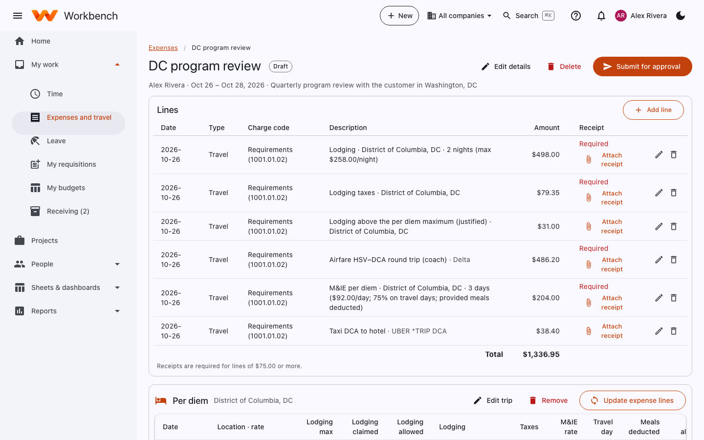

# Expenses, receipts and travel

Everyone · Supervisors approve (and project managers approve trips) · Finance pays and reconciles cards

The three pages under **My work › Expenses and travel** work together:

1. **Travel**: ask for approval before a trip. The approved trip becomes the budget for its expense report.
2. **My receipts**: upload receipts, hotel folios and card statements as you go.
3. **Expenses**: put what you spent in a report, attach the receipts and submit it to be reimbursed.

## Request a trip

Open **Travel** and select **Request a trip**. Enter where and when, the charge code, the purpose, and the estimated
cost (per diem is worked out from the GSA rates for the destination). Your supervisor and the project manager approve
it. You can ask for a travel advance on the request if your company allows it.

<figure markdown="span">
  { .shot }
  <figcaption>An approved trip and the draft expense report that goes with it.</figcaption>
</figure>

## My receipts

**My receipts** holds every receipt, hotel folio and card statement you've uploaded. Each file is stored once and can
back several expense lines. Files that aren't attached to anything are listed first; a file attached to a line can't be
deleted. Select **Upload receipt**, or snap a photo on your phone (see [Workbench on your phone](../getting-started/mobile.md)).
Search by name, vendor or place, date and amount.

<figure markdown="span">
  { .shot }
</figure>

## Expense reports

**Expenses** lists your reports. **Card charges** (the second tab) shows corporate card charges waiting to go on a
report.

<figure markdown="span">
  { .shot }
</figure>

### Start a report and add lines

1. Select **New report** and give it a title, like *DC program review, Oct 26–28*. Link it to the trip if there is one.
2. Select **Add line** for each expense: the date, the type, a description, the amount and the charge code.
3. **Attach receipt** on each line. Receipts are required at or above your company's limit (often $75) and always for
   lodging; lines that need one say **Required** until you attach it.

<figure markdown="span">
  { .shot }
  <figcaption>An expense report for a three-day trip. Lines marked <b>Required</b> still need a receipt.</figcaption>
</figure>

Some costs can't be billed to the government (for example alcohol). Workbench marks them **unallowable**: they're still
reimbursed if company policy allows, but never billed.

### Per diem

Per diem is the daily allowance for lodging and meals that the GSA sets for each city.

1. In the report, open **Per diem** and select **Add a destination** (or **Edit trip**) with the city and your dates.
2. Select **Save and compute**. Workbench works out the daily amounts, including the reduced meal rate on your first and
   last day, and deducts meals that were provided.
3. Select **Update expense lines**. The per diem appears as ordinary lines on your report.

Per diem meals don't need receipts; lodging does. Lodging above the GSA maximum needs a justification and may be
unallowable above it, depending on company policy.

### Submit

Select **Submit for approval**. Your home page reminds you if receipts are missing. Your supervisor approves it; they may send it back with a comment, in which case fix it and submit again.
You get a notification when it's approved and when it's paid.

## Corporate card charges

If you have a company card, Finance imports its statement each month. Your charges show under **Expenses › Card
charges** and as a to-do on your home page. Add each one to an expense report (with its receipt) so it's approved and
coded to the right charge code. Charges left too long appear as **Overdue** on your home page.

Finance follows charges through to approval on **Finance › Cash › Corporate cards**; see
[Cash, banks and cards](../finance/cash.md#corporate-cards).
