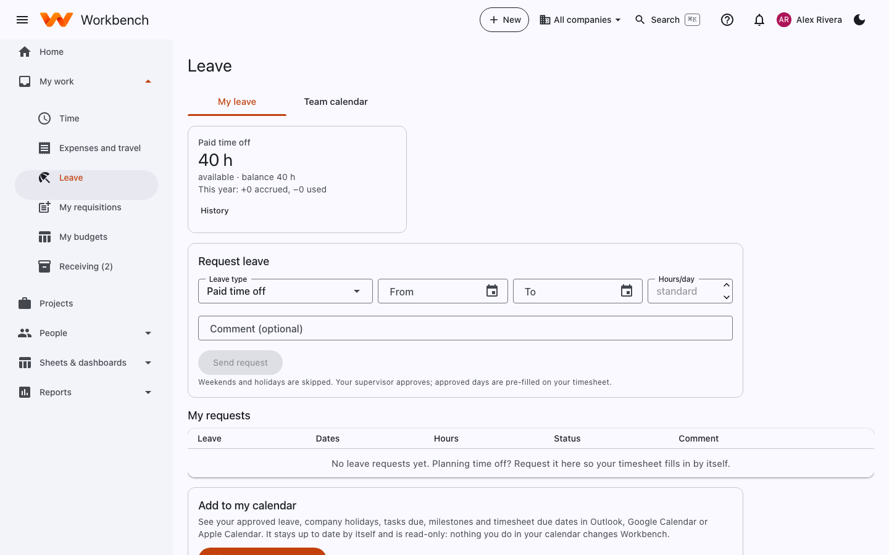

# Leave

Everyone · Supervisors approve

Open **My work › Leave**.

<figure markdown="span">
  { .shot }
</figure>

## Check your balance

Each balance (for example **Paid time off**) shows what's available, the balance, and what's been accrued and used this
year. **History** lists every accrual, use and adjustment. Your home page shows the same balances under **This week**.

## Request time off

1. Under **Request leave**, pick the leave type, the dates and the hours per day, and add a comment if you like.
   Weekends and holidays are skipped.
2. Select **Send request**. Your supervisor is notified.
3. When it's approved, the days are pre-filled on your timesheet.

Approved leave still goes on your timesheet on the leave charge code (for example *Paid time off*): that's what takes the
hours off your balance. Holidays go on the *Holiday* code and don't use a balance.

!!! tip
    Request long trips early. Approved leave reduces your available hours in [resource planning](resourcing.md), so your
    project manager can plan around it.

## Team calendar

The **Team calendar** tab shows who on your team is out and when, so you can plan around each other.

## Add to my calendar

**Get my calendar link** gives you a private address for a calendar feed of your approved leave, company holidays, tasks
due, milestones and timesheet due dates. Add it to Outlook, Google Calendar or Apple Calendar as a subscribed calendar;
it stays up to date by itself. The feed is read-only. If the link is ever shared by mistake, make a new one: the old link
stops working at once.
