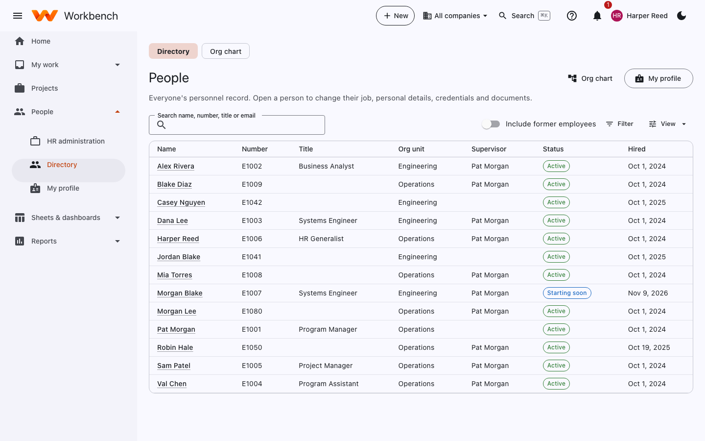
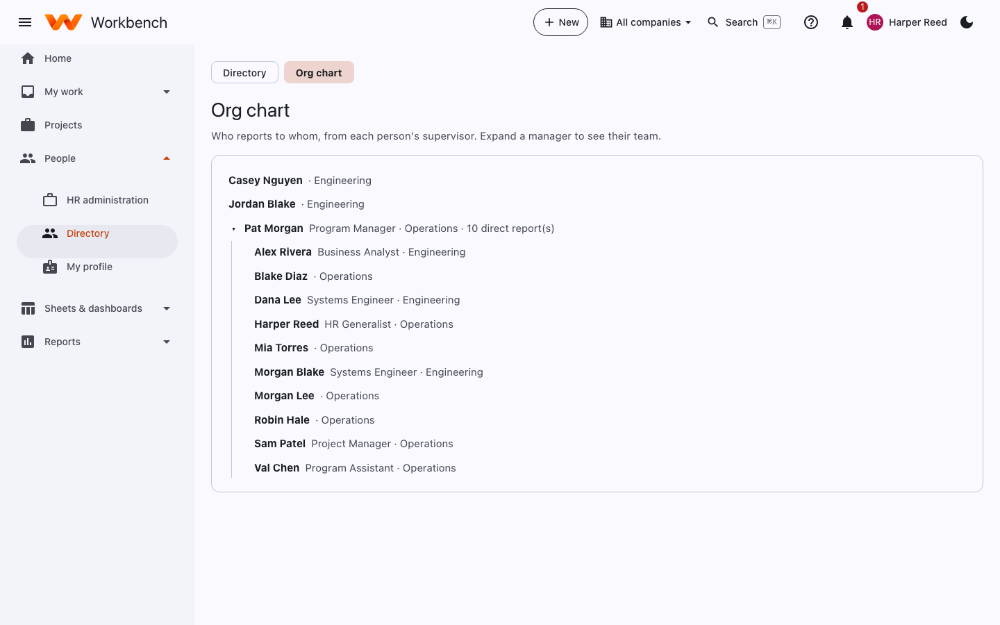
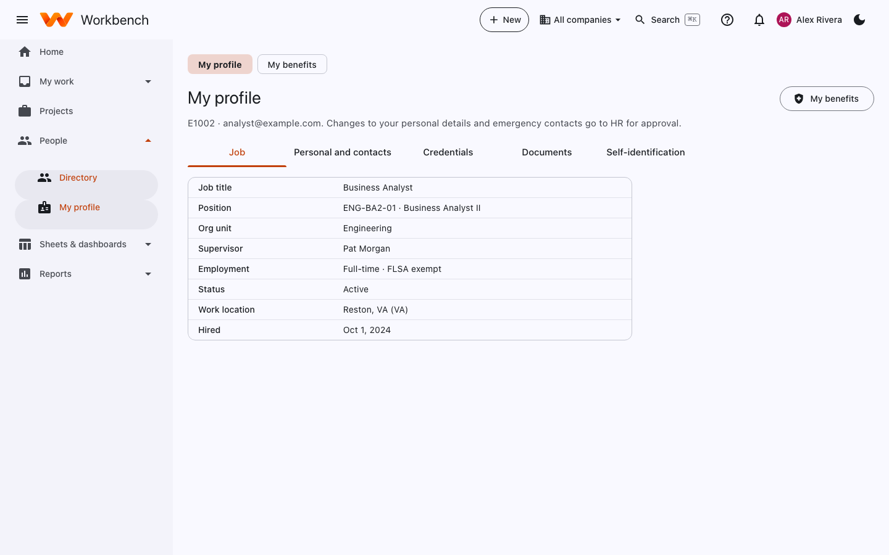
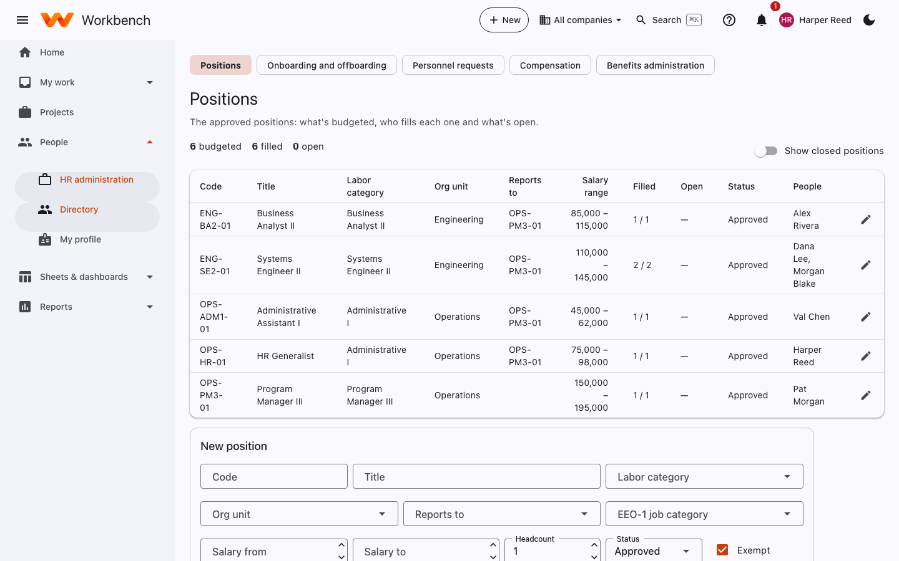
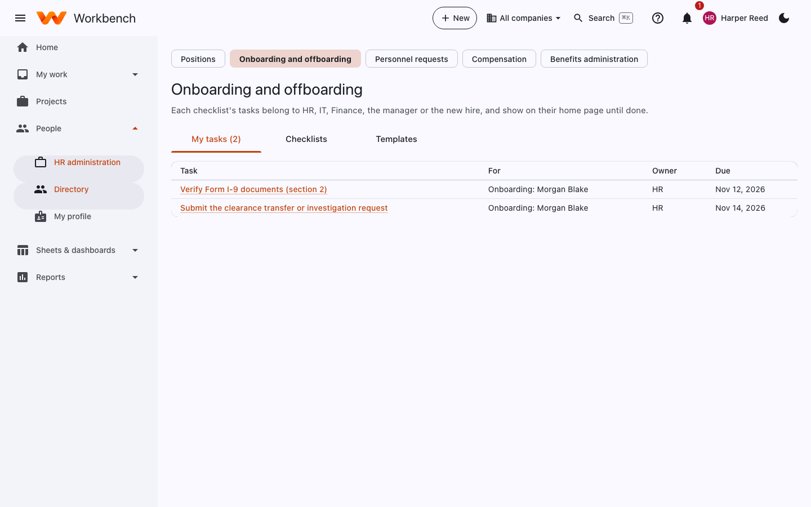
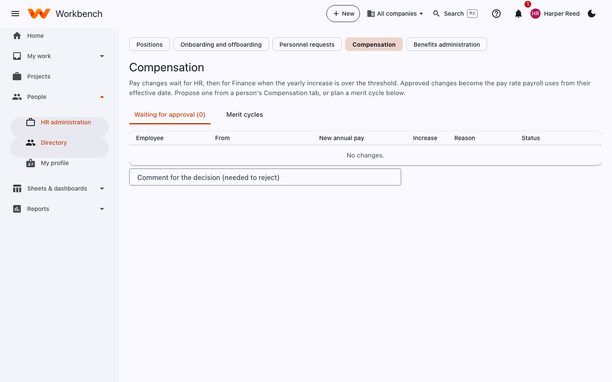
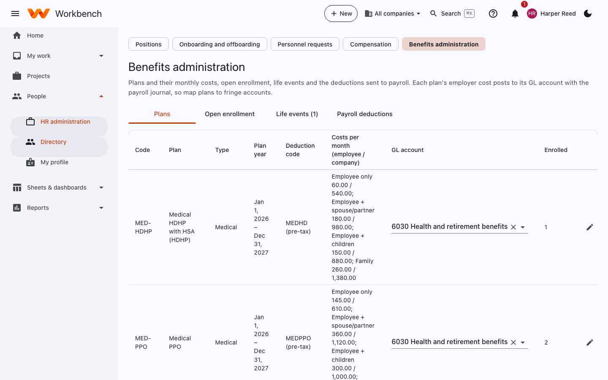
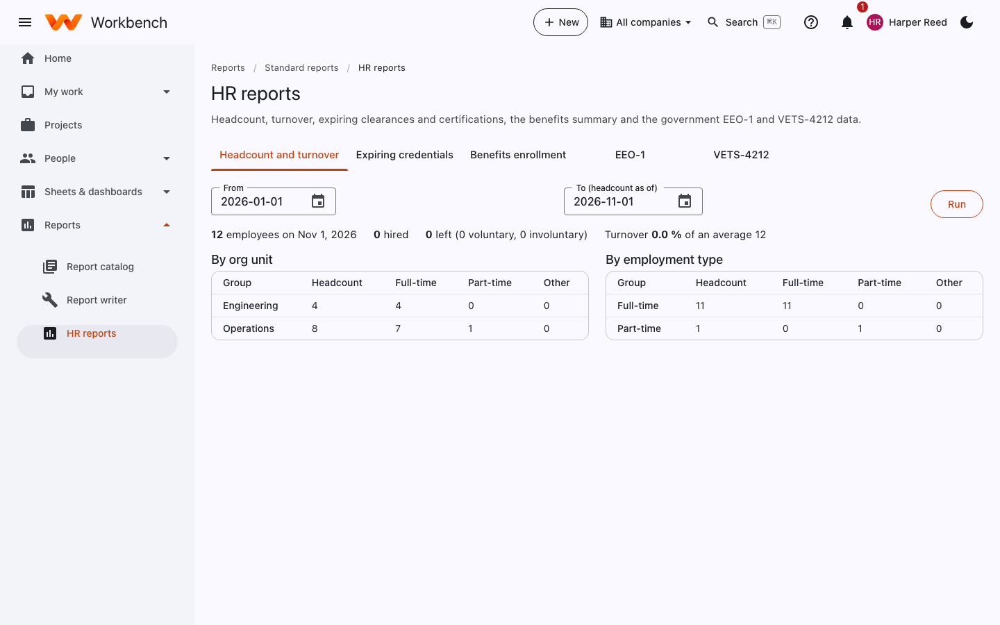

# People and HR

Everyone sees the directory and their own profile · HR administers

## For everyone

### Directory and org chart

**People › Directory** lists everyone with their number, title, org unit, supervisor, status and hire date. HR sees
everyone's full personnel record; everyone else sees the directory details.

<figure markdown="span">
  { .shot }
</figure>

**Org chart** shows who reports to whom, from each person's supervisor. Expand a manager to see their team.

<figure markdown="span">
  { .shot }
</figure>

### My profile

**People › My profile** is your own personnel record. Changes to your personal details and emergency contacts go to HR
for approval.

<figure markdown="span">
  { .shot }
</figure>

| Tab | What's there |
| --- | --- |
| **Job** | Title, position, org unit, supervisor, employment type (for example full-time, FLSA exempt), work location, hire date |
| **Personal and contacts** | Address, phone and emergency contacts |
| **Credentials** | Clearances, certifications and licenses with their expiry dates. You get a to-do before one expires. |
| **Documents** | Files HR has shared with you or asked you for |
| **Self-identification** | Voluntary gender, ethnicity, veteran and disability information for government reporting (EEO-1, VETS-4212) |

### My benefits

**My benefits** shows the plans you're enrolled in, your dependents and what's deducted from your pay. During open
enrollment, or after a life event (marriage, a birth), you choose your plans here.

## For HR

The **HR administration** pages are under **People** for people with the HR role.

### Positions

The approved positions: what's budgeted, who fills each one and what's open, by labor category, org unit and salary
range. **Add position** opens a new requisition to hire against.

<figure markdown="span">
  { .shot }
</figure>

### Onboarding and offboarding

Checklists of tasks for each new hire or leaver. Each task belongs to HR, IT, Finance, the manager or the new hire, and
shows on their home page until done. **Templates** define the standard checklists; **Checklists** lists the ones in
progress; **My tasks** is yours.

<figure markdown="span">
  { .shot }
</figure>

### Personnel requests

Changes to a person's job (title, org unit, supervisor, status) and their personal details wait here for HR approval.

### Compensation

Pay changes wait for HR, then for Finance when the yearly increase is over the threshold. Approved changes become the pay
rate payroll uses from their effective date. Propose one from a person's **Compensation** tab, or plan a **merit
cycle** for everyone at once.

<figure markdown="span">
  { .shot }
</figure>

### Benefits administration

Plans and their monthly costs, open enrollment, life events and the deductions sent to payroll. Each plan's employer cost
posts to its GL account with the payroll journal, so map plans to fringe accounts.

<figure markdown="span">
  { .shot }
</figure>

| Tab | What you do there |
| --- | --- |
| **Plans** | Add and edit plans: type, plan year, deduction code, employee and employer cost by coverage level, GL account. |
| **Open enrollment** | Open a window, see who has chosen, send reminders, close it. |
| **Life events** | Review requests to change plans outside open enrollment. |
| **Payroll deductions** | The deductions to send to payroll for a pay period. |

### HR reports

**Reports › Standard reports › HR reports**: headcount and turnover, expiring clearances and certifications, benefits
enrollment, and the government **EEO-1** and **VETS-4212** data.

<figure markdown="span">
  { .shot }
</figure>

!!! note "Employees and users"
    The personnel record (HR) and the employee record used for time and cost rates (**Admin › Setup › People**) are the
    same person. Cost rates and labor categories are set in Setup; see [Organization and calendars](../admin-guide/organization.md#people).
