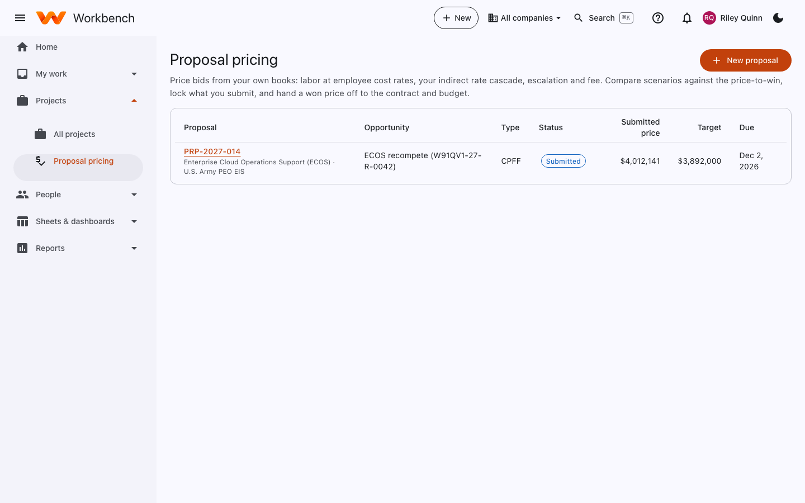
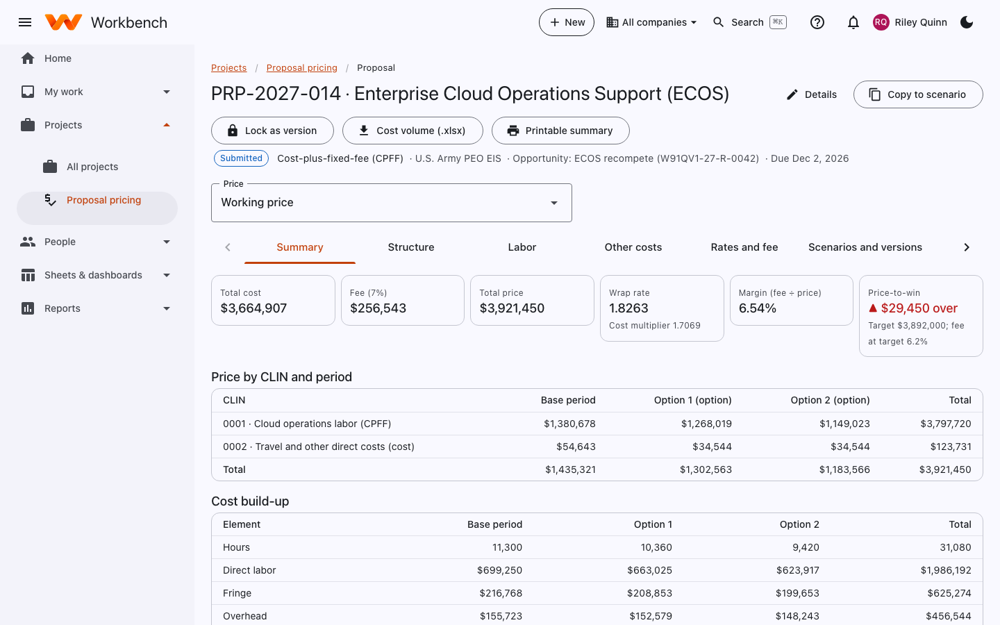

# Proposal pricing

Pricing

**Projects › Proposal pricing** prices bids from your own books: labor at employee cost rates, your indirect rate
cascade, escalation and fee. Compare scenarios against the price-to-win, lock what you submit, and hand a won price off
to the contract and budget.

<figure markdown="span">
  { .shot }
</figure>

Select **New proposal** and link it to an opportunity from [Business development](business-development.md). Pick the
contract type (FFP, T&M, CPFF and so on), the periods (base and options) and the customer.

## The proposal

<figure markdown="span">
  { .shot }
  <figcaption>The Summary tab: price, fee, wrap rate and margin, compared with the price-to-win.</figcaption>
</figure>

| Tab | What you do there |
| --- | --- |
| **Summary** | Total cost, fee, total price, wrap rate and margin; price-to-win against target; price by CLIN and period; the cost build-up (direct labor, fringe, overhead, G&A, other costs, fee). |
| **Structure** | CLINs, periods of performance and the WBS the price is built on. |
| **Labor** | Labor categories and named or generic people, hours by period, cost rates and escalation. |
| **Other costs** | Travel, materials, subcontracts and other direct costs by period. |
| **Rates and fee** | The indirect rates used (forward pricing, provisional or what-if) and the fee or profit rate. |
| **Scenarios and versions** | Copies of the proposal with different assumptions, side by side; locked versions. |
| **Won handoff** | When the bid is won, send the price to the contract (bill rates, CLINs) and the project budget. |

Buttons along the top:

- **Copy to scenario** makes a what-if copy to compare.
- **Lock as version** freezes what you're submitting; later edits go into a new version.
- **Cost volume (.xlsx)** exports the cost volume workbook for the proposal.
- **Printable summary** opens a summary to print or save as PDF.
