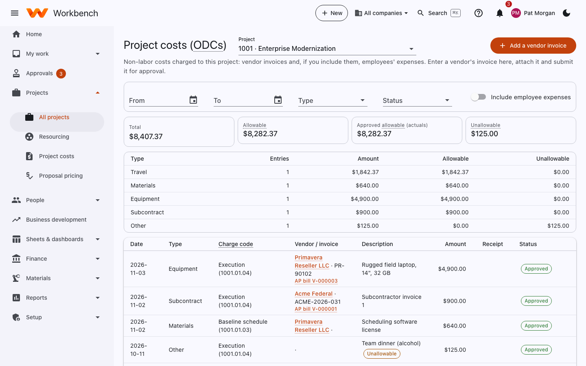

# Project costs (ODCs)

Project managers · Finance

**Projects › Project costs** shows the non-labor costs charged to a project: vendor invoices, travel, materials,
equipment, subcontracts and, if you include them, employees' expenses. Pick the project at the top.

<figure markdown="span">
  { .shot }
</figure>

- The tiles show the total, what's **Allowable**, what's been approved, and what's **Unallowable** (recorded but never
  billed).
- The summary breaks costs down by type.
- The list shows each cost with its date, type, charge code, vendor or invoice, description, amount, receipt and status.
  Filter by dates, type and status; **Include employee expenses** adds approved expense report lines.

## Add a vendor invoice

For a small vendor charge that doesn't go through purchasing, select **Add a vendor invoice**: the vendor, invoice
number and date, the charge code, the type, the amount and a description. Attach the invoice and submit it. The project
manager approves it, and it posts to the project's cost.

Bills that come from a purchase order are entered by Finance under [Payables](../finance/payables.md); they appear here
too once approved.
