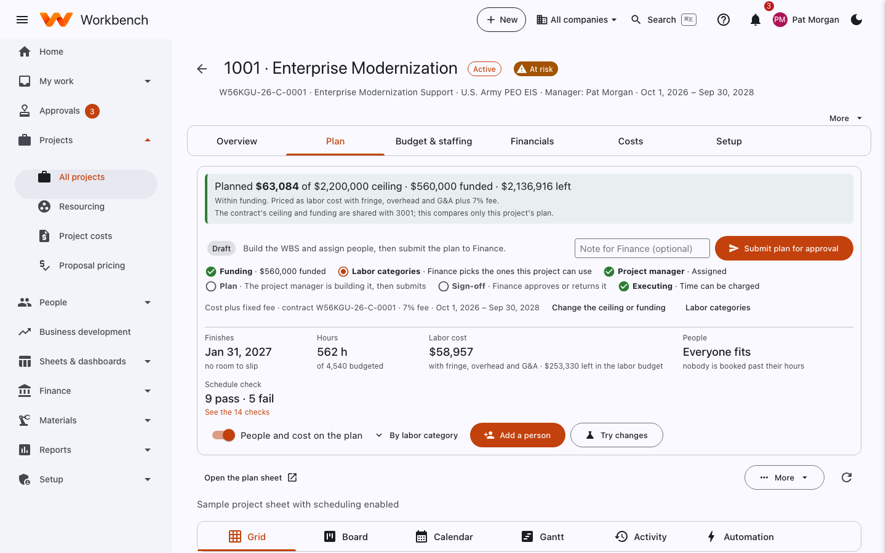

# Planning a project

Project managers build the plan · Finance approves it

A project's plan and its WBS are the same tree. Every row you add is a WBS element; the lowest rows are the charge codes
people record time against (milestones aren't). Open the project and select the **Plan** tab.

<figure markdown="span">
  { .shot }
  <figcaption>The top of the Plan tab: the money against the ceiling, where approval stands, and a summary of the plan.</figcaption>
</figure>

## The summary at the top

- **Planned … of … ceiling · … funded · … left**: what the plan costs (labor with fringe, overhead, G&A and fee) against
  the contract's ceiling and funding. **Change the ceiling or funding** and **Labor categories** link to the contract. While a new project is waiting on setup, Finance sees a **Set up for planning** checklist at the top: contract funding (with a button to the contract), labor categories (pick them, or **Use the contract's categories**), and the project manager. **Tell the project manager** sends the notification that it is ready to plan.
- **The status line**: Draft, live, with Finance or returned. Within the contract's money there is nothing to submit:
  the plan goes live as you build it. Past it, **Send to Finance for approval** (with an optional note) appears. The checklist shows Funding, Labor categories, Project manager, Plan, Sign-off and Executing.
- **Finishes / Hours / Labor cost / People**: the plan's finish date and slack, hours against the budget, labor cost,
  and whether everyone fits their available hours.
- **Schedule check**: checks such as tasks without dates, links that go backwards, or summary tasks with resources.
  **See the checks** lists them.
- **People and cost on the plan** shows hours and cost per row; **By labor category** groups them. **Add a person**
  staffs someone; **Try changes** lets you test a change (a later start, more people) without saving it.

## Build the WBS

Scroll down to the plan grid.

<figure markdown="span">
  { .shot }
  <figcaption>The plan grid (tasks) and, below it, the People grid (who does them).</figcaption>
</figure>

The grid works like Microsoft Project:

- Type a task in **Type a task and press Enter**, or press ++enter++ after the last task's name to start the next one.
- ++tab++ makes a task a subtask of the one above; ++shift+tab++ moves it back out (or ++alt+shift+right++ /
  ++alt+shift+left++, or the row menu). **Add subtask** adds one under the selected task; **Insert** adds a row above.
- **Summary tasks** (tasks with subtasks) take their start, finish, duration and % complete from their subtasks.
- **Duration** is in working days, Monday to Friday less company holidays. Type it and the finish follows from the start.
  **0** makes a milestone.
- **Predecessors** use the task IDs in the left column: `3`, `3, 5`, or `5SS+2d` (start-to-start with 2 days' lag;
  FF and SF work too). Moving one task pushes the tasks that wait on it.
- WBS codes are numbered for you under the parent (the third subtask of 1001.02 is 1001.02.03) and follow rows when you
  move them. A code you type yourself is kept; clear it to get the automatic one back.
- Once time has been charged to a code it keeps its code, and its row can't be deleted (close the code in Setup instead).

The plan's own tabs (**Grid**, **Board**, **Calendar**, **Gantt**, **Activity**, **Automation**) work as they do on any
sheet: see [Sheets](sheets.md). **Open the plan sheet** opens it full screen.

## Assign people

In the **People** grid under the plan, type a person, task, labor category, hours and dates in the last row, or paste
rows from Excel. **Total hours** / **By week** switches between entering a total and week-by-week hours. A warning
appears when someone is booked over their available hours, or on a holiday.

## Excel

Use **Import / export** (or **More › Excel**) on the plan:

- **Export plan to Excel** downloads the plan with task names indented and grouped by outline level: ID, outline number
  and level, WBS code, name, duration, start, finish, predecessors, % complete, resource names and notes.
- **Import plan from Excel** reads a file in the same layout. You see what it adds, changes and removes, and any rows
  with problems, before anything is saved. The file is the whole plan, so rows deleted in Excel are removed.
- **Download blank template** gets an empty workbook with the columns and instructions.

## Going live, and when Finance gets involved

You don't submit a plan that stays within the contract's money: it goes live as you build it.

- **Within the contract's money, it goes live by itself.** A plan whose labor cost is at or under the project's ceiling
  (or its funding, when there is no ceiling) becomes the project's budget at once, and the charge codes open for
  charging. Changes after that go live the same way, whether they add hours or take them away. The status line says
  "Live", and Finance isn't asked. If something is still wrong (someone is overbooked, a schedule check fails), the
  plan waits and the button reads **Make it live**; it lists what's open first.
- **Past the contract's money, Finance reviews it.** **Send to Finance for approval** appears instead; Finance
  approves it or returns it with comments, and the note you add goes with it. A plan with no ceiling or funding to
  measure against also goes to Finance.

After approval, changes to the plan are tracked against the baseline; the Gantt chart can show the baseline beside
today's plan.
