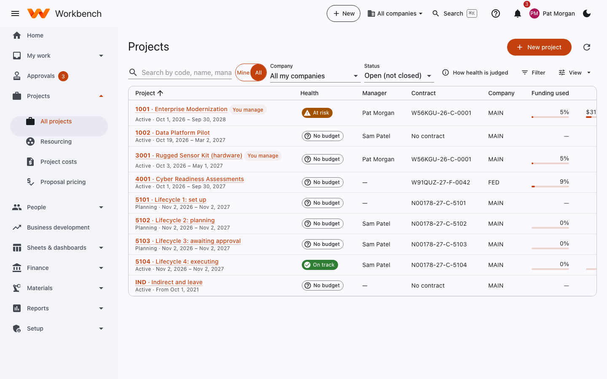
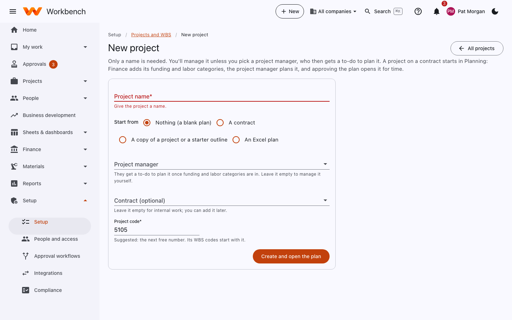
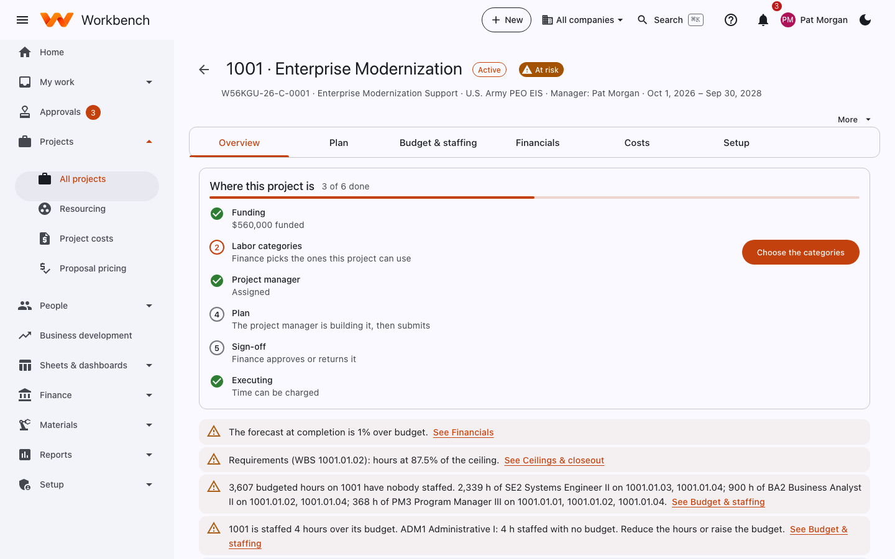
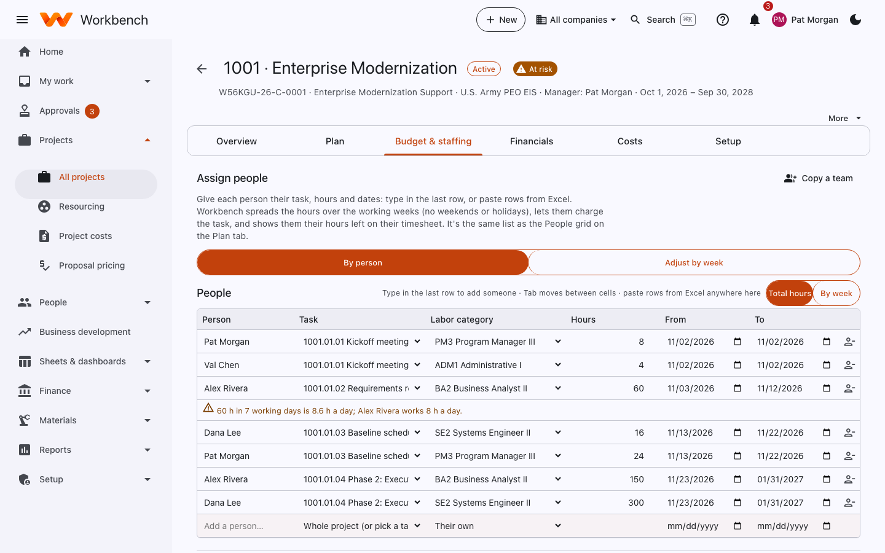
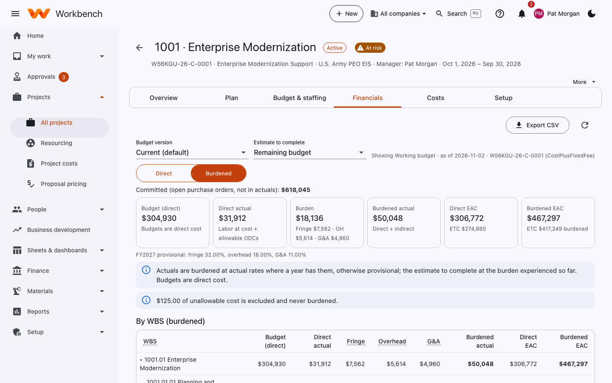

# Projects and the project page

Everyone sees the projects they work on · Project managers and Finance see the money

## All projects

**Projects › All projects** lists the projects you manage or charge to (**Mine**), or every project you're allowed to see
(**All**). For each one: its health, manager, contract, company, how much of the funding is used, spend against budget,
forecast against budget, and open tasks. **How health is judged** explains the badges.

<figure markdown="span">
  { .shot }
</figure>

### Health, in plain words

| Badge | Means |
| --- | --- |
| **On track** | Spend, forecast and funding are all within limits. |
| **At risk** | The estimate is a little over budget, spending is running well ahead of the schedule, or 90% of the funding is used. |
| **Over** | Spend is past the budget, the estimate at completion (EAC) is more than 5% over budget, or the funding is used up. |
| **No budget** | Nothing to judge it against yet. |

## Start a project

Select **New project** (or **+ New › Project**). Only a name is needed: the code is suggested (the next free number),
you're the project's manager unless you pick someone else, and the contract is optional.

<figure markdown="span">
  { .shot }
</figure>

Choose where it starts from:

- **Nothing (a blank plan)**: an empty plan to fill in.
- **A contract**: its period of performance sets the dates, its CLINs become the top of the WBS, and its labor-category
  hours start the budget when the contract has them.
- **A copy of a project or a starter outline**: a project's tasks, durations and links move to the new start date
  (people, budgets and costs aren't copied), or common phases to rename and fill in.
- **An Excel plan**: a plan workbook (an export, or the blank template). It's checked before the project is created.

Select **Create and open the plan**. A project on a contract starts in **Planning**: Finance adds its funding and
labor categories, you plan it, and when Finance approves the plan the project opens for time. See
[Planning a project](project-plan.md).

## The project page

Open a project from the list. The header shows its code and name, status and health, the contract, customer, manager
and period of performance. The tabs below hold everything about it.

<figure markdown="span">
  { .shot }
  <figcaption>The Overview tab: the setup checklist and what needs attention.</figcaption>
</figure>

| Tab | What it shows |
| --- | --- |
| **Overview** | Health, spend against budget, funding used, what needs your attention (forecast over budget, hours near a ceiling, unstaffed budget), and the setup steps with a button for each. |
| **Plan** | The WBS and schedule in one grid: rows, dates, predecessors, people, hours and cost, the money against the ceiling, approval, and the Gantt chart. See [Planning a project](project-plan.md). |
| **Budget & staffing** | The budget by labor category and WBS, your estimate at completion, and the people staffed into each category. |
| **Financials** | Cost, revenue and margin by WBS element, direct or burdened, against budget and EAC, with committed cost from open purchase orders. |
| **Costs** | Other direct costs (ODCs): vendor invoices, travel, materials. See [Project costs](project-costs.md). |
| **Setup** | For those who set the project up: details, charge codes and who can charge them, syncing with the plan, ceilings and closeout. |

**More** (top right) holds pages used now and then: revenue, earned value (CPI, SPI), the monthly narrative and variance
explanations, ceilings and closeout, and the customer view link.

### Budget & staffing

The budget says how many hours of each labor category, and how many dollars of other costs, each WBS element may use.
Staffing puts people against it.

<figure markdown="span">
  { .shot }
</figure>

- **Assign people**: type each person's task, hours and dates in the last row, or paste rows from Excel. Workbench spreads
  the hours over the working weeks and tells you when someone is booked past their hours.
- **Copy a team** brings the staffing of another project.
- **By person** / **Adjust by week** switch between total hours and a week-by-week grid.
- Budget versions: **New version**, **Copy**, **Create from plan sheet**, **Lock baseline**, **Promote to Current** and
  **Reprice** (recompute the cost at current rates). Add rows with **Add labor row** and **Add ODC row**.

### Financials

<figure markdown="span">
  { .shot }
</figure>

Switch between **Direct** and **Burdened** (with fringe, overhead and G&A). Actuals are burdened at actual rates when a
year has been finalized, otherwise at provisional rates. Unallowable cost is shown but never burdened or billed.
**Export CSV** downloads the table.

### Ceilings and funding

Contracts limit what can be spent: a ceiling (the most the customer will pay) and funding (what's actually been
obligated so far), sometimes by CLIN or by labor category hours. The project warns you as you approach a limit, and
notifies its manager as each threshold is crossed (for example 75% and 80% of a CLIN's funding, or 85% of a task's hours ceiling). When a charge code reaches a hard ceiling, charging to it is
blocked until Finance raises the limit. Check **More › Ceilings** for warnings before that happens.

### Customer view

Finance can give a contracting officer a read-only link to a contract's funding and invoice status, which they open
without a Workbench account. The link can be revoked at any time. See [Customer view](../security/customer-view.md).

## Things to do every month

1. Review your EAC (estimate at completion). Your home page reminds you when it's due.
2. Approve your team's timesheets and expenses on time.
3. Explain any variances that are due (the monthly narrative).
4. Watch the ceilings for warnings before charging is blocked.
