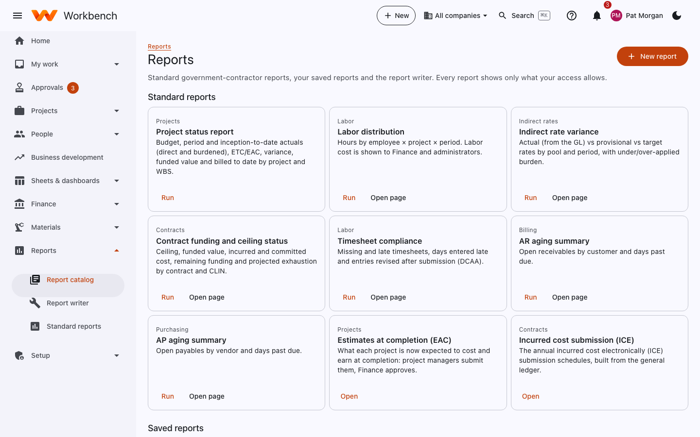
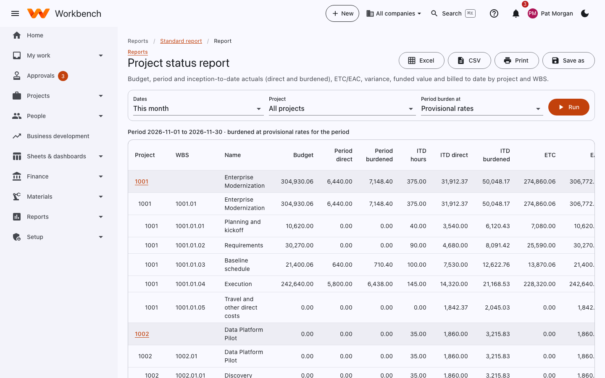
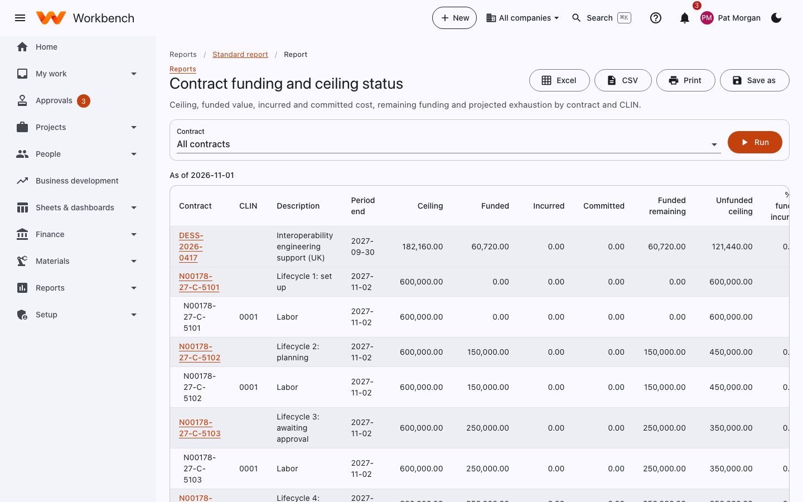
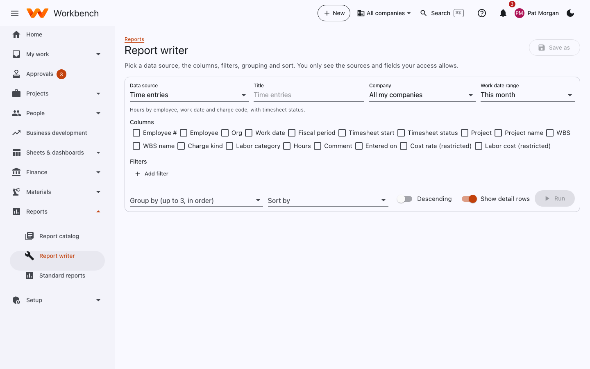

# Reports

Everyone · Every report shows only what your access allows

**Reports › Report catalog** lists the standard government-contractor reports, your saved reports and the report writer.

<figure markdown="span">
  { .shot }
</figure>

## Standard reports

| Report | What it shows |
| --- | --- |
| **Project status** | Budget, period and inception-to-date actuals (direct and burdened), ETC/EAC, variance, funded value and billed to date by project and WBS. |
| **Labor distribution** | Hours by employee × project × period. Labor cost is shown to Finance and administrators. |
| **Indirect rate variance** | Actual (from the GL) against provisional and target rates by pool and month, with under- or over-applied burden. |
| **Contract funding and ceiling status** | Ceiling, funded value, incurred and committed cost, remaining funding and projected exhaustion by contract and CLIN. |
| **Timesheet compliance** | Missing and late timesheets, weekend and holiday hours, entries revised after submission. |
| **AR aging summary** | Open receivables by customer and days past due. |
| **AP aging summary** | Open payables by vendor and days past due. |
| **Estimates at completion** | Each project's latest EAC against budget, and the history of approved estimates. |
| **Incurred cost submission** | The annual ICE schedules (Finance). |

More reports are under their own areas and listed on the **Standard reports** tabs: HR reports, Timesheet flags,
Financial statements, Consolidated statements, AP reports, Asset reports and Revenue reports.

<figure markdown="span">
  { .shot }
  <figcaption>The project status report. <b>Excel</b>, <b>CSV</b>, <b>Print</b> and <b>Save as</b> are at the top.</figcaption>
</figure>

Every report has filters at the top and **Run**. Export with **Excel** or **CSV**, **Print** it, or **Save as** a saved
report with your filters, to run again later or share.

<figure markdown="span">
  { .shot }
</figure>

## Report writer

**Report writer** builds your own report without code:

1. Pick a **data source**: time entries, ODCs, invoices, AP bills, projects and WBS, employees, journal lines and more.
2. Tick the **columns** you want. Custom fields your administrator added appear as columns too.
3. **Add filter** for conditions, choose up to three levels of **Group by**, and the **Sort**.
4. **Run**, then **Save as** to keep it.

<figure markdown="span">
  { .shot }
</figure>

You only see the sources and fields your access allows; restricted fields (cost rates, for example) are marked and only
appear for people who may see them.
