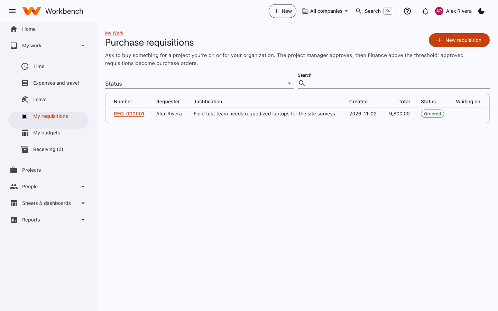

# Purchase requests and receiving

Everyone can request · Project managers and Finance approve · Named receivers receive

## Ask to buy something

Open **My work › My requisitions** (or **+ New › Purchase request**) and select **New requisition**.

1. Say why you need it (the justification).
2. Add a line for each item: description, quantity, estimated unit price, the charge code (WBS element) it's for, the
   kind of cost (equipment, materials, subcontract and so on), when you need it, and a suggested vendor if you have one.
3. **Submit**.

<figure markdown="span">
  { .shot }
</figure>

The project manager approves it. Requisitions over your company's threshold (by default $10,000) then also need Finance.
Once approved, purchasing turns it into a purchase order; its status changes to **Ordered** and you can follow it from
the requisition.

## Receive what arrives

If you're named as a receiver on a purchase order, it appears on your home page (*Receive PO-000004 from …*) and under
**My work › Receiving**. When the goods arrive:

1. Open the purchase order from the to-do and select **Record receipt**.
2. Enter the quantity received on each line (partial receipts are fine), the date, and a note such as *First two units*.
3. Save. The PO shows as **Partly received** until everything arrives.

What you record is what the vendor's bill is matched against (the three-way match), so record receipts promptly and
accurately. Warehouse staff can receive with a phone or scanner: see [Workbench on your phone](../getting-started/mobile.md#warehouse-pages).
