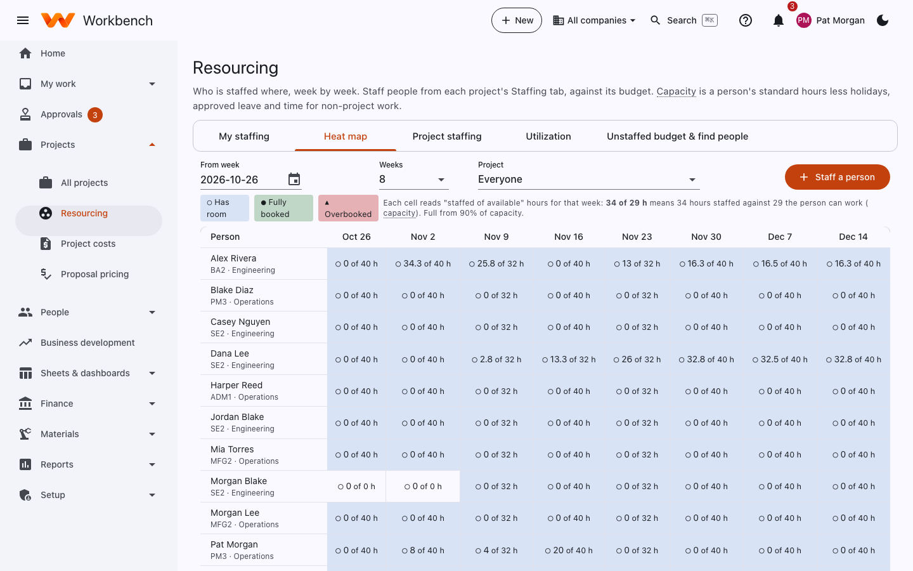

# Resourcing

Resource managers see every project · Project managers see their own · Everyone sees My staffing

**Projects › Resourcing** shows who is staffed where, week by week, against their capacity: a person's standard hours
less leave and holidays.

<figure markdown="span">
  { .shot }
  <figcaption>The heat map: each cell is hours staffed of hours available that week.</figcaption>
</figure>

| Tab | What it shows |
| --- | --- |
| **My staffing** | Your own assignments by week (everyone sees this, as **My work › My staffing**). |
| **Heat map** | Everyone (or one project's people) by week. Cells are shaded **Has room**, **Fully booked** or **Overbooked**; choose the start week, the number of weeks and the project. |
| **Project staffing** | Each project's assignments by person and labor category, against the budget. |
| **Utilization** | Billable and total hours against capacity, by person and org unit, for a period. |
| **Unstaffed budget & find people** | Budgeted hours nobody is staffed to yet, and people with the right labor category and free time to fill them. |

**Staff a person** adds an assignment: the person, project task, labor category, hours and dates. Workbench spreads the
hours over the working weeks. Assignments made on a project's [Budget & staffing tab](projects.md#budget-staffing) show
here too, and the other way around.

Thresholds (what counts as full, how much non-billable time to allow, the staffing tolerance) are set by your
administrator: see [Configuration](../operations/configuration.md).
