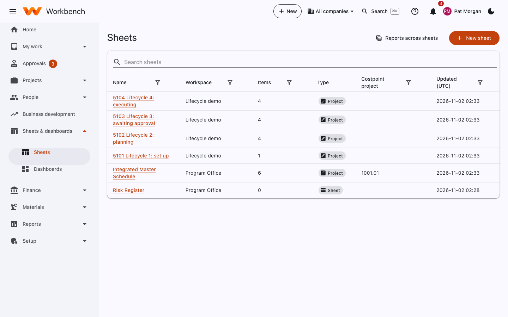
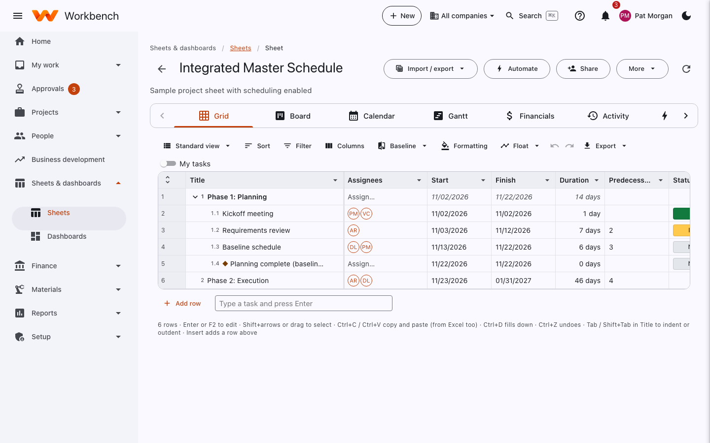
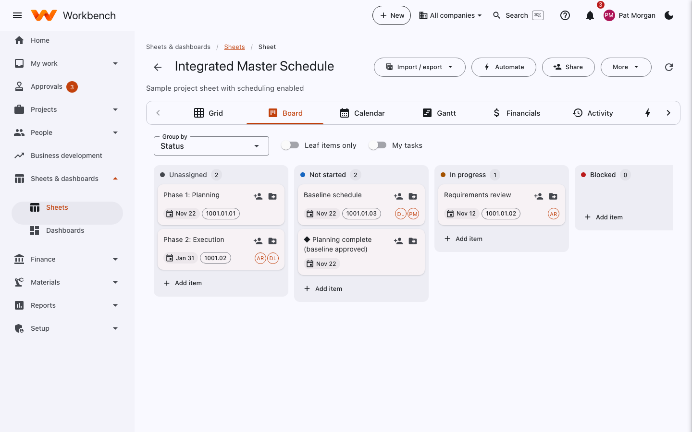
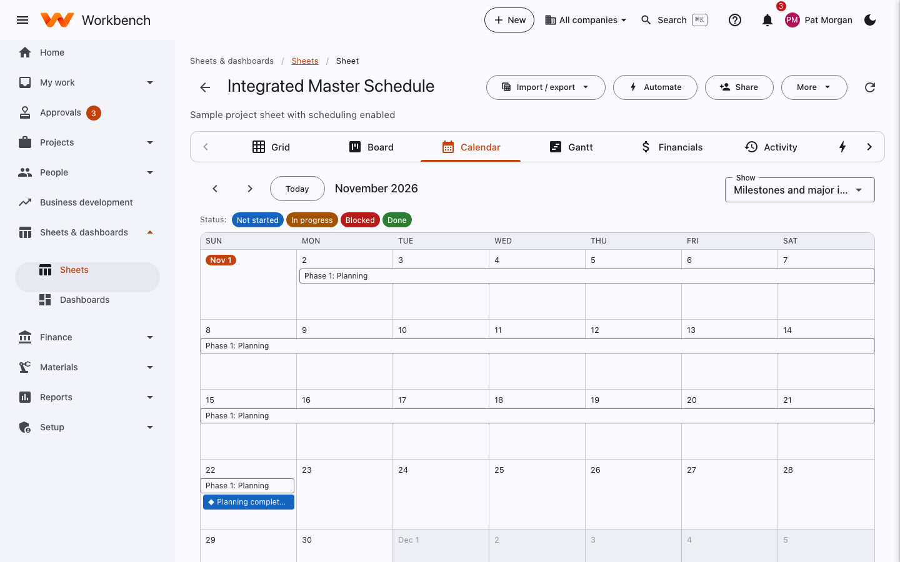
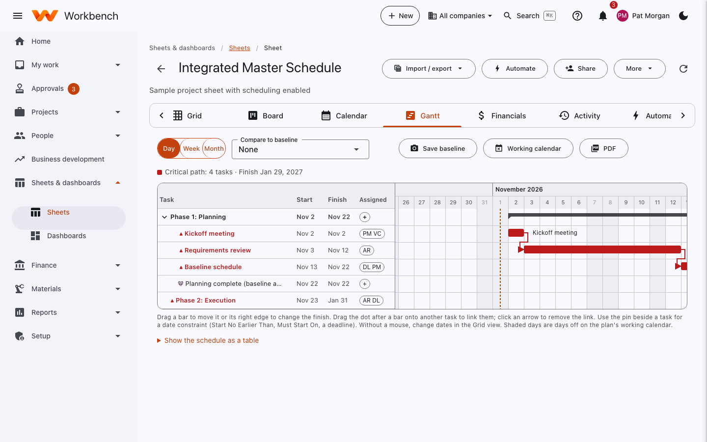
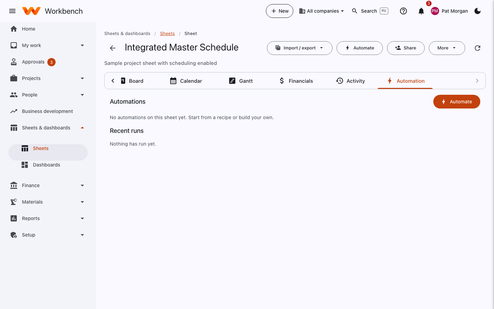

# Sheets

Everyone · Access comes from each sheet's workspace

A sheet is a shared table, like a spreadsheet built for teamwork: a risk register, an action tracker, a request log, an
integrated master schedule. Every sheet can be shown as a grid, a board, a calendar or a Gantt chart. A project's plan is
a sheet too, linked to its WBS.

## Your sheets

**Sheets & dashboards › Sheets** lists the sheets you can open, with their workspace, number of items, type (a plain
**Sheet** or a **Project** plan), the Costpoint project it's linked to, and when it last changed.

<figure markdown="span">
  { .shot }
</figure>

- **New sheet** starts a blank sheet, one from a template, or an import (Excel, CSV, or Smartsheet).
- **Reports across sheets** combines rows from several sheets into one view (for example every open risk on every
  project).

## Grid

<figure markdown="span">
  { .shot }
</figure>

Rows are items, columns are their details. Click a cell to edit it, or press ++enter++ or ++f2++. Columns have types
(text, number, currency, date, dropdown, person, checkbox, formula and more) so entries stay tidy.

- Select a range with the mouse or ++shift+arrow-keys++; ++ctrl+c++ / ++ctrl+v++ copy and paste, including from Excel.
  ++ctrl+d++ fills down; ++ctrl+z++ undoes.
- **Add row**, or type in **Type a task and press Enter** at the bottom.
- The toolbar: **Sort**, **Filter**, **Columns** (show, hide, add, change type), **Formatting** (conditional colors),
  **Baseline**, **Float** (slack on scheduled sheets), **Export**, and the saved view menu (**Standard view**).
- **My tasks** shows only rows assigned to you.
- **Formula columns** calculate for you: see [Sheet formulas](../sheets/formulas.md).

Open a row's details to add **comments** (type `@` to mention someone, who's notified), attach **files**, and see the
row's **activity** history.

### Plans and schedules

On a sheet with scheduling turned on (every project plan), the grid works like Microsoft Project: ++tab++ to indent,
summary tasks roll up their subtasks, duration in working days, predecessors such as `5SS+2d`, and the critical path.
The details are in [Planning a project](project-plan.md#build-the-wbs).

## Board

Each card is a row, in lanes by a dropdown column such as **Status**. Drag a card to another lane to change it.
**Group by** picks the column; **Leaf items only** hides summary rows; **My tasks** shows only yours. **Add item** adds a
card to a lane.

<figure markdown="span">
  { .shot }
</figure>

## Calendar

Rows with dates appear on the calendar, colored by status. Drag one to another day to reschedule it. **Show** chooses
which rows (for example milestones and major items).

<figure markdown="span">
  { .shot }
</figure>

## Gantt

Tasks with start and finish dates appear as bars, with the critical path highlighted (*Critical path: 4 tasks · Finish
Jan 29, 2027*).

<figure markdown="span">
  { .shot }
</figure>

- Drag a bar to move it, or its right edge to change the finish. Drag from the end of one bar to another to link them.
- **Day / Week / Month** zooms the timeline.
- **Save baseline** keeps today's dates to compare against later; **Compare to baseline** shows both.
- **Working calendar** sets the working days and holidays the schedule uses.
- **PDF** exports the chart.

## Financials, Activity and Automation

- **Financials** (project plans): cost and hours by row against the budget.
- **Activity**: every change to the sheet, who made it and when.
- **Automation**: the sheet's automations and their recent runs. **Automate** starts one from a recipe ("when Status
  changes to Done, notify the owner", "remind assignees two days before the finish date") or from scratch. See
  [Automation](../admin-guide/automation.md#sheet-automations).

<figure markdown="span">
  { .shot }
</figure>

## Forms

A sheet can have a **form**: a simple page that adds a row when someone fills it in, for requests or intake. Share the
form's link inside your company, or make it public for people without a Workbench account. Automations can react to
rows added by a form.

## Sharing and access

Access comes from the sheet's **workspace**. Select **Share** to add people to it:

| Role | Can |
| --- | --- |
| **Viewer** | Read the sheet |
| **Commenter** | Also comment |
| **Editor** | Change rows and columns, and automate the sheet |
| **Owner** | Manage the workspace and its members |

Some columns are marked **Finance and owners only** (for example cost rates) and are hidden from everyone else.

## Import and export

**Import / export** on a sheet brings in Excel, CSV or Smartsheet data and exports the sheet to Excel or CSV. Moving a
whole set of Smartsheet sheets is easiest with [Import](../admin-guide/import-and-migration.md).
