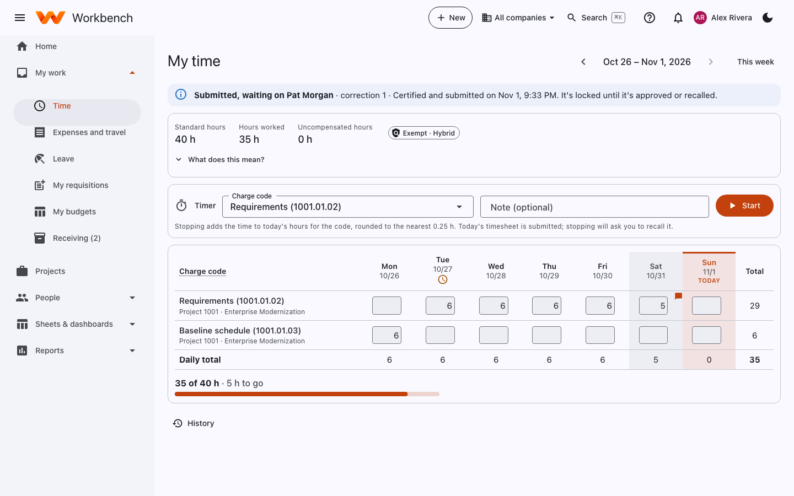
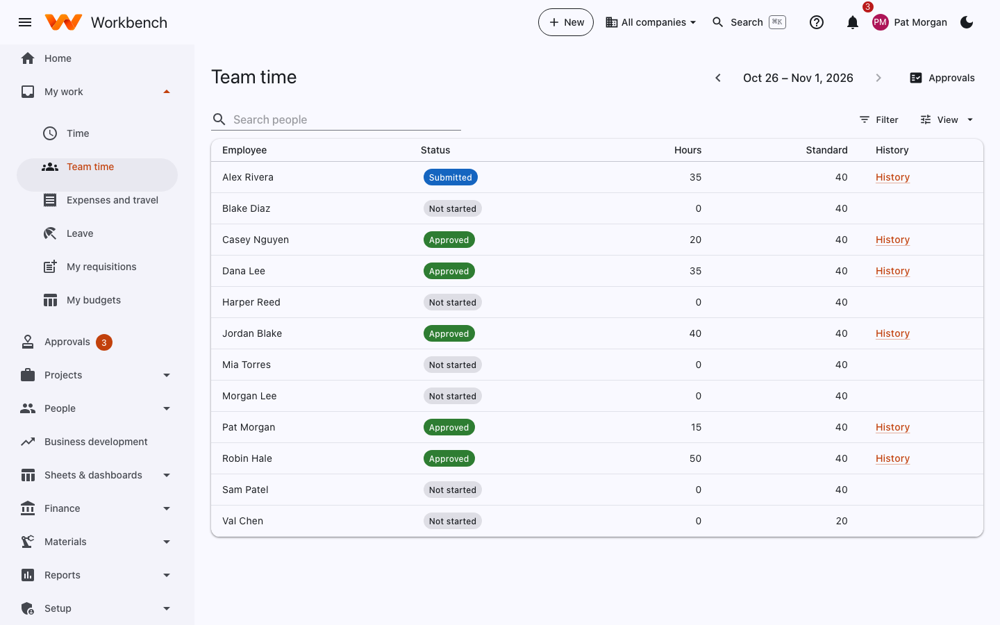
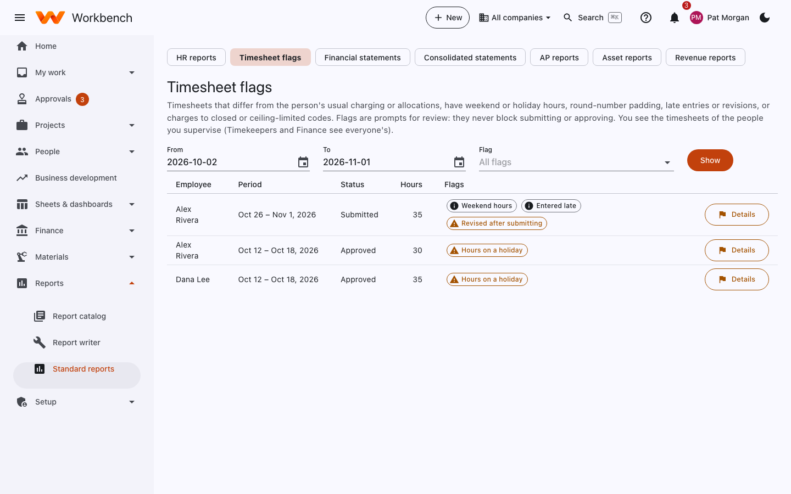

# Timesheets

Everyone records time · Supervisors approve it · Timekeepers and Finance see every timesheet

Your timesheet is a legal record. The government audits it (DCAA), so a few rules matter more here than in most
companies. They're simple once you know them.

!!! warning "The rules, in plain words"
    1. **Enter your time every day.** Record each day's hours on the day you work them. Workbench notes when each day was
       first entered, and flags days entered late.
    2. **Record every hour you work**, on the task you worked on, including company work like training or proposals
       (indirect) and leave.
    3. **Only charge what you actually did.** Never move hours to a different project because it has more budget.
    4. **Changes leave a trail.** Once you've submitted, any change asks for a reason and is kept in the history.
    5. **You certify your own timesheet.** Nobody else may enter or submit it for you.

## Your timesheet

Open **My work › Time** (or select the timesheet item on your home page). The page shows one period: a week, two weeks,
half a month or a month, depending on how your company is set up.

<figure markdown="span">
  { .shot }
  <figcaption>A submitted weekly timesheet. Weekends and today are shaded; the flag on Saturday marks a day worth a second look.</figcaption>
</figure>

| Part | What it shows |
| --- | --- |
| **Banner** | The timesheet's status: Draft, *Submitted, waiting on* your supervisor, Approved, or *Sent back for changes* with their comment. |
| **Standard hours / Hours worked / Uncompensated hours** | What you're expected to record this period (less holidays), what you've entered, and hours over standard if you're salaried and exempt. **What does this mean?** explains it. |
| **Timer** | Start and stop a timer on a charge code; stopping adds the time to today. |
| **The grid** | One row per charge code (task name and code, with its project), one column per day, and the totals. |
| **History** | Earlier timesheets and every revision of this one. |

Use the arrows next to the dates to move between periods, and **This week** to come back.

### Enter your hours

1. Type the hours in today's box for the task you worked on.
2. To add a task, use **Add row** and pick a charge code. You only see codes you're assigned to; if one is missing,
   ask your project manager.
3. **Save**. Come back tomorrow and do the same.

Leave and holidays go on their own codes (for example *Paid time off* and *Holiday*) under **LV**. Company work that
isn't for a project (overhead, G&A, bid and proposal) goes on the codes under **IND**.

### The timer

On the timesheet or your home page, pick a charge code, add a note if you like, and select **Start**. When you stop, the
time is added to today's hours for that code, rounded to the nearest quarter hour. If today's timesheet is already
submitted, stopping asks you to recall it first.

## Certify and submit

At the end of the period:

1. Check every working day has hours, including holidays and leave on their leave codes.
2. Select **Certify and submit**.
3. Read the statement, tick **I certify this timesheet**, and select **Certify and submit** again.

If you're below your standard hours Workbench warns you. That's fine if it's true (part-time, unpaid leave), but make
sure you haven't forgotten a day. When your supervisor approves, you get a notification. If they send it back, the
banner says **Sent back for changes** with their comment: fix it and submit again.

## Correct a past day

=== "Before you submit"

    Just change the hours and select **Save**. No reason is needed while the timesheet is a draft.

=== "Submitted, not yet approved"

    1. Open the timesheet (use **History** for an older one).
    2. Click into the hours to change. Workbench asks you to **Recall** the timesheet.
    3. Give a short reason, for example *Charged Tuesday to the wrong task*.
    4. Make the change, **Save**, then **Certify and submit** again.

=== "Already approved"

    1. Open the timesheet and click into the day to change.
    2. Select **Reopen for correction** and give a reason.
    3. Make the change and save, then **Certify and submit** again. Your supervisor approves the corrected version.

Each correction starts a new revision. The old hours, the new hours, who changed them, when and why are all kept.
Good reasons are specific: *Entered 8 h on 1001.01.02 instead of 1001.01.03*, *Forgot to record Friday's holiday*.
Avoid *update* or *fix*.

!!! note "Closed months"
    Once Finance closes a month, its timesheets can't be changed. Ask Finance: they make the correction in an open month.

## Team time (supervisors)

**My work › Team time** lists the people you supervise for the period with their status (Not started, Draft,
Submitted, Approved), hours against standard, and their **History**. Approve submitted timesheets from
[Approvals](approvals.md).

<figure markdown="span">
  { .shot }
</figure>

## Timesheet flags

**Reports › Timesheet flags** lists timesheets that differ from the person's usual charging or their allocations, have
weekend or holiday hours, round-number padding, late entries or revisions, or charges to closed or ceiling-limited codes.
Flags are prompts for review: they never block submitting or approving. Supervisors see their own people; Timekeepers
and Finance see everyone. Select **Details** for the reasons behind a flag.

<figure markdown="span">
  { .shot }
</figure>

If your administrator has turned on the [AI assistant](../admin-guide/assistant.md), supervisors and Finance can ask it
for a plain-language explanation of a flag.
